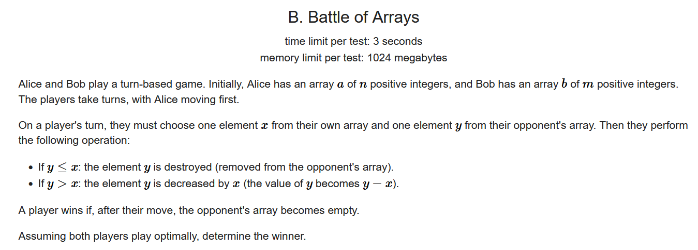
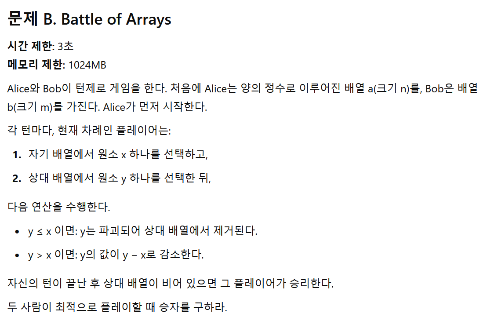

[상위 페이지 · 2025-2026 ICPC, NERC, Northern Eurasia Finals](/study/algorithms/competitive-programming/2025-2026-icpc-nerc-northern-eurasia-finals/)





## 문제 태그

- 자료구조
- 그리디

## 아이디어

1. 가장 최적의 전략은 나의 가장 큰 숫자로 상대의 가장 큰 숫자를 공격하는것.
2. 여기서 가장 큰 숫자를 매턴 빠르게 구하기 위해 우선순위 큐로 저장한다
3. 방어하는 숫자가 더 크면 공격하는 숫자에서 빼고 다시 우선 순위 큐에 저장한다
4. 이를 반복하며 먼저 배열이 소진한 플레이어가 패배한다

## 정답

```cpp
#include <bits/stdc++.h>

using namespace std;

using ll = long long;
using pii = pair<int, int>;
using vi = vector<int>;
using vll = vector<ll>;
using vpii = vector<pii>;

#define all(x) (x).begin(), (x).end()
#define rall(x) (x).rbegin(), (x).rend()
#define F first
#define S second
#define pb push_back
#define mp make_pair
#define lb lower_bound
#define ub upper_bound

#ifndef ONLINE_JUDGE
template <typename A, typename B>
ostream &operator<<(ostream &os, const pair<A, B> &p)
{
    return os << "{" << p.first << ", " << p.second << "}";
}
template <typename T>
ostream &operator<<(ostream &os, const vector<T> &v)
{
    os << "[";
    for (size_t i = 0; i < v.size(); ++i)
    {
        os << v[i];
        if (i != v.size() - 1)
            os << ", ";
    }
    return os << "]";
}

#define debug(...) cerr << "[DEBUG] " << #__VA_ARGS__ << ": ", DBG(__VA_ARGS__)
template <typename T>
void DBG(const T &v) { cerr << v << endl; }
template <typename T, typename... Args>
void DBG(const T &v, const Args &...args)
{
    cerr << v << ", ";
    DBG(args...);
}
#else
#define debug(...)
#endif

int main()
{
    ios::sync_with_stdio(0);
    cin.tie(0);
    int t;
    cin >> t;
    while (t--)
    {
        int n, m;
        cin >> n >> m;

        priority_queue<ll> pq_a;
        priority_queue<ll> pq_b;

        for (int i = 0; i < n; i++)
        {
            ll x;
            cin >> x;
            pq_a.push(x);
        }
        for (int i = 0; i < m; i++)
        {
            ll x;
            cin >> x;
            pq_b.push(x);
        }

        bool turn = true;

        while (!pq_a.empty() && !pq_b.empty())
        {
            if (turn)
            {
                ll atk = pq_a.top();
                ll def = pq_b.top();
                pq_b.pop();

                if (def > atk)
                {
                    pq_b.push(def - atk);
                }
            }
            else
            {
                ll atk = pq_b.top();
                ll def = pq_a.top();
                pq_a.pop();

                if (def > atk)
                {
                    pq_a.push(def - atk);
                }
            }
            turn ^= 1;
        }

        if(pq_b.empty()) cout << "Alice\n";
        else cout << "Bob\n";
    }

    return 0;
}
```
