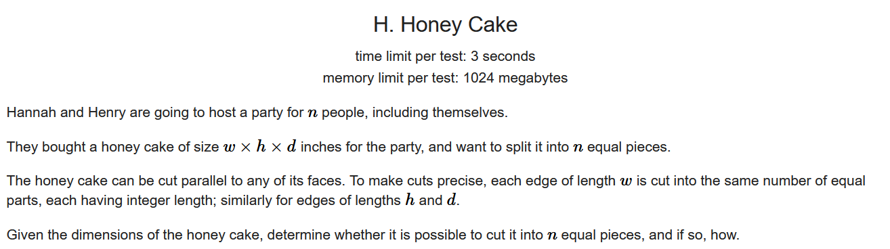
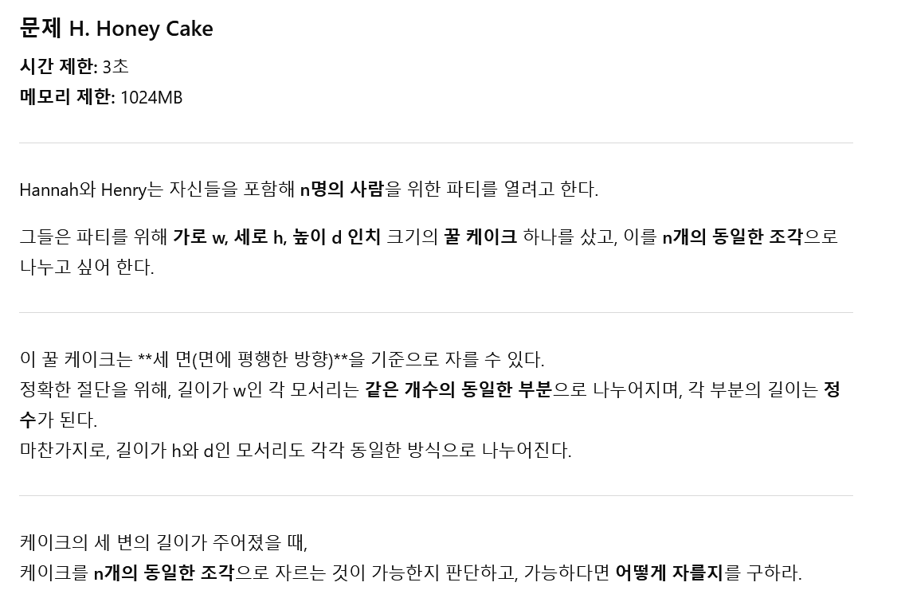

[상위 페이지 · 2025-2026 ICPC, NERC, Northern Eurasia Finals](/study/algorithms/competitive-programming/2025-2026-icpc-nerc-northern-eurasia-finals/)





## 문제 태그

- 수학

## 아이디어

1. w,h,d의 약수들을 이용해서 n을 만드는것이 목표
2. gcd(n,w)를 통해 n과 w 사이의 가장 큰 공약수를 구하고, 나누어준다 (= remain)
3. gcd(remain , h)를 통해 w와 n 사이의 가장 큰 공약수를 구하고 남은 remain과 h의 공약수를 구해준다
4. 여기까지 다 구하고 남은 n이 d로 나누어 떨어진다면 그것은 동일한 조각으로 n개 만들 수 있는것
5. 조각이 n개 만들어진다는것은 n-1번 칼질한것으로 1~3번에서 구한 값을 -1하고 출력해야한다

## 정답

```cpp
#include <bits/stdc++.h>

using namespace std;

using ll = long long;
using pii = pair<int, int>;
using vi = vector<int>;
using vll = vector<ll>;
using vpii = vector<pii>;

#define all(x) (x).begin(), (x).end()
#define rall(x) (x).rbegin(), (x).rend()
#define F first
#define S second
#define pb push_back
#define mp make_pair
#define lb lower_bound
#define ub upper_bound

#ifndef ONLINE_JUDGE
template<typename A, typename B>
ostream& operator<<(ostream& os, const pair<A, B>& p) {
    return os << "{" << p.first << ", " << p.second << "}";
}
template<typename T>
ostream& operator<<(ostream& os, const vector<T>& v) {
    os << "[";
    for (size_t i = 0; i < v.size(); ++i) {
        os << v[i];
        if (i != v.size() - 1) os << ", ";
    }
    return os << "]";
}

#define debug(...) cerr << "[DEBUG] " << #__VA_ARGS__ << ": ", DBG(__VA_ARGS__)
template<typename T> void DBG(const T& v) { cerr << v << endl; }
template<typename T, typename... Args> void DBG(const T& v, const Args&... args) { cerr << v << ", "; DBG(args...); }
#else
#define debug(...)
#endif

int main() {
    ios::sync_with_stdio(0);
    cin.tie(0);
    ll w,h,d,n;

    cin >> w >> h >> d >> n;

    ll wc = gcd(w,n);
    ll remain = n / wc;
    ll hc = gcd(h,remain);
    remain /= hc;

    d % remain == 0 ? cout << wc-1 << " " << hc - 1 << " " << remain - 1<< "\n" : cout << -1 << "\n";
    return 0;
}
```
