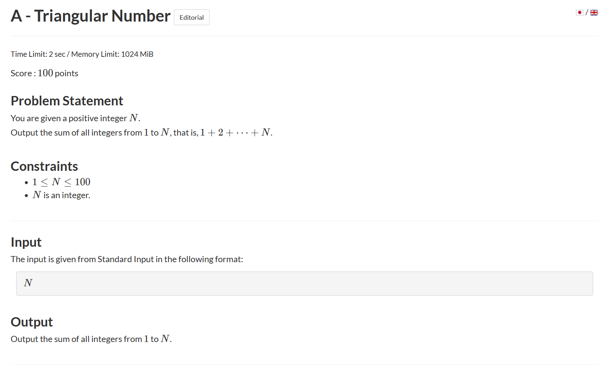
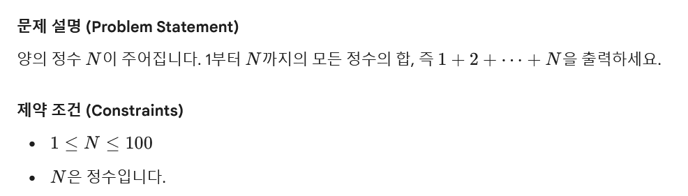

[상위 페이지 · AtCoder Beginner Contest 435](/study/algorithms/competitive-programming/atcoder-beginner-contest-435/)





## 문제 태그

- 수학

## 아이디어

- 단순 합산 문제로 시그마 합공식을 사용한다

$$
\sum_{i=1}^n i = \frac{n(n+1)}{2}
$$

## 정답

```cpp
#include <bits/stdc++.h>

using namespace std;

using ll = long long;
using pii = pair<int, int>;
using vi = vector<int>;
using vll = vector<ll>;
using vpii = vector<pii>;

#define all(x) (x).begin(), (x).end()
#define rall(x) (x).rbegin(), (x).rend()
#define F first
#define S second
#define pb push_back
#define mp make_pair
#define lb lower_bound
#define ub upper_bound

#ifndef ONLINE_JUDGE
template<typename A, typename B>
ostream& operator<<(ostream& os, const pair<A, B>& p) {
    return os << "{" << p.first << ", " << p.second << "}";
}
template<typename T>
ostream& operator<<(ostream& os, const vector<T>& v) {
    os << "[";
    for (size_t i = 0; i < v.size(); ++i) {
        os << v[i];
        if (i != v.size() - 1) os << ", ";
    }
    return os << "]";
}

#define debug(...) cerr << "[DEBUG] " << #__VA_ARGS__ << ": ", DBG(__VA_ARGS__)
template<typename T> void DBG(const T& v) { cerr << v << endl; }
template<typename T, typename... Args> void DBG(const T& v, const Args&... args) { cerr << v << ", "; DBG(args...); }
#else
#define debug(...)
#endif

int main() {
    ios::sync_with_stdio(0);
    cin.tie(0);
    
    int N;
    cin >> N;

    cout << N * (N + 1) / 2 << '\n';
    
    return 0;
}
```
