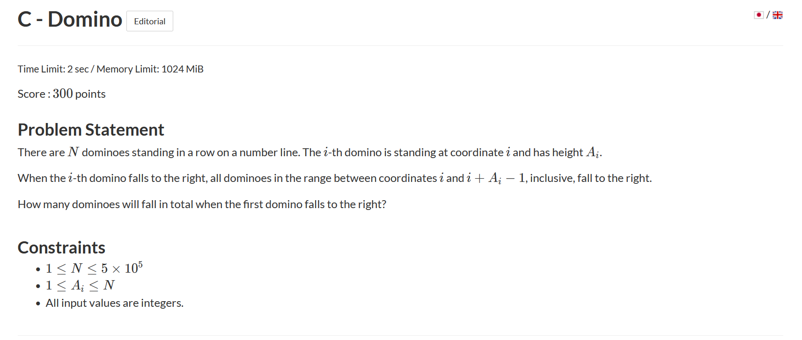
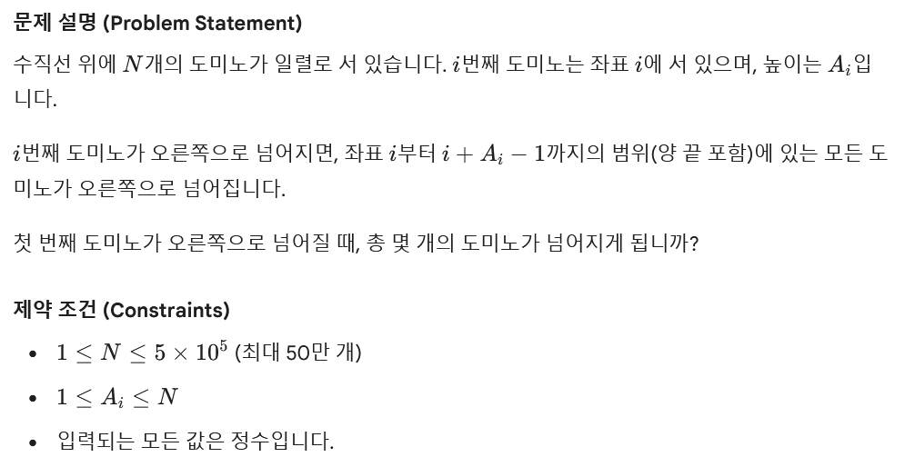

[상위 페이지 · AtCoder Beginner Contest 435](/study/algorithms/competitive-programming/atcoder-beginner-contest-435/)





## 문제 태그

- 그리디
- 스위핑

## 아이디어

- 가장 중요한 포인트는 “지금까지 넘어진 도미노들로 인해 닿을 수 있는 가장 오른쪽 좌표”(= max_reach)를 저장하는것
- 1~(N-1)까지 다음 알고리즘을 시행한다
    - Case1 : 만약 현재 도미노의 좌표가 max_reach보다 작다
        - 이 도미노는 앞선 도미노의 여파로 넘어진다
        - 이 도미노가 넘어지면서 사거리가 더 늘어날 수 있으므로 max_reach를 갱신한다
        
        $$
        max\ reach = max(max\ reach,i + A_i - 1)
        $$
        
    - Case2: 만약 현재 도미노의 좌표가 max_reach보다 크다
        - 이 이후로는 연쇄반응이 일어나지 않아 정답에 변화가 없으므로 break를 한다

## 정답

```cpp
#include <bits/stdc++.h>

using namespace std;

using ll = long long;
using pii = pair<int, int>;
using vi = vector<int>;
using vll = vector<ll>;
using vpii = vector<pii>;

#define all(x) (x).begin(), (x).end()
#define rall(x) (x).rbegin(), (x).rend()
#define F first
#define S second
#define pb push_back
#define mp make_pair
#define lb lower_bound
#define ub upper_bound

#ifndef ONLINE_JUDGE
template<typename A, typename B>
ostream& operator<<(ostream& os, const pair<A, B>& p) {
    return os << "{" << p.first << ", " << p.second << "}";
}
template<typename T>
ostream& operator<<(ostream& os, const vector<T>& v) {
    os << "[";
    for (size_t i = 0; i < v.size(); ++i) {
        os << v[i];
        if (i != v.size() - 1) os << ", ";
    }
    return os << "]";
}

#define debug(...) cerr << "[DEBUG] " << #__VA_ARGS__ << ": ", DBG(__VA_ARGS__)
template<typename T> void DBG(const T& v) { cerr << v << endl; }
template<typename T, typename... Args> void DBG(const T& v, const Args&... args) { cerr << v << ", "; DBG(args...); }
#else
#define debug(...)
#endif

int main() {
    ios::sync_with_stdio(0);
    cin.tie(0);
    
    int N;
    cin >> N;

    vi A(N);
    for(int i = 0; i < N; ++i) {
        cin >> A[i];
    }
    ll max_reach = 1 + A[0] - 1;
    int ans = 1;
    for(int i = 1; i < N; ++i) {
        int current_coord = i + 1;
        if(current_coord > max_reach) break;
        ans++;
        ll current_reach = (ll)current_coord + A[i] - 1;
        max_reach = max(max_reach, current_reach);
    }

    cout << ans << '\n';

    return 0;
}
```
