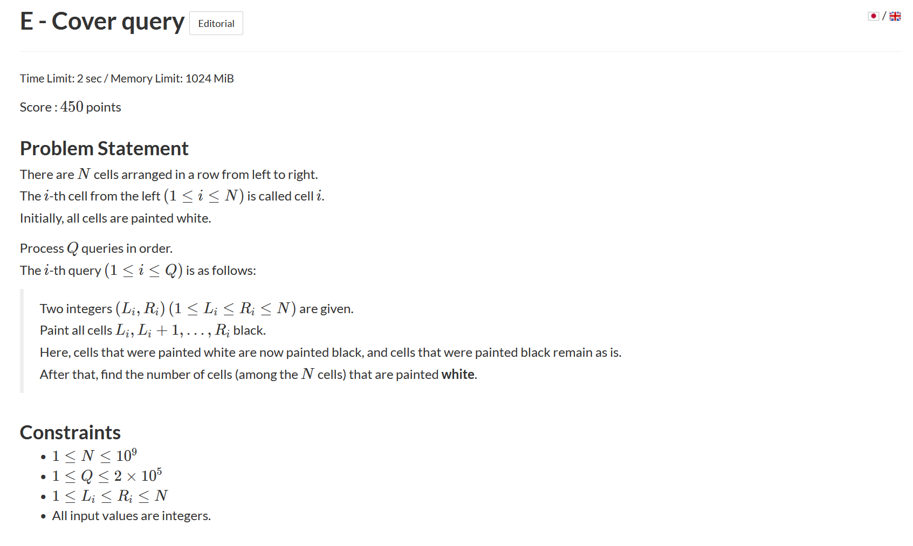
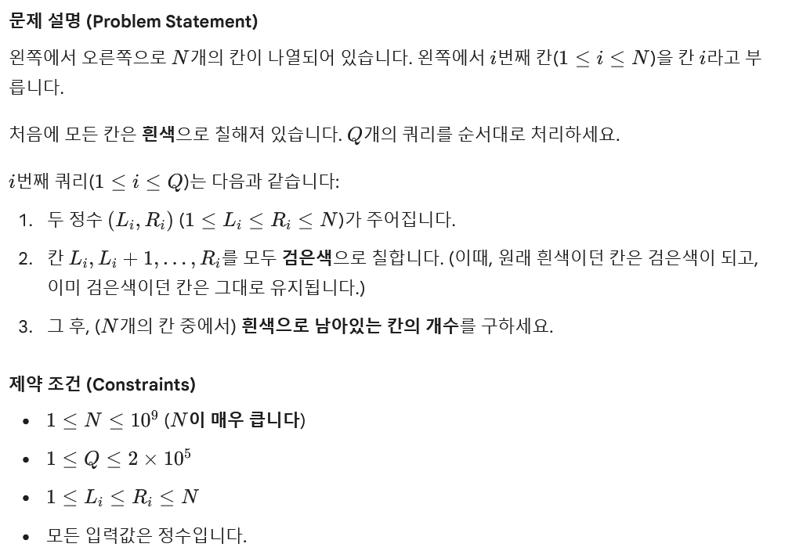

[상위 페이지 · AtCoder Beginner Contest 435](/study/algorithms/competitive-programming/atcoder-beginner-contest-435/)





## 문제 태그

- 자료구조
- 구현
- 좌표압축

## 아이디어

- 모든 칸을 배열로 관리하는 대신 검은색으로 칠해진 연속된 구간 [Start,End] 좌표만 set에 압축하여 저장한다
set는 구간들을 시작점 기준 오름차순으로 자동 정렬해주므로 특정 범위와 겹치는 구간을 빠르게 찾을 수 있음
- 전체 흰색칸을 매번 세는건 비효율적이므로 변수 하나를 유지하며 구간이 추가/삭제될때마다 그 길이를 동적으로 관리한다.
- 새로운 구간 [L,R]이 들어오면 기존 set에 있던 구간들 중 새 구간과 겸치거나 맞닿아 있는 모든 구간을 찾아낸다
- 구간을 찾아내면 다음 과정을 수행한다
    - 합치기 : 새 구간의 범위를 확장한다
    - 지우기 : 기존 구간의 길이만큼 총 흰색의 개수를 빼고 set에서 삭제한다
    - 병합이 끝난 후 새 구간을 set에 다시 삽입하고 길이를 더한다

## 정답

```cpp
#include <bits/stdc++.h>

using namespace std;

using ll = long long;
using pii = pair<int, int>;
using vi = vector<int>;
using vll = vector<ll>;
using vpii = vector<pii>;

#define all(x) (x).begin(), (x).end()
#define rall(x) (x).rbegin(), (x).rend()
#define F first
#define S second
#define pb push_back
#define mp make_pair
#define lb lower_bound
#define ub upper_bound

#ifndef ONLINE_JUDGE
template<typename A, typename B>
ostream& operator<<(ostream& os, const pair<A, B>& p) {
    return os << "{" << p.first << ", " << p.second << "}";
}
template<typename T>
ostream& operator<<(ostream& os, const vector<T>& v) {
    os << "[";
    for (size_t i = 0; i < v.size(); ++i) {
        os << v[i];
        if (i != v.size() - 1) os << ", ";
    }
    return os << "]";
}

#define debug(...) cerr << "[DEBUG] " << #__VA_ARGS__ << ": ", DBG(__VA_ARGS__)
template<typename T> void DBG(const T& v) { cerr << v << endl; }
template<typename T, typename... Args> void DBG(const T& v, const Args&... args) { cerr << v << ", "; DBG(args...); }
#else
#define debug(...)
#endif

int main() {
    ios::sync_with_stdio(0);
    cin.tie(0);
    
    ll N;
    int Q;
    cin >> N >> Q;

    set<pair<ll, ll>> ranges;

    ll cnt = 0;

    while(Q--) {
        ll L, R;
        cin >> L >> R;

        auto i = ranges.lb({L, -1});
        
        if (i != ranges.begin()) {
            i--;
            if (i->second < L) {
                i++;
            }
        }

        ll newL = L;
        ll newR = R;

        while (i != ranges.end() && i->first <= R) {

            newL = min(newL, i->first);
            newR = max(newR, i->second);

            cnt -= (i->second - i->first + 1);

            i = ranges.erase(i);
        }

        ranges.insert({newL, newR});
        cnt += (newR - newL + 1);
        
        ll ans = N - cnt;

        cout << ans << '\n';
    }
    
    return 0;
}
```
