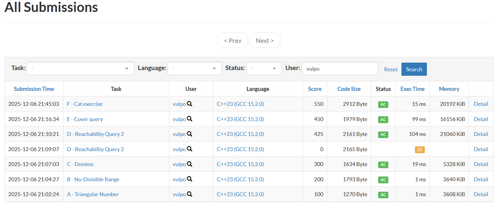
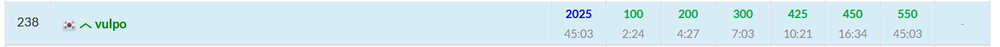

[상위 페이지 · Competitive Programming](/study/algorithms/competitive-programming/)

---

- [A - Triangular Number](/study/algorithms/competitive-programming/atcoder-beginner-contest-435/a-triangular-number/)

- [B - No-Divisible Range](/study/algorithms/competitive-programming/atcoder-beginner-contest-435/b-no-divisible-range/)

- [C - Domino](/study/algorithms/competitive-programming/atcoder-beginner-contest-435/c-domino/)

- [D - Reachability Query 2](/study/algorithms/competitive-programming/atcoder-beginner-contest-435/d-reachability-query-2/)

- [E - Cover query](/study/algorithms/competitive-programming/atcoder-beginner-contest-435/e-cover-query/)

- [F - Cat exercise](/study/algorithms/competitive-programming/atcoder-beginner-contest-435/f-cat-exercise/)
