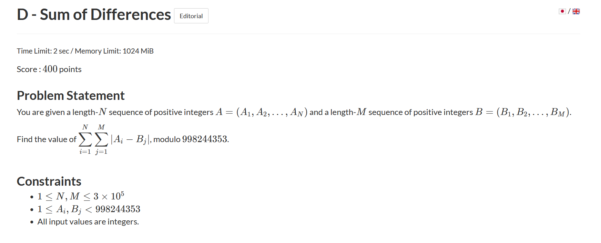
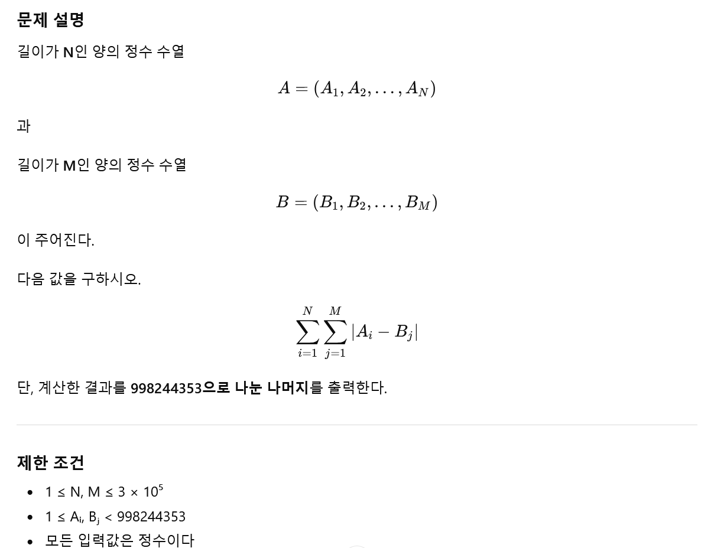

[상위 페이지 · AtCoder Beginner Contest 437](/study/algorithms/competitive-programming/atcoder-beginner-contest-437/)





## 문제 태그

- 누적합
- 정렬

## 아이디어

1. 절대값은 기준값보다 큰것/작은것으로 나누어 계산하면 쉬워진다
    - 어떤 값 x에 대해:
        - y ≤ x → |x - y| = x - y
        - y > x → |x - y| = y - x
2. 각 $$A_i$$를 기준으로 B를 두 구간으로 나누어 계산한다
3. 고로 수열 A와 B 모두 정렬한다
4. B의 누적합을 계산한다
5. 각 $$A_i$$에 대해:
    1. 이분 탐색으로 B를 두 구간으로 분리한다
    2. 작은쪽 절대값 합 계산한다 $$(개수 \times A_i - 합)$$
    3. 큰 쪽 절대값 합 계산한다 $$(합 - 개수 \times A_i)$$
    4. 결과에 누적한다
6. 최종 결과를 출력한다

## 정답

```cpp
#include <bits/stdc++.h>

using namespace std;

using ll = long long;
using pii = pair<int, int>;
using vi = vector<int>;
using vll = vector<ll>;
using vpii = vector<pii>;

#define all(x) (x).begin(), (x).end()
#define rall(x) (x).rbegin(), (x).rend()
#define F first
#define S second
#define pb push_back
#define mp make_pair
#define lb lower_bound
#define ub upper_bound

#ifndef ONLINE_JUDGE
template <typename A, typename B>
ostream &operator<<(ostream &os, const pair<A, B> &p)
{
    return os << "{" << p.first << ", " << p.second << "}";
}
template <typename T>
ostream &operator<<(ostream &os, const vector<T> &v)
{
    os << "[";
    for (size_t i = 0; i < v.size(); ++i)
    {
        os << v[i];
        if (i != v.size() - 1)
            os << ", ";
    }
    return os << "]";
}

#define debug(...) cerr << "[DEBUG] " << #__VA_ARGS__ << ": ", DBG(__VA_ARGS__)
template <typename T>
void DBG(const T &v) { cerr << v << endl; }
template <typename T, typename... Args>
void DBG(const T &v, const Args &...args)
{
    cerr << v << ", ";
    DBG(args...);
}
#else
#define debug(...)
#endif

const int MOD = 998244353;

int main()
{
    ios::sync_with_stdio(0);
    cin.tie(0);

    int N, M;
    cin >> N >> M;

    vll A(N), B(M);
    for (int i = 0; i < N; ++i)
        cin >> A[i];
    for (int i = 0; i < M; ++i)
        cin >> B[i];

    sort(all(A));
    sort(all(B));

    vll P(M + 1, 0);
    for (int i = 0; i < M; ++i)
    {
        P[i + 1] = (P[i] + B[i]) % MOD;
    }

    ll ans = 0;

    for (int i = 0; i < N; ++i)
    {
        int idx = lb(all(B), A[i]) - B.begin();

        ll cnt_small = idx;
        ll sum_small = P[idx];

        ll temp1 = (cnt_small * A[i]) % MOD;
        temp1 = (temp1 - sum_small + MOD) % MOD;

        ll cnt_large = M - idx;
        ll sum_large = (P[M] - P[idx] + MOD) % MOD;

        ll temp2 = (cnt_large * A[i]) % MOD;
        temp2 = (sum_large - temp2 + MOD) % MOD;

        ans = (ans + temp1) % MOD;
        ans = (ans + temp2) % MOD;
    }

    cout << ans << "\n";

    return 0;
}
```
