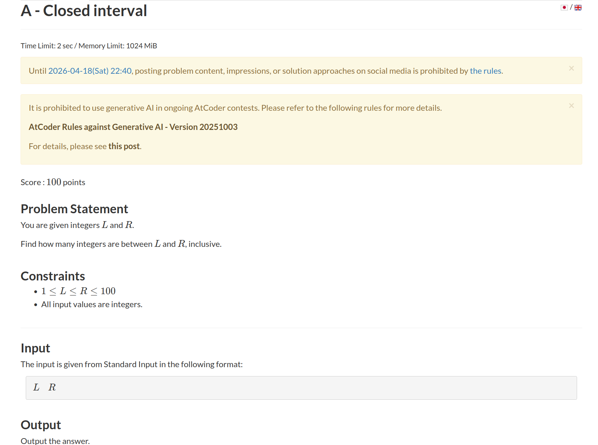

[상위 페이지 · AtCoder Beginner Contest 454](/study/algorithms/competitive-programming/atcoder-beginner-contest-454/)



## 문제 태그

- 구현
- 산술

## 한국어 문제 해석

정수 L과 R이 주어진다. L 이상 R 이하인 정수가 몇 개인지 구한다.

입력은 정수 L, R 한 줄이다. 출력은 닫힌 구간에 포함되는 정수의 개수다.

## 문제 요약

- 시작값 L과 끝값 R이 주어진다.
- 양 끝을 모두 포함해서 정수를 센다.
- 목표는 구간 길이를 출력하는 것이다.

## 예시 워크스루

예를 들어 L이 3이고 R이 7이라고 하자.

- 포함되는 정수는 3, 4, 5, 6, 7이다.
- 끝값에서 시작값을 빼면 간격의 수가 4개다.
- 양 끝 정수를 모두 세야 하므로 1을 더한다.
- 따라서 답은 5다.

## 아이디어

닫힌 구간 L부터 R까지의 정수 개수는 항상 다음과 같다.

$$
R - L + 1
$$

중간에 반복문으로 직접 셀 필요가 없다. 구간의 양 끝을 포함한다는 점 때문에 마지막에 1이 더해진다.

## 구현 포인트

입력으로 L, R을 읽고 바로 R에서 L을 뺀 뒤 1을 더해 출력한다. 값의 범위가 크더라도 파이썬 정수는 오버플로우 걱정이 없다.

## 정답

```python
L, R = map(int, input().split())
print(R - L + 1)
```

## 검증

### 시간복잡도

입력 한 줄을 읽고 상수 번 계산하므로 시간복잡도는 $$O(1)$$이다.

### 공간복잡도

정수 두 개만 저장하므로 공간복잡도는 $$O(1)$$이다.

### 코너 케이스

- L과 R이 같은 경우 답은 1이다.
- L과 R이 연속한 경우 답은 2이다.
- 구간이 커도 공식 하나로 처리된다.
