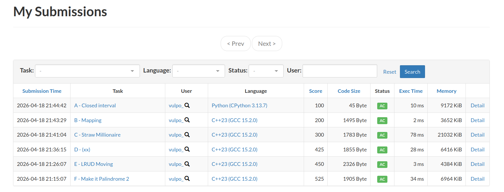
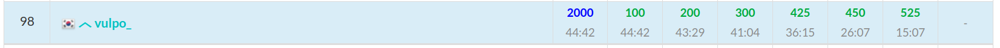

[상위 페이지 · Competitive Programming](/study/algorithms/competitive-programming/)

---

- [A. Closed interval](/study/algorithms/competitive-programming/atcoder-beginner-contest-454/a-closed-interval/)

- [B. Mapping](/study/algorithms/competitive-programming/atcoder-beginner-contest-454/b-mapping/)

- [C. Straw Millionaire](/study/algorithms/competitive-programming/atcoder-beginner-contest-454/c-straw-millionaire/)

- [D. (xx)](/study/algorithms/competitive-programming/atcoder-beginner-contest-454/d-xx/)

- [E. LRUD Moving](/study/algorithms/competitive-programming/atcoder-beginner-contest-454/e-lrud-moving/)

- [F. Make it Palindrome 2](/study/algorithms/competitive-programming/atcoder-beginner-contest-454/f-make-it-palindrome-2/)
