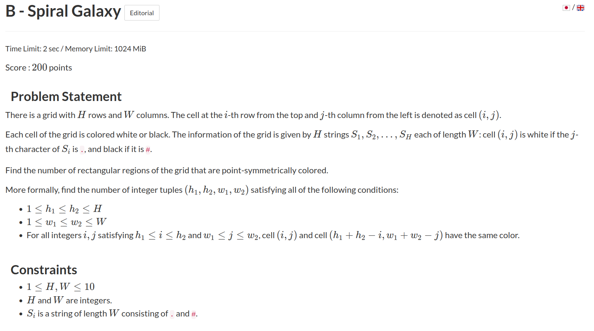

[상위 페이지 · AtCoder Beginner Contest 455](/study/algorithms/competitive-programming/atcoder-beginner-contest-455/)



## 문제 태그

- 브루트포스
- 구현
- 격자
- 대칭성

## 한국어 문제 해석

격자에서 직사각형 부분 영역을 하나 고른다.

그 직사각형을 중심 기준으로 180도 회전했을 때 색 배치가 그대로 같으면 정답에 포함한다.

조건을 만족하는 모든 직사각형의 개수를 구하면 된다.

## 문제 요약

- 각 칸은 흰색 또는 검은색이다.
- 직사각형 내부의 모든 칸이 중심 반대편 칸과 같은 색이어야 한다.
- 가능한 모든 직사각형을 검사해 개수를 센다.

## 예시 워크스루

2행 2열 직사각형이 다음과 같다고 하자.

- 첫 번째 행은 .#
- 두 번째 행은 #.

이 직사각형을 180도 회전해도 배치가 그대로다.

- 왼쪽 위와 오른쪽 아래가 서로 대응되고 둘 다 흰색이다.
- 오른쪽 위와 왼쪽 아래가 서로 대응되고 둘 다 검은색이다.
- 따라서 이 직사각형은 조건을 만족한다.

반대로 대응되는 칸 중 하나라도 색이 다르면 그 직사각형은 즉시 탈락이다.

## 아이디어

제약이 매우 작기 때문에 완전탐색으로 충분하다.

직사각형을 하나 정하면, 그 안의 어떤 칸은 직사각형 중심을 기준으로 정확히 하나의 대응 칸을 가진다.

직사각형의 위쪽 경계와 아래쪽 경계, 왼쪽 경계와 오른쪽 경계를 각각 더한 뒤 현재 좌표를 빼면 대응 좌표가 나온다.

이 대응 칸과 현재 칸의 색이 항상 같으면 그 직사각형은 점대칭 색칠이다.

따라서 다음 과정을 그대로 수행하면 된다.

1. 위쪽 경계와 아래쪽 경계를 모두 고른다.
2. 왼쪽 경계와 오른쪽 경계도 모두 고른다.
3. 선택한 직사각형 내부를 훑으며 각 칸과 대응 칸의 색을 비교한다.
4. 끝까지 모순이 없으면 정답에 1을 더한다.

## 구현 포인트

격자 크기가 최대 10이라서 직사각형 수 자체가 매우 작다.

검사 도중 불일치가 보이면 그 직사각형은 더 볼 필요 없이 바로 중단하면 된다.

## 정답

```cpp
#include <bits/stdc++.h>

using namespace std;

using ll = long long;
using pii = pair<int, int>;
using vi = vector<int>;
using vll = vector<ll>;
using vpii = vector<pii>;

#define all(x) (x).begin(), (x).end()
#define rall(x) (x).rbegin(), (x).rend()
#define sz(x) ((int)((x).size()))
#define F first
#define S second
#define pb push_back
#define mp make_pair
#define lb lower_bound
#define ub upper_bound

#ifndef ONLINE_JUDGE
template<typename A, typename B>
ostream& operator<<(ostream& os, const pair<A, B>& p) {
    return os << "{" << p.first << ", " << p.second << "}";
}
template<typename T>
ostream& operator<<(ostream& os, const vector<T>& v) {
    os << "[";
    for (size_t i = 0; i < v.size(); ++i) {
        os << v[i];
        if (i != v.size() - 1) os << ", ";
    }
    return os << "]";
}

#define debug(...) cerr << "[DEBUG] " << #__VA_ARGS__ << ": ", DBG(__VA_ARGS__)
template<typename T> void DBG(const T& v) { cerr << v << endl; }
template<typename T, typename... Args> void DBG(const T& v, const Args&... args) { cerr << v << ", "; DBG(args...); }
#else
#define debug(...)
#endif

int main() {
    ios::sync_with_stdio(0);
    cin.tie(0);
    
    int h, w;
    cin >> h >> w;

    vector<string> s(h);
    for (int i = 0; i < h; i++) {
        cin >> s[i];
    }

    ll ans = 0;
    for (int h1 = 0; h1 < h; h1++) {
        for (int h2 = h1; h2 < h; h2++) {
            for (int w1 = 0; w1 < w; w1++) {
                for (int w2 = w1; w2 < w; w2++) {
                    bool ok = 1;
                    for (int i = h1; i <= h2 && ok; i++) {
                        for (int j = w1; j <= w2; j++) {
                            if (s[i][j] != s[h1 + h2 - i][w1 + w2 - j]) {
                                ok = 0;
                                break;
                            }
                        }
                    }
                    ans += ok;
                }
            }
        }
    }

    cout << ans << "\n";
    
    return 0;
}
```

## 검증

### 시간복잡도

직사각형 개수는 $$O(H^2 W^2)$$개이고, 각 직사각형마다 내부 칸을 최대 O(HW)개 확인한다.

전체 시간복잡도는 $$O(H^3 W^3)$$ 수준으로 볼 수 있다. 하지만 H, W가 최대 10이라 충분히 통과한다.

### 공간복잡도

격자만 저장하므로 공간복잡도는 O(HW)이다.

### 코너 케이스

- 1행 1열 직사각형은 항상 조건을 만족한다.
- 1행 또는 1열 직사각형도 뒤집어서 같은지만 확인하면 된다.
- 전체 격자가 점대칭이 아니어도 작은 부분 직사각형은 정답에 포함될 수 있다.
