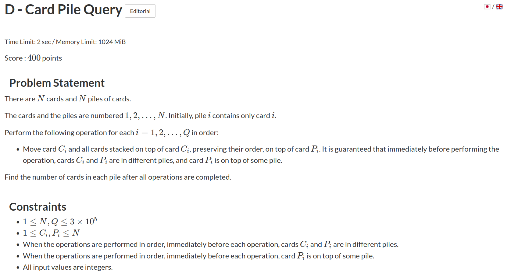

[상위 페이지 · AtCoder Beginner Contest 455](/study/algorithms/competitive-programming/atcoder-beginner-contest-455/)



## 문제 태그

- 구현
- 연결 구조
- 배열로 링크드 리스트 흉내내기

## 한국어 문제 해석

카드 1부터 N까지와 카드 더미 1부터 N까지가 있다. 처음에는 i번 더미에 i번 카드만 하나 들어 있다.

각 연산에서는 카드 C와 그 위에 쌓인 카드들을 순서를 유지한 채 통째로 잘라서, 카드 P의 위에 올린다.

모든 연산이 끝난 뒤 각 더미에 카드가 몇 장 남아 있는지 구한다.

## 문제 요약

- 잘라낸 묶음 안의 상대 순서는 변하지 않는다.
- 매 연산에서 실제로 바뀌는 연결은 잘라낸 묶음의 맨 아래 카드 주변뿐이다.
- 마지막에는 각 더미의 바닥 카드에서 위로 따라가며 크기를 셀 수 있다.

## 예시 워크스루

처음에는 모든 카드가 자기 더미에 혼자 있다.

예를 들어 1번 카드를 포함한 묶음을 3번 카드 위에 올리면, 3번 더미는 아래에서부터 3, 1 순서가 된다.

그 뒤에 다시 1번 카드를 포함한 묶음을 다른 더미 위로 옮기면, 1번 카드 위에 있던 카드들은 그대로 따라간다.

여기서 변하는 것은 묶음 전체가 아니라 경계 연결이다.

- 잘라낸 묶음 아래에 있던 카드는 위쪽 연결이 끊긴다.
- 잘라낸 묶음의 맨 아래 카드는 새 목적지 카드 위에 놓인다.
- 묶음 내부의 순서는 그대로 유지된다.

## 아이디어

각 카드에 대해 바로 위 카드와 바로 아래 카드만 저장하면 충분하다.

연산 하나가 바꾸는 정보는 세 가지뿐이다.

1. 잘라낸 묶음 아래에 남는 카드가 있으면, 그 카드의 위쪽 연결을 끊는다.
2. 잘라낸 묶음의 맨 아래 카드 아래를 새 목적지 카드로 바꾼다.
3. 목적지 카드의 위를 잘라낸 묶음의 맨 아래 카드로 바꾼다.

중요한 관찰은 빈 더미가 다시 채워질 수 없다는 점이다.

연산의 목적지는 항상 어떤 카드의 위이므로, 한 번 비어 버린 더미는 이후에도 계속 빈 더미로 남는다.

따라서 마지막 상태에서 아래에 아무 카드도 없는 카드만 각 물리 더미의 바닥 카드다.

이 바닥 카드에서 위쪽 연결을 따라가며 카드 수를 세면 그 더미의 최종 크기가 된다.

## 구현 포인트

카드 전체를 실제로 옮기는 시뮬레이션을 하면 느리다.

인접한 카드 연결만 배열로 관리하면 각 연산을 O(1)에 처리할 수 있다.

마지막에 모든 카드를 위로 한 번씩만 따라가므로 전체도 선형 시간에 끝난다.

## 정답

```cpp
#include <bits/stdc++.h>

using namespace std;

using ll = long long;
using pii = pair<int, int>;
using vi = vector<int>;
using vll = vector<ll>;
using vpii = vector<pii>;

#define all(x) (x).begin(), (x).end()
#define rall(x) (x).rbegin(), (x).rend()
#define sz(x) ((int)((x).size()))
#define F first
#define S second
#define pb push_back
#define mp make_pair
#define lb lower_bound
#define ub upper_bound

#ifndef ONLINE_JUDGE
template<typename A, typename B>
ostream& operator<<(ostream& os, const pair<A, B>& p) {
    return os << "{" << p.first << ", " << p.second << "}";
}
template<typename T>
ostream& operator<<(ostream& os, const vector<T>& v) {
    os << "[";
    for (size_t i = 0; i < v.size(); ++i) {
        os << v[i];
        if (i != v.size() - 1) os << ", ";
    }
    return os << "]";
}

#define debug(...) cerr << "[DEBUG] " << #__VA_ARGS__ << ": ", DBG(__VA_ARGS__)
template<typename T> void DBG(const T& v) { cerr << v << endl; }
template<typename T, typename... Args> void DBG(const T& v, const Args&... args) { cerr << v << ", "; DBG(args...); }
#else
#define debug(...)
#endif

int main() {
    ios::sync_with_stdio(0);
    cin.tie(0);
    
    int n, q;
    cin >> n >> q;

    vi up(n + 1), down(n + 1);
    while (q--) {
        int c, p;
        cin >> c >> p;

        int d = down[c];
        if (d) up[d] = 0;
        down[c] = p;
        up[p] = c;
    }

    vi ans(n + 1);
    for (int i = 1; i <= n; i++) {
        if (down[i]) continue;
        int cur = i;
        while (cur) {
            ans[i]++;
            cur = up[cur];
        }
    }

    for (int i = 1; i <= n; i++) {
        cout << ans[i] << " \n"[i == n];
    }
    
    return 0;
}
```

## 검증

### 시간복잡도

각 연산은 연결 몇 개만 바꾸므로 O(1)이다.

마지막 카운트는 모든 카드를 위로 한 번씩만 따라가므로 O(N)이다.

전체 시간복잡도는 O(N + Q)다.

### 공간복잡도

연결 정보와 정답 배열만 쓰므로 공간복잡도는 O(N)이다.

### 코너 케이스

- 잘라낸 카드가 원래 바닥 카드여도 같은 방식으로 처리된다.
- 카드가 하나만 남은 더미도 자연스럽게 길이 1로 세어진다.
- 한 번 빈 더미는 다시 채워질 수 없다.
