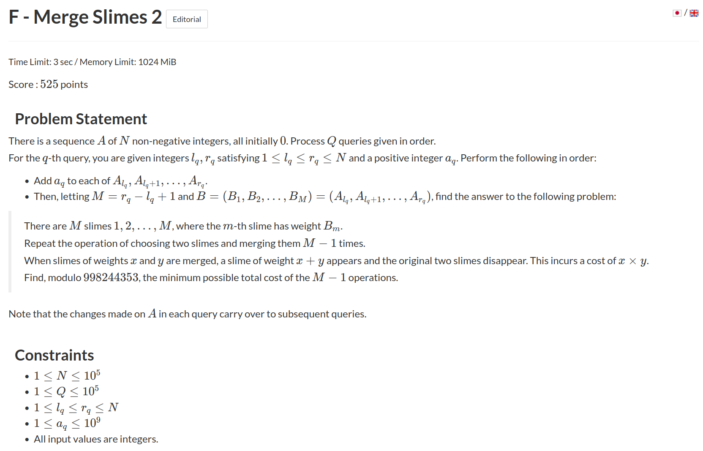

[상위 페이지 · AtCoder Beginner Contest 455](/study/algorithms/competitive-programming/atcoder-beginner-contest-455/)



## 문제 태그

- 세그먼트 트리
- lazy propagation
- 수식 정리
- 모듈러 연산

## 한국어 문제 해석

길이 N의 수열 A가 처음에 전부 0이다.

각 쿼리마다 어떤 구간에 값을 더한 뒤, 그 구간만 떼어 슬라임을 하나로 합칠 때의 최소 비용을 구한다.

슬라임 두 개의 무게가 x와 y이면 합칠 때 비용은 x 곱하기 y다. 매 쿼리마다 최소 총비용을 출력하면 된다.

## 문제 요약

- 구간 가산 업데이트가 누적된다.
- 매 쿼리마다 같은 구간의 최소 합치기 비용을 다시 계산해야 한다.
- 최소 비용은 구간합과 구간 제곱합만 알면 바로 구할 수 있다.

## 예시 워크스루

첫 번째 쿼리 뒤의 구간 값이 22, 22, 22라고 하자.

- 22와 22를 먼저 합치면 비용 484가 든다.
- 새 무게 44와 남은 22를 합치면 비용 968이 든다.
- 총비용은 1452다.

이 값을 다른 방식으로 보면, 서로 다른 두 슬라임을 한 번씩 짝지은 곱의 합과 같다.

이 예시에서는 22 곱하기 22가 세 쌍 있으므로 484가 세 번 더해져 1452가 된다.

즉 실제 핵심은 합치는 순서를 찾는 것이 아니라, 현재 구간 값들의 쌍별 곱의 총합을 빠르게 계산하는 것이다.

## 아이디어

구간 값이 B1, B2, ..., BM이라고 하자.

최소 총비용은 서로 다른 두 위치를 한 번씩 짝지은 곱의 합으로 정리된다.

이 값은 구간합과 구간 제곱합만 알면 계산할 수 있다.

따라서 각 쿼리에서 필요한 정보는 두 개뿐이다.

- 구간에 들어 있는 값들의 합
- 구간에 들어 있는 값들의 제곱합

구간 전체에 어떤 값을 더하면 이 두 값은 동시에 갱신된다.

그래서 세그먼트 트리의 각 노드에 구간합과 구간 제곱합을 저장하고, lazy propagation으로 구간 가산을 처리하면 된다.

업데이트가 끝난 뒤 해당 구간의 합과 제곱합을 읽어 공식에 넣으면 정답이 나온다.

## 구현 포인트

모든 계산은 998244353으로 나눈 나머지로 관리한다.

2로 나누는 연산은 역원을 곱해서 처리한다.

구간에 값을 더할 때 제곱합 갱신식에는 갱신 전 구간합이 들어가므로, 갱신 함수 안의 계산 순서가 중요하다.

## 정답

```cpp
#include <bits/stdc++.h>

using namespace std;

using ll = long long;
using pii = pair<int, int>;
using vi = vector<int>;
using vll = vector<ll>;
using vpii = vector<pii>;

#define all(x) (x).begin(), (x).end()
#define rall(x) (x).rbegin(), (x).rend()
#define sz(x) ((int)((x).size()))
#define F first
#define S second
#define pb push_back
#define mp make_pair
#define lb lower_bound
#define ub upper_bound

#ifndef ONLINE_JUDGE
template<typename A, typename B>
ostream& operator<<(ostream& os, const pair<A, B>& p) {
    return os << "{" << p.first << ", " << p.second << "}";
}
template<typename T>
ostream& operator<<(ostream& os, const vector<T>& v) {
    os << "[";
    for (size_t i = 0; i < v.size(); ++i) {
        os << v[i];
        if (i != v.size() - 1) os << ", ";
    }
    return os << "]";
}

#define debug(...) cerr << "[DEBUG] " << #__VA_ARGS__ << ": ", DBG(__VA_ARGS__)
template<typename T> void DBG(const T& v) { cerr << v << endl; }
template<typename T, typename... Args> void DBG(const T& v, const Args&... args) { cerr << v << ", "; DBG(args...); }
#else
#define debug(...)
#endif

const ll MOD = 998244353;
const ll INV2 = 499122177;
const int MAX = 400005;

ll seg[MAX], sq[MAX], lazy[MAX];

void apply(int node, int l, int r, ll v) {
    v %= MOD;
    ll len = r - l + 1;
    sq[node] = (sq[node] + 2LL * v % MOD * seg[node] + len % MOD * v % MOD * v) % MOD;
    seg[node] = (seg[node] + len % MOD * v) % MOD;
    lazy[node] = (lazy[node] + v) % MOD;
}

void push(int node, int l, int r) {
    if (!lazy[node] || l == r) return;
    int mid = (l + r) >> 1;
    apply(node << 1, l, mid, lazy[node]);
    apply(node << 1 | 1, mid + 1, r, lazy[node]);
    lazy[node] = 0;
}

void update(int node, int l, int r, int ql, int qr, ll v) {
    if (qr < l || r < ql) return;
    if (ql <= l && r <= qr) {
        apply(node, l, r, v);
        return;
    }
    push(node, l, r);
    int mid = (l + r) >> 1;
    update(node << 1, l, mid, ql, qr, v);
    update(node << 1 | 1, mid + 1, r, ql, qr, v);
    seg[node] = (seg[node << 1] + seg[node << 1 | 1]) % MOD;
    sq[node] = (sq[node << 1] + sq[node << 1 | 1]) % MOD;
}

pair<ll, ll> query(int node, int l, int r, int ql, int qr) {
    if (qr < l || r < ql) return {0, 0};
    if (ql <= l && r <= qr) return {seg[node], sq[node]};
    push(node, l, r);
    int mid = (l + r) >> 1;
    auto L = query(node << 1, l, mid, ql, qr);
    auto R = query(node << 1 | 1, mid + 1, r, ql, qr);
    return {(L.F + R.F) % MOD, (L.S + R.S) % MOD};
}

int main() {
    ios::sync_with_stdio(0);
    cin.tie(0);
    
    int n, q;
    cin >> n >> q;

    while (q--) {
        int l, r;
        ll a;
        cin >> l >> r >> a;

        update(1, 1, n, l, r, a);
        auto cur = query(1, 1, n, l, r);

        ll ans = (cur.F * cur.F - cur.S + MOD) % MOD;
        ans = ans * INV2 % MOD;
        cout << ans << "\n";
    }
    
    return 0;
}
```

## 검증

### 시간복잡도

각 쿼리마다 구간 업데이트와 구간 조회를 한 번씩 수행하므로 O(log N)이다.

전체 시간복잡도는 O(Q log N)이다.

### 공간복잡도

세그먼트 트리 배열 세 개를 사용하므로 공간복잡도는 O(N)이다.

### 코너 케이스

- 길이 1 구간은 쌍이 없으므로 답이 항상 0이다.
- 같은 구간에 여러 번 값을 더해도 lazy 값이 누적되어 정확히 반영된다.
- 값이 매우 커져도 모든 계산을 모듈러와 long long 안에서 처리하므로 안전하다.
