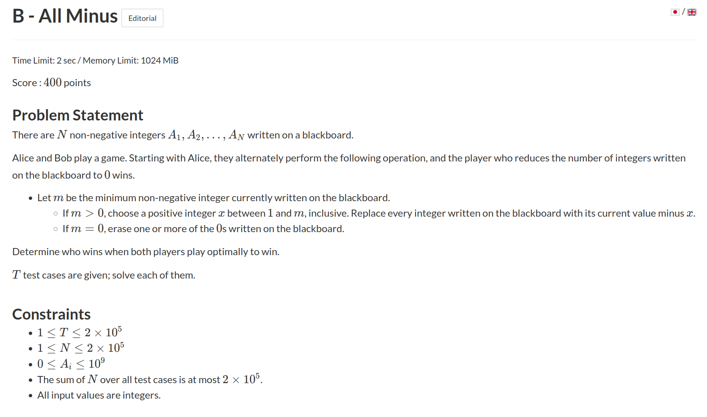

[상위 페이지 · AtCoder Regular Contest 218](/study/algorithms/competitive-programming/atcoder-regular-contest-218/)



## 문제 태그

- 게임 이론
- 정렬
- 상태 압축

## 한국어 문제 해석

칠판에 N개의 0 이상의 정수 $$A_1, A_2, ..., A_N$$이 적혀 있다.

Alice와 Bob이 게임을 한다. Alice부터 시작해서 두 사람은 번갈아 다음 조작을 수행하며, 칠판에 적힌 정수의 개수를 0개로 만든 사람이 이긴다.

현재 칠판에 적힌 0 이상의 정수 중 최솟값을 m이라고 하자.

- m이 0보다 크다면, 1 이상 m 이하인 양의 정수 x를 하나 고른다. 그리고 칠판에 적힌 모든 정수를 현재 값에서 x를 뺀 값으로 바꾼다.
- m이 0이라면, 칠판에 적힌 0 중 하나 이상을 지운다.

두 사람이 모두 이기기 위해 최적으로 행동한다고 할 때 누가 이기는지 판정한다.

T개의 테스트 케이스가 주어지므로, 각각에 대해 답을 구한다.

### 제약

- T는 1 이상 200000 이하이다.
- 각 테스트 케이스에서 N은 1 이상 200000 이하이다.
- 모든 i에 대해 $$A_i$$는 0 이상 1000000000 이하이다.
- 모든 테스트 케이스에 대한 N의 합은 200000 이하이다.
- 입력으로 주어지는 값은 모두 정수다.

### 입력

입력은 표준 입력에서 다음 형식으로 주어진다.

```
T
case_1
case_2
...
case_T
```

각 테스트 케이스는 다음 형식으로 주어진다.

```
N
A_1 A_2 ... A_N
```

### 출력

T줄을 출력한다. i번째 줄에는 i번째 테스트 케이스에서 Alice가 이기면 Alice를, Bob이 이기면 Bob을 출력한다.

## 문제 요약

- 모든 수에서 같은 값을 빼므로 수들 사이의 차이는 유지된다.
- 최솟값이 0이 되면 빼기 연산을 할 수 없고, 반드시 0을 지워야 한다.
- 같은 값이 여러 개 있으면 한 번에 여러 개의 0이 생긴다.
- 값 자체보다 인접한 서로 다른 값 사이의 차이와 같은 값의 개수가 중요하다.

## 예시 워크스루

예를 들어 수가 1, 1, 1이라고 하자.

처음 최솟값은 1이다. Alice는 x를 1로 고르는 수밖에 없다. 그러면 세 수가 모두 0이 된다.

```
1 1 1
0 0 0
```

이제 Bob은 0을 하나 이상 지울 수 있다. Bob이 0을 하나만 지우면 다음 상태는 다음과 같다.

```
0 0
```

Alice가 다시 0 하나를 지우고, Bob이 마지막 0을 지우면 Bob이 이긴다. 즉 0이 여러 개 생기면 그 0을 지우는 사람이 턴을 조절할 수 있다.

반대로 수가 하나만 있고 값이 2라면 다음처럼 진행할 수 있다.

```
2
1
0
빈 칠판
```

Alice가 처음에 1을 빼고, Bob이 다시 1을 빼면 0이 생긴다. Alice가 마지막 0을 지워 이긴다.

## 아이디어

먼저 같은 값을 묶어서 정렬한다. 값이 0인 묶음은 처음부터 0을 지우는 단계이므로 따로 처리한다.

양수만 남은 상태를 생각하면, 서로 다른 값들을 작은 값부터 볼 수 있다. 현재 값과 바로 이전 값을 비교해 두 값 사이의 간격을 본다.

```
이전 값
현재 값
두 값 사이의 간격
```

간격이 1이면 현재 최솟값이 이 층에 도달했을 때 뺄 수 있는 선택이 강제된다. 정확히 1을 빼서 현재 묶음이 0이 된다.

간격이 2 이상이면 현재 플레이어는 중간에 멈추는 선택을 할 수 있다. 이 자유도 때문에 그 상태는 이기는 상태가 된다.

이제 간격이 1인 경우를 본다.

현재 값의 개수가 1개라면, 그 하나가 0이 된 뒤 상대는 그 0을 지울 수밖에 없다. 그러면 다시 원래 플레이어가 더 큰 값들의 게임을 이어받는다. 따라서 승패는 뒤쪽 상태와 같다.

현재 값의 개수가 2개 이상이라면, 상대가 0을 몇 개 지울지 선택할 수 있다. 상대는 뒤쪽 게임을 누가 받게 할지 조절할 수 있으므로 원래 플레이어에게 불리하다. 그래서 이 경우는 지는 상태가 된다.

코드는 이 판단을 큰 값에서 작은 값 방향으로 계산한다. 뒤쪽 상태가 지는 상태인지 여부를 하나의 불리언으로 들고 내려오면 된다.

## 초기 0 처리

처음부터 0이 있다면 첫 플레이어는 빼기 연산을 할 수 없고 0을 지워야 한다.

0이 두 개 이상이면 첫 플레이어가 이긴다. 0을 전부 지워서 상대에게 양수 게임을 넘길 수도 있고, 0 하나를 남겨서 상대가 그 0을 지우게 만든 뒤 자신이 양수 게임을 받을 수도 있기 때문이다.

0이 정확히 하나라면 선택지가 없다. 그 0 하나를 지운 뒤 상대가 양수 게임을 시작한다. 따라서 상대가 양수 게임에서 이기는 상태라면 현재 플레이어는 진다.

## 구현 포인트

정렬한 뒤 같은 값을 묶어서 서로 다른 값 배열과 각 값의 개수 배열로 압축한다.

양수 부분은 뒤에서 앞으로 순회한다. 현재 값과 이전 값의 차이를 보고 다음 규칙으로 지는 상태 여부를 갱신한다.

- 두 값 사이의 간격이 2 이상이면 현재 상태는 이기는 상태다.
- 두 값 사이의 간격이 1이고 현재 값이 여러 개면 현재 상태는 지는 상태다.
- 두 값 사이의 간격이 1이고 현재 값이 하나면 뒤쪽 상태의 승패를 그대로 따른다.

마지막에 초기 0의 개수에 따라 한 번 더 조정한다.

## 정당성 요약

모든 수에서 같은 값을 빼므로 서로 다른 값 사이의 차이만 남는다. 각 서로 다른 값 묶음은 그 값이 최솟값이 되는 순간 한 번에 0 묶음으로 바뀐다. 두 값 사이의 간격이 1이면 빼기 선택이 강제되고, 간격이 2 이상이면 현재 플레이어가 턴을 유리하게 만드는 선택을 할 수 있다. 0 묶음의 크기가 1이면 다음 양수 게임을 받을 사람이 고정되고, 2 이상이면 0을 지우는 사람이 받을 사람을 조절할 수 있다. 따라서 큰 값부터 작은 값으로 지는 상태를 갱신한 결과가 최적 플레이의 승패와 일치한다.

## 정답

```cpp
#include <bits/stdc++.h>

using namespace std;

using ll = long long;
using pii = pair<int, int>;
using vi = vector<int>;
using vll = vector<ll>;
using vpii = vector<pii>;

#define all(x) (x).begin(), (x).end()
#define rall(x) (x).rbegin(), (x).rend()
#define sz(x) ((int)((x).size()))
#define F first
#define S second
#define pb push_back
#define mp make_pair
#define lb lower_bound
#define ub upper_bound

#ifndef ONLINE_JUDGE
template<typename A, typename B>
ostream& operator<<(ostream& os, const pair<A, B>& p) {
    return os << "{" << p.first << ", " << p.second << "}";
}
template<typename T>
ostream& operator<<(ostream& os, const vector<T>& v) {
    os << "[";
    for (size_t i = 0; i < v.size(); ++i) {
        os << v[i];
        if (i != v.size() - 1) os << ", ";
    }
    return os << "]";
}

#define debug(...) cerr << "[DEBUG] " << #__VA_ARGS__ << ": ", DBG(__VA_ARGS__)
template<typename T> void DBG(const T& v) { cerr << v << endl; }
template<typename T, typename... Args> void DBG(const T& v, const Args&... args) { cerr << v << ", "; DBG(args...); }
#else
#define debug(...)
#endif

int main() {
    ios::sync_with_stdio(0);
    cin.tie(0);
    
    int t;
    cin >> t;

    while (t--) {
        int n;
        cin >> n;

        vi a(n);
        for (int i = 0; i < n; i++) cin >> a[i];
        sort(all(a));

        vi val, cnt;
        for (int x : a) {
            if (!val.empty() && val.back() == x) cnt.back()++;
            else {
                val.pb(x);
                cnt.pb(1);
            }
        }

        int st = 0, z = 0;
        if (val[0] == 0) {
            z = cnt[0];
            st = 1;
        }

        bool lose = 1;
        for (int i = sz(val) - 1; i >= st; i--) {
            int prev = (i == st ? 0 : val[i - 1]);
            int gap = val[i] - prev;
            lose = (gap == 1 && (cnt[i] > 1 || lose));
        }

        bool ans;
        if (z) {
            bool nxt = (st < sz(val) && !lose);
            ans = !(z == 1 && nxt);
        } else {
            ans = !lose;
        }

        cout << (ans ? "Alice\n" : "Bob\n");
    }
    
    return 0;
}
```

## 검증

### 시간복잡도

각 테스트 케이스에서 정렬이 가장 크므로 시간복잡도는 O(N log N)이다. 전체 입력에서 ∑N ≤ 2 × 10^5이므로 충분하다.

### 공간복잡도

정렬 배열과 압축 배열을 저장하므로 공간복잡도는 O(N)이다.

### 코너 케이스

- 모든 수가 0이면 Alice가 전부 지워 이긴다.
- 0이 정확히 하나 있고 양수 게임이 다음 플레이어에게 이기는 상태면 Alice가 진다.
- 같은 양수 값이 여러 개 있고 이전 값과의 간격이 1이면 0 묶음을 지우는 사람이 턴을 조절할 수 있다.
- 서로 다른 값 사이의 gap이 2 이상이면 현재 플레이어가 중간에 멈추는 선택으로 이길 수 있다.
- 값이 10의 9까지 가능하지만 정렬 기반으로 처리하므로 값 범위 크기에 의존하지 않는다.

## 참고 개념정리

- 게임 이론
- 상태 압축
