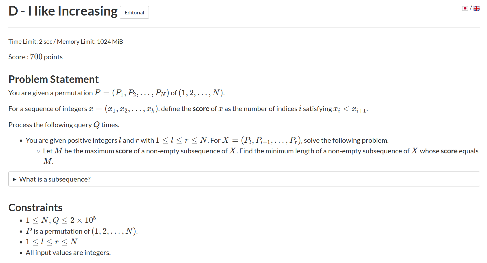

[상위 페이지 · AtCoder Regular Contest 218](/study/algorithms/competitive-programming/atcoder-regular-contest-218/)



## 문제 태그

- 세그먼트 트리
- 함수 합성
- 그리디
- 순열

## 한국어 문제 해석

$$1, 2, ..., N$$의 순열 $$P = (P_1, P_2, ..., P_N)$$이 주어진다.

정수열 $$x = (x_1, x_2, ..., x_k)$$에 대해, x의 점수를 x의 i번째 원소가 x의 i+1번째 원소보다 작은 인덱스 i의 개수로 정의한다.

다음 쿼리를 Q번 처리한다.

양의 정수 l, r이 주어진다. 1 이상 l 이하 r 이하 N을 만족한다. $$X = (P_l, P_l+1, ..., P_r)$$에 대해 다음 문제를 푼다.

X의 비어 있지 않은 부분수열이 가질 수 있는 점수의 최댓값을 M이라고 하자. 점수가 M인 비어 있지 않은 부분수열 중 길이의 최솟값을 구한다.

부분수열이란, 어떤 수열에서 0개 이상의 원소를 제거하고 남은 원소들의 순서를 그대로 유지해서 얻을 수 있는 수열이다.

### 제약

- N과 Q는 각각 1 이상 200000 이하이다.
- P는 1, 2, ..., N의 순열이다.
- 각 쿼리에서 l, r은 1 이상 l 이하 r 이하 N을 만족한다.
- 입력으로 주어지는 값은 모두 정수다.

### 입력

입력은 표준 입력에서 다음 형식으로 주어진다.

```
N Q
P_1 P_2 ... P_N
query_1
query_2
...
query_Q
```

각 쿼리는 다음 형식으로 주어진다.

```
l r
```

### 출력

Q줄을 출력한다. i번째 줄에는 i번째 쿼리의 답을 출력한다.

## 문제 요약

- 쿼리마다 부분배열을 하나 잡는다.
- 그 부분배열에서 부분수열을 골라 점수를 최대화한다.
- 최대 점수를 유지하면서 길이는 최소화해야 한다.
- N, Q ≤ 2 × 10^5라 쿼리마다 직접 보면 안 된다.

## 예시 워크스루

샘플의 전체 배열을 보자.

```
P = 2 1 4 6 3 5
```

인접 증가가 생기는 곳은 다음 세 곳이다.

- 1에서 4로 증가한다.
- 4에서 6으로 증가한다.
- 3에서 5로 증가한다.

따라서 원래 배열의 점수는 3이다. 이 점수는 부분수열을 골라도 더 커질 수 없다. 그래서 최대 점수 M은 3이다.

이제 길이를 줄여야 한다. 다음 부분수열을 고르면 된다.

```
1 4 6 3 5
```

점수는 세 번의 증가에서 나온다.

- 1에서 4로 증가한다.
- 4에서 6으로 증가한다.
- 3에서 5로 증가한다.

길이는 5다. 중간의 6에서 3으로 한 번 내려가야 뒤의 3에서 5로 가는 증가를 다시 만들 수 있다. 그래서 증가 3개를 만들기 위해 하나의 증가 체인만으로는 부족하고, 두 개의 체인이 필요하다.

- 요약하면 최대 점수는 3이다.
- 필요한 증가 체인 수는 2다.
- 그래서 답은 5다.

## 핵심 관찰 1: 삭제해도 점수는 증가하지 않는다

부분수열을 고른다는 것은 원소를 지우는 것이다. 어떤 세 원소 a, b, c가 연속으로 있다고 하자. b를 지우면 두 번의 비교가 한 번의 비교로 바뀐다.

새 비교 하나는 점수에 최대 1만 기여한다. 기존 두 비교의 기여도보다 커질 수 없다. 기존 두 비교가 모두 증가가 아니면 a, b, c는 내려가는 형태라서 a에서 c로도 증가가 생기지 않는다. 기존 두 비교 중 하나가 이미 증가라면 새 비교가 증가여도 점수는 늘지 않는다.

따라서 원소를 삭제해도 점수는 절대 증가하지 않는다. 그러므로 쿼리 구간의 최대 점수 M은 원래 구간에서 인접 증가가 몇 번 나오는지와 같다.

## 핵심 관찰 2: 증가 위치에서 블록을 끊는다

증가하는 지점마다 배열을 끊으면 각 블록 내부는 감소한다.

```
P = 2 1 4 6 3 5
블록 = [2 1] [4] [6 3] [5]
```

블록 번호를 붙이면 다음과 같다.

```
0번 블록: 2 1
1번 블록: 4
2번 블록: 6 3
3번 블록: 5
```

쿼리 구간의 왼쪽 끝이 속한 블록과 오른쪽 끝이 속한 블록을 보면, 그 사이에서 지나는 블록 경계 수가 정해진다. 각 경계는 원래 배열에서 증가가 발생한 지점이다. 따라서 최대 점수는 두 블록 번호의 차이와 같다.

이제 남은 문제는 그만큼의 증가를 만들기 위해 필요한 최소 길이를 구하는 것이다.

## 핵심 관찰 3: 필요한 것은 증가 체인 개수다

증가 하나를 만들려면 부분수열 안에서 실제로 작은 값에서 큰 값으로 올라가는 간선이 하나 필요하다.

증가 여러 개를 한 체인으로 이어 붙일 수 있으면 길이가 줄어든다.

예를 들어 다음 배열을 보자.

```
1 2 5 3 4 6
```

원래 증가는 4개다. 하지만 5를 고르지 않고 다음 부분수열을 고를 수 있다.

```
1 2 3 4 6
```

점수는 여전히 4이고 길이는 5다. 증가 4개를 하나의 체인으로 연결한 것이다.

반대로 샘플 전체에서는 다음처럼 된다.

```
1 4 6 / 3 5
```

6 다음에 5를 바로 붙이면 증가가 되지 않는다. 그래서 체인이 한 번 끊긴다. 최대 점수 3을 만들기 위해 체인이 2개 필요하므로 길이는 3 더하기 2가 된다.

> 답은 최대 점수와 필요한 증가 체인 수를 더한 값이다.
> 

## 블록 하나가 의미하는 전이 함수

세그먼트 트리에는 단순한 최솟값이나 합을 넣지 않는다. 각 노드에는 전이 함수를 넣는다.

전이 함수는 현재까지 만든 증가 체인의 마지막 값이 주어졌을 때, 이 구간의 블록들을 지난 뒤 상태가 어떻게 바뀌는지를 나타낸다.

전이 함수는 다음 두 가지를 반환한다고 생각하면 된다.

- 추가로 필요한 체인 수
- 처리 후 마지막 값

예를 들어 블록이 다음과 같다고 하자.

```
[6 3]
```

블록 내부는 감소한다. 이 블록에서 현재 마지막 값보다 큰 값 중 가장 작은 값을 골라야 뒤쪽 선택에 가장 유리하다. 그래서 구현에서는 블록을 뒤집어 오름차순으로 저장한 뒤 이분 탐색을 한다.

현재 마지막 값이 4라면 이 블록에서 4보다 큰 값 중 가장 작은 값은 6이다.

- 현재 마지막 값은 4다.
- 처리 후 마지막 값은 6이 된다.
- 체인은 추가되지 않는다.

현재 마지막 값이 6이라면 이 블록에는 6보다 큰 값이 없다. 그러면 기존 체인으로 이 증가를 만들 수 없으므로 체인을 새로 시작해야 한다.

- 현재 마지막 값은 6이다.
- 체인을 1개 추가한다.
- 새 체인의 마지막 값을 다시 잡는다.

새 체인의 마지막 값은 이전 블록의 최솟값보다 큰 현재 블록의 원소 중 가장 작은 값으로 잡는다. 체인을 새로 시작해도 현재 블록으로 들어오는 증가 하나는 만들어야 하므로 이전 블록 끝값에서 현재 블록의 어떤 값으로 올라가야 하기 때문이다.

## 전이 노드에 들어가는 정보

전이 노드는 함수를 구간별로 압축해 저장한다.

```cpp
struct Node {
    vi lim, add, val;
};
```

해설에서는 세 배열을 각각 다음 역할로 보면 된다.

- 경계값 배열은 현재 마지막 값이 어느 범위에 속하는지 나눈다.
- 추가 체인 수 배열은 해당 범위에서 체인이 몇 개 더 필요한지 저장한다.
- 다음 마지막 값 배열은 해당 범위를 처리한 뒤 마지막 값이 무엇이 되는지 저장한다.

예를 들어 현재 블록을 뒤집어 저장한 값이 다음과 같고, 이전 블록의 최솟값이 4라고 하자.

```
오름차순 블록 값: [3, 6]
이전 블록 최솟값: 4
```

이 경우 체인을 새로 시작할 때 다시 잡는 값은 6이다. 전이 함수는 다음처럼 나뉜다.

- 현재 마지막 값이 2 이하이면 3을 고른다. 체인은 추가되지 않고, 처리 후 마지막 값은 3이 된다.
- 현재 마지막 값이 5 이하이면 6을 고른다. 체인은 추가되지 않고, 처리 후 마지막 값은 6이 된다.
- 그보다 크면 체인을 새로 시작한다. 체인을 1개 추가하고, 처리 후 마지막 값은 6이 된다.

따라서 노드에는 다음 정보가 들어간다.

- 경계값 배열은 2, 5, N이다.
- 추가 체인 수 배열은 0, 0, 1이다.
- 다음 마지막 값 배열은 3, 6, 6이다.

조회 함수는 현재 마지막 값을 받아 경계값 배열에서 이분 탐색을 하고, 해당 범위의 추가 체인 수와 다음 마지막 값을 반환한다.

## 세그먼트 트리에서 합성하는 것

두 전이 함수가 있다고 하자. 앞쪽 전이를 지나면 현재 마지막 값이 중간값으로 바뀌고, 뒤쪽 전이는 그 중간값을 입력으로 받는다.

- 앞쪽 전이는 현재 마지막 값을 받아 체인을 몇 개 늘리고 중간값을 만든다.
- 뒤쪽 전이는 중간값을 받아 체인을 몇 개 더 늘리고 최종값을 만든다.

두 전이를 합친 전체 전이는 다음 의미를 가진다.

- 처음 마지막 값을 입력으로 받는다.
- 두 전이에서 늘어난 체인 수를 더한다.
- 최종 마지막 값을 반환한다.

이것이 전이 합성 함수가 하는 일이다. 왼쪽 노드의 각 범위에 대해 왼쪽 결과 값을 오른쪽 노드에 넣고, 추가 체인 수를 더한다.

샘플에서 1번 블록과 2번 블록을 합성해 보자.

```
1번 블록: [4]
2번 블록: [6 3]
```

1번 블록 전이는 대략 다음과 같다.

- 현재 마지막 값이 3 이하이면 4를 고른다. 체인은 추가되지 않는다.
- 현재 마지막 값이 4 이상이면 새 체인을 시작하고 4를 고른다. 체인이 1개 추가된다.

2번 블록 전이는 다음과 같다.

- 현재 마지막 값이 2 이하이면 3을 고른다. 체인은 추가되지 않는다.
- 현재 마지막 값이 5 이하이면 6을 고른다. 체인은 추가되지 않는다.
- 현재 마지막 값이 6 이상이면 새 체인을 시작하고 6을 고른다. 체인이 1개 추가된다.

이 둘을 합치면, 처음 마지막 값이 3 이하인 경우 1번 블록에서 4가 되고, 2번 블록에서 6이 된다. 체인은 추가되지 않는다.

처음 마지막 값이 4 이상인 경우 1번 블록에서 이미 체인이 하나 추가되고 4가 된다. 그 뒤 2번 블록에서는 6으로 이어진다. 전체 체인 추가는 1이다.

이렇게 여러 블록을 하나의 전이 함수로 합성해 세그먼트 트리 노드에 저장한다.

## 쿼리 처리

쿼리의 왼쪽 끝과 오른쪽 끝이 같은 블록에 속하면 구간 안에 증가 경계가 없으므로 최대 점수는 0이고, 길이 1짜리 부분수열이면 충분하다.

서로 다른 블록에 속한다면 최대 점수는 두 블록 번호의 차이다. 이제 체인 수를 센다.

첫 블록에서는 가능한 가장 작은 값을 잡고 시작하는 것이 좋다. 그래야 뒤에서 더 큰 값을 찾기 쉽다. 그래서 현재 마지막 값을 첫 블록의 최솟값으로 둔다.

중간에 완전히 포함되는 블록들은 세그먼트 트리로 한 번에 전이시킨다.

마지막 블록은 쿼리의 오른쪽 끝이 블록 중간에서 끝날 수 있다. 그래서 마지막 블록 전체를 세그먼트 트리에 맡기지 않고, 실제로 포함되는 부분에서만 현재 마지막 값보다 큰 값이 있는지 이분 탐색으로 확인한다.

최종 답은 최대 점수와 필요한 체인 수를 더한 값이다.

## 구현 포인트

블록 시작 위치 배열과 블록 끝 위치 배열을 따로 둔다. 마지막 블록이 쿼리 중간에서 끝나는 경우 실제로 포함되는 구간만 보기 위해 끝 위치가 필요하다.

위치별 블록 번호 배열을 만들어 두면 쿼리의 양끝이 어떤 블록에 속하는지 바로 알 수 있다.

각 블록의 값은 뒤집어서 저장한다. 블록 내부는 감소하므로 뒤집으면 오름차순이 되고, 이분 탐색으로 현재 마지막 값보다 큰 최소 값을 찾을 수 있다.

각 블록의 최솟값도 따로 저장한다. 블록은 감소하므로 원래 블록의 마지막 값이 최솟값이다.

세그먼트 트리에 올리는 기본 전이는 특정 블록으로 들어가는 전이를 저장한다. 그래서 쿼리에서 양끝 블록 사이에 완전히 포함되는 블록들만 세그먼트 트리로 처리하고, 마지막 블록의 잘린 부분은 따로 이분 탐색으로 처리한다.

## 정당성 요약

부분수열을 만드는 과정은 원소 삭제이므로 점수는 원래 구간의 인접 증가 횟수보다 커질 수 없다. 증가 지점에서 블록을 끊으면 쿼리 구간의 최대 점수는 지나가는 블록 경계 수와 같다. 각 증가 경계는 부분수열에서 증가 간선 하나로 표현되어야 한다. 여러 증가 간선을 한 체인으로 이어 붙일 수 있는지는 현재 체인의 마지막 값보다 큰 값을 다음 블록에서 고를 수 있는지로 결정된다. 항상 가능한 값 중 가장 작은 값을 고르는 것이 이후 선택에 불리하지 않으므로 그리디가 성립한다. 블록 하나의 그리디 전이는 현재 마지막 값을 입력으로 받는 함수로 표현할 수 있고, 전이 함수는 순서대로 합성 가능하다. 세그먼트 트리는 이 합성 함수를 구간별로 저장하므로 각 쿼리에서 필요한 중간 블록들의 전이를 빠르게 적용할 수 있다.

## 정답

```cpp
#include <bits/stdc++.h>

using namespace std;

using ll = long long;
using pii = pair<int, int>;
using vi = vector<int>;
using vll = vector<ll>;
using vpii = vector<pii>;

#define all(x) (x).begin(), (x).end()
#define rall(x) (x).rbegin(), (x).rend()
#define sz(x) ((int)((x).size()))
#define F first
#define S second
#define pb push_back
#define mp make_pair
#define lb lower_bound
#define ub upper_bound

#ifndef ONLINE_JUDGE
template<typename A, typename B>
ostream& operator<<(ostream& os, const pair<A, B>& p) {
    return os << "{" << p.first << ", " << p.second << "}";
}
template<typename T>
ostream& operator<<(ostream& os, const vector<T>& v) {
    os << "[";
    for (size_t i = 0; i < v.size(); ++i) {
        os << v[i];
        if (i != v.size() - 1) os << ", ";
    }
    return os << "]";
}

#define debug(...) cerr << "[DEBUG] " << #__VA_ARGS__ << ": ", DBG(__VA_ARGS__)
template<typename T> void DBG(const T& v) { cerr << v << endl; }
template<typename T, typename... Args> void DBG(const T& v, const Args&... args) { cerr << v << ", "; DBG(args...); }
#else
#define debug(...)
#endif

int n;

struct Node {
    vi lim, add, val;
};

pair<int, int> get(const Node& cur, int x) {
    int idx = lb(all(cur.lim), x) - cur.lim.begin();
    return {cur.add[idx], cur.val[idx]};
}

void put(Node& cur, int lim, int add, int val) {
    if (!cur.lim.empty() && cur.add.back() == add && cur.val.back() == val) {
        cur.lim.back() = lim;
        return;
    }
    cur.lim.pb(lim);
    cur.add.pb(add);
    cur.val.pb(val);
}

Node merge_node(const Node& L, const Node& R) {
    if (L.lim.empty()) return R;
    if (R.lim.empty()) return L;

    Node cur;
    cur.lim.reserve(sz(L.lim));
    cur.add.reserve(sz(L.add));
    cur.val.reserve(sz(L.val));

    for (int i = 0; i < sz(L.lim); i++) {
        auto nxt = get(R, L.val[i]);

        int add = L.add[i] + nxt.F;
        int val = nxt.S;

        put(cur, L.lim[i], add, val);
    }

    return cur;
}

Node make_node(const vi& v, int x) {
    Node cur;
    cur.lim.reserve(sz(v) + 1);
    cur.add.reserve(sz(v) + 1);
    cur.val.reserve(sz(v) + 1);

    int reset = *ub(all(v), x);
    for (int y : v) {
        put(cur, y - 1, 0, y);
    }
    put(cur, n, 1, reset);
    return cur;
}

struct SegmentTree {
    int size;
    vector<Node> tree;

    SegmentTree(const vector<Node>& a) {
        size = 1;

        while (size < sz(a)) {
            size <<= 1;
        }

        tree.resize(size << 1);

        for (int i = 0; i < sz(a); i++) {
            tree[size + i] = a[i];
        }

        for (int i = size - 1; i >= 1; i--) {
            tree[i] = merge_node(tree[i << 1], tree[i << 1 | 1]);
        }
    }

    pair<int, int> query(int node, int s, int e, int l, int r, int x) {
        if (r < s || e < l) return {0, x};

        if (l <= s && e <= r) {
            return get(tree[node], x);
        }

        int mid = (s + e) >> 1;
        auto L = query(node << 1, s, mid, l, r, x);
        auto R = query(node << 1 | 1, mid + 1, e, l, r, L.S);

        return {L.F + R.F, R.S};
    }
};

int main() {
    ios::sync_with_stdio(0);
    cin.tie(0);
    
    int q;
    cin >> n >> q;

    vi p(n + 1);
    for (int i = 1; i <= n; i++) cin >> p[i];

    vi start, finish, mn, id(n + 1);
    vector<vi> vals;

    int s = 1;
    for (int i = 2; i <= n; i++) {
        if (p[i - 1] < p[i]) {
            start.pb(s);
            finish.pb(i - 1);
            for (int j = s; j < i; j++) 
                id[j] = sz(start) - 1;

            vi cur;
            for (int j = i - 1; j >= s; j--) cur.pb(p[j]);
            vals.pb(cur);
            mn.pb(p[i - 1]);

            s = i;
        }
    }

    start.pb(s);
    finish.pb(n);
    for (int j = s; j <= n; j++) id[j] = sz(start) - 1;

    vi cur;
    for (int j = n; j >= s; j--) cur.pb(p[j]);
    vals.pb(cur);
    mn.pb(p[n]);

    int m = sz(start);
    vector<Node> base;

    for (int i = 1; i < m; i++) {
        base.pb(make_node(vals[i], mn[i - 1]));
    }

    SegmentTree seg(base);

    while (q--) {
        int l, r;
        cin >> l >> r;

        int L = id[l], R = id[r];
        if (L == R) {
            cout << 1 << "\n";
            continue;
        }

        int cnt = 1;
        int x = mn[L];

        if (L + 1 <= R - 1) {
            auto cur = seg.query(1, 0, seg.size - 1, L, R - 2, x);

            cnt += cur.F;
            x = cur.S;
        }

        int idx = finish[R] - r;
        auto it = ub(vals[R].begin() + idx, vals[R].end(), x);
        if (it == vals[R].end()) 
            cnt++;

        int ans = (R - L) + cnt;
        cout << ans << "\n";
    }
    
    return 0;
}
```

## 검증

### 시간복잡도

블록 분해는 O(N)이다. 각 세그먼트 트리 노드는 전이 함수를 합성하며, 전체적으로 $$O(N log N)$$에 가까운 크기의 전이 정보를 저장한다. 쿼리는 방문하는 노드마다 lower_bound를 수행하므로 $$O(log N log N)$$ 정도로 볼 수 있다.

### 공간복잡도

세그먼트 트리 노드의 전이 정보를 저장하므로 공간복잡도는 $$O(N log N)$$ 정도다. 메모리 제한이 1024 MiB라 충분하다.

### 코너 케이스

- 쿼리 구간이 한 블록 안에 있으면 증가가 없으므로 답은 1이다.
- 완전히 증가하는 배열에서는 각 원소가 별도 블록이 되고, 답은 구간 길이와 같다.
- 완전히 감소하는 배열에서는 블록이 하나뿐이고 모든 쿼리 답은 1이다.
- 쿼리가 인접한 두 블록만 걸치면 중간 블록이 없으므로 세그먼트 트리 조회를 하지 않는다.
- 쿼리의 오른쪽 끝이 마지막 블록 중간에서 끝날 수 있으므로 마지막 블록은 별도로 처리한다.
- 체인을 새로 시작할 때 다시 잡는 값은 항상 존재한다. 증가 지점에서 블록을 끊었기 때문에 현재 블록의 첫 값은 이전 블록의 최솟값보다 크다.

## 참고 개념정리

- Segment Tree
- 함수 합성
- 그리디
