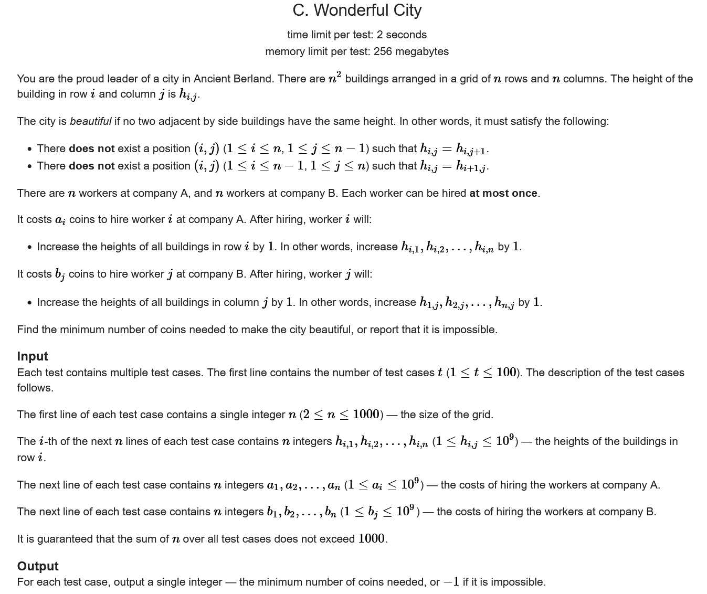

[상위 페이지 · Codeforce Round 1018 (Div. 1+Div. 2)](/study/algorithms/competitive-programming/codeforce-round-1018-div-1-div-2/)



## 문제 해석

- 각 행 i, 각 열 j에 “한 번만” 높이 +1을 할지(변수 xᵢ, yⱼ∈{0,1}) 결정한다.
- 결과 높이 hᵢⱼ′ = hᵢⱼ + xᵢ + yⱼ 에서, 모든 가로·세로 인접 쌍이 같지 않아야 한다.
- 비용은 ∑ (aᵢ·xᵢ) + ∑ (bⱼ·yⱼ) 이며, 불가능하면 −1을 출력.

## 문제 태그

- DP

## 아이디어

- **행과 열을 분리해 각각 독립적으로 판단**
    - 전체 그리드(n×n)를 한꺼번에 고려하지 않고,
        - 먼저 “행들”만 보고 각 행에 +1을 할지 말지 결정하고,
        - 그 다음 “열들”만 보고 각 열에 +1을 할지 말지 결정한다.
    - 행에 대한 선택(x₁…xₙ)과 열에 대한 선택(y₁…yₙ)은 서로 영향을 주지 않으므로, 두 결과를 합산하면 전체 경우가 커버된다.
- **각 인접 라인 쌍(행 k–k+1 또는 열 k–k+1)에 대해 충돌 가능성 검사**
    1. 두 라인의 원래 높이 차들을 모두 살펴본다.
        - 같은 열(또는 같은 행) 위치마다 위쪽이 높으면 +d, 아래쪽이 높으면 –d, 같으면 0이다.
    2. 그 중 차이가 –1, 0, +1인 경우들은 “한쪽만 올리거나(±1) 또는 둘 다 올리거나(0→0,1→1)” 하면 최종 높이가 같아지는 충돌 후보다.
    3. 따라서 해당 라인 쌍에서는
        - (0→0), (1→1) 조합이 불가(원래 차=0),
        - (0→1) 조합이 불가(원래 차=+1),
        - (1→0) 조합이 불가(원래 차=–1)
            
            와 같이 금지된 전이(transition)를 먼저 모아둔다.
            
    4. 만약 이 금지 전이를 제외하고 남은 선택 조합이 하나도 없다면,
        
        “어떻게 해도 이 두 라인 사이에 높이 충돌이 발생” → 해당 방향 전체가 불가능임을 바로 판정한다.
        
- **허용 전이 정보를 이용해 DP로 최소 비용 계산**
    - 상태: “0부터 i번째 라인까지 고려했고, i번째 라인에서(안 올리기=0/올리기=1) 중 하나를 택했을 때의 최소 누적 비용”
    - 초기:
        
        첫 라인에서는 0을 택하면 비용 0, 1을 택하면 그 라인의 비용 a₁(또는 b₁).
        
    - 전이:
        - i번째 라인에서 0/1을 택하는 각각의 경우에
        - 이전 라인에서 0/1을 택한 두 경우 중, “충돌 금지가 없는 조합”만 골라
        - 그 중 누적 비용이 가장 작은 값을 가져온 뒤
        - 현재 라인에서 1을 택했다면 여기에 그 라인 비용을 더한다
    - 이렇게 1번부터 n–1번까지 채워 나가면, 마지막 라인에서 안 올리기와 올리기 중 더 적은 비용이 그 방향의 해답이 된다.
- **행 DP 결과 + 열 DP 결과 = 전체 최소 비용**
    - 두 방향 중 하나라도 불가능 판정이 나왔다면 최종적으로 “–1”
    - 그렇지 않으면 “행에서 든 최소 비용”과 “열에서 든 최소 비용”을 합쳐 답으로 출력

## 정답

```python
import sys
input = sys.stdin.readline

INF = 10**30

def solve_one(n, h, cost):
    allowed = []
    m = len(h)
    for k in range(n - 1):
        S = {h[k][t] - h[k + 1][t] for t in range(m)}
        bad = S & {-1, 0, 1}
        ok = {(u, v) for u in (0, 1) for v in (0, 1) if (v - u) not in bad}
        if not ok:
            return INF
        allowed.append(ok)
    dp0 = [0, cost[0]]
    for i in range(1, n):
        dp1 = [INF, INF]
        for v in (0, 1):
            base = cost[i] * v
            best = INF
            for u in (0, 1):
                if (u, v) in allowed[i - 1] and dp0[u] < best:
                    best = dp0[u]
            dp1[v] = base + best
        dp0 = dp1
    return min(dp0)

t = int(input())
out = []
for _ in range(t):
    n = int(input())
    h = [list(map(int, input().split())) for _ in range(n)]
    a = list(map(int, input().split()))
    b = list(map(int, input().split()))
    cost_rows = solve_one(n, h, a)
    cost_cols = solve_one(n, list(zip(*h)), b)
    ans = cost_rows + cost_cols
    out.append(str(ans if ans < INF//2 else -1))
print("\n".join(out))
```
