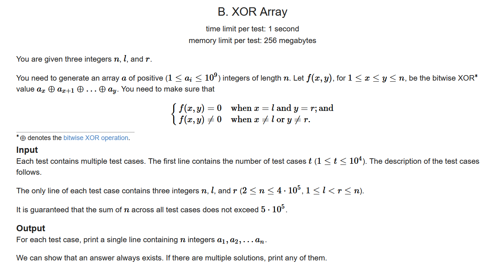
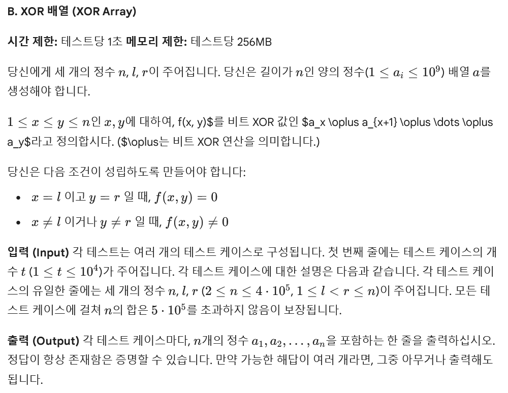

[상위 페이지 · Codeforce Round 1069 (Div. 2)](/study/algorithms/competitive-programming/codeforce-round-1069-div-2/)





## 문제 태그

- 수학

## 아이디어

- 핵심은 [l,r]의 누적합이 0이여야 하고 그 외에는 0이 아니여야함
- 누적 XOR 값을 0~n까지 채우되, r번째 위치만 l-1 값으로 바꾼다
- 출력으로 우리가 만든건 누적 XOR 값이니 $$P_i \oplus P_{i-1}$$을 한다

## 정답

```cpp
#include <bits/stdc++.h>

using namespace std;

using ll = long long;
using pii = pair<int, int>;
using vi = vector<int>;
using vll = vector<ll>;
using vpii = vector<pii>;

#define all(x) (x).begin(), (x).end()
#define rall(x) (x).rbegin(), (x).rend()
#define F first
#define S second
#define pb push_back
#define mp make_pair
#define lb lower_bound
#define ub upper_bound

#ifndef ONLINE_JUDGE
template<typename A, typename B>
ostream& operator<<(ostream& os, const pair<A, B>& p) {
    return os << "{" << p.first << ", " << p.second << "}";
}
template<typename T>
ostream& operator<<(ostream& os, const vector<T>& v) {
    os << "[";
    for (size_t i = 0; i < v.size(); ++i) {
        os << v[i];
        if (i != v.size() - 1) os << ", ";
    }
    return os << "]";
}

#define debug(...) cerr << "[DEBUG] " << #__VA_ARGS__ << ": ", DBG(__VA_ARGS__)
template<typename T> void DBG(const T& v) { cerr << v << endl; }
template<typename T, typename... Args> void DBG(const T& v, const Args&... args) { cerr << v << ", "; DBG(args...); }
#else
#define debug(...)
#endif

int main() {
    ios::sync_with_stdio(0);
    cin.tie(0);
    int t;
    cin >> t;
    while (t--) {
        int n, l, r;
        cin >> n >> l >> r;
        int prev_p = 0;
        for (int i = 1; i <= n; ++i) {
            int curr_p;
            if (i == r) {
                curr_p = l - 1;
            } else {
                curr_p = i;
            }
            cout << (curr_p ^ prev_p) << (i == n ? "" : " ");
            prev_p = curr_p;
        }
        cout << "\n";
    }

    return 0;
}
```
