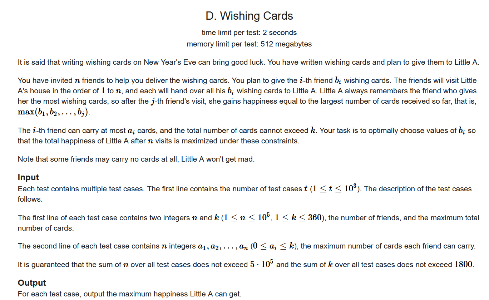
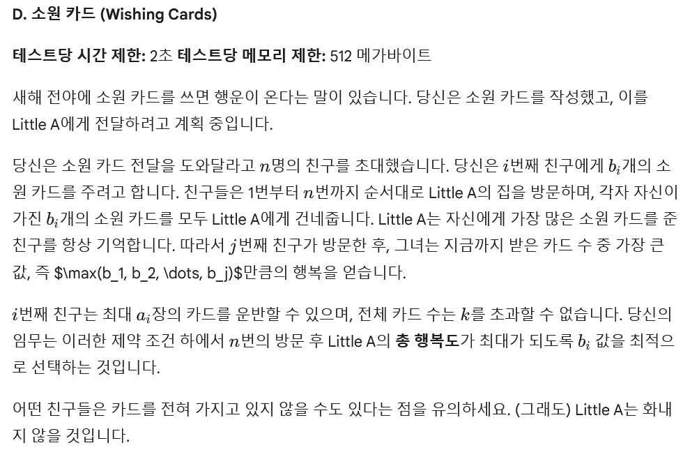

[상위 페이지 · Codeforce Round 1069 (Div. 2)](/study/algorithms/competitive-programming/codeforce-round-1069-div-2/)





## 문제 태그

- dp

## 아이디어

- 문제의 목표는 $$\sum_{j=1}^n \max(b_1, \dots, b_j)$$을 최대화하는것. 이 식을 그대로 사용하면 시뮬레이션이지만 값이 변하는 시점을 기준으로 식을 변형하면 dp로 접근이 가능함
- 최댓값이 $$v_{k-1}$$에서 $$v_k$$로 바뀌는 시점에서 친구의 인덱스을 $$i_k$$라고 한다. (초기값 v0=0) 마지막 최댓값이 $$v_{last}$$라면, 총 행복도는 다음과 같이 정리할 수 있다.
    
    $$
    total = (n + 1) \cdot v_{last} - \underset{k}{\sum}(v_k - v_{k-1}) \cdot i_k
    $$
    
    dp는 뒤에 시그마의 최소 값을 유지한다
    
- dp 상태 정의 = dp[c][v]
    - c : 지금까지 사용한 카드 개수
    - v : 현재까지의 최대 값
    - 점화식:
        
        i번째 친구가 $$v_{new}$$개의 카드를 내서 기존 최대값 $$v_{old}$$ 갱신시
        
        $$
        dp[c + v_{new}][v_{new}] = \underset{0\le v_{old}<v_{new}}{min}(dp[c][v_{old}] + (v_{new} -v_{old}) \times idx)
        $$
        
- 위 점화식을 그대로 사용하면 $$v_{old}$$를 매번 순회해야하므로 느리다. 식을 전개하여 변수를 불리한다
    
    $$
    dp[c + v_{new}][v_{new}] = (v_{new} \times idx)\underset{0\le v_{old}<v_{new}}{min}(dp[c][v_{old}]-v_{old} \times idx)
    $$
    
    이렇게 식을 전개하면 $$\underset{0\le v_{old}<v_{new}}{min}(dp[c][v_{old}]-v_{old} \times idx]$$이 부분을 또 메모이제이션하여 O(1)에 가깝게 가져올 수 있다
    
    $$
    prev[c] = \underset{v<v_{new}}{min}(dp[c][v] - v \times idx)
    $$
    
    최종적으로는
    
    $$
    dp[c + v_{new}][v_{new}] =  prev[c] + (v_{new} \times idx)
    $$
    
- N은 최대 $$10^5$$지만 K는 최대 360으로 작은 값이다. 용량이 C인 친구가 아무리 많아도 전체 용량 K를 채우는데에는 약 K/C명만 있으면 충분하다. 따라서 각 용량 별로 필요한 최소 인원만 남기고 DP를 수행한다.

## 정답

```cpp
#include <bits/stdc++.h>

using namespace std;

using ll = long long;
using pii = pair<int, int>;
using vi = vector<int>;
using vll = vector<ll>;
using vpii = vector<pii>;

#define all(x) (x).begin(), (x).end()
#define rall(x) (x).rbegin(), (x).rend()
#define F first
#define S second
#define pb push_back
#define mp make_pair
#define lb lower_bound
#define ub upper_bound

#ifndef ONLINE_JUDGE
template<typename A, typename B>
ostream& operator<<(ostream& os, const pair<A, B>& p) {
    return os << "{" << p.first << ", " << p.second << "}";
}
template<typename T>
ostream& operator<<(ostream& os, const vector<T>& v) {
    os << "[";
    for (size_t i = 0; i < v.size(); ++i) {
        os << v[i];
        if (i != v.size() - 1) os << ", ";
    }
    return os << "]";
}

#define debug(...) cerr << "[DEBUG] " << #__VA_ARGS__ << ": ", DBG(__VA_ARGS__)
template<typename T> void DBG(const T& v) { cerr << v << endl; }
template<typename T, typename... Args> void DBG(const T& v, const Args&... args) { cerr << v << ", "; DBG(args...); }
#else
#define debug(...)
#endif

const ll INF = 1e18;
const int MAX_K = 366; 

ll dp[MAX_K][MAX_K];
ll prev_min[MAX_K];

int main() {
    ios::sync_with_stdio(0);
    cin.tie(0);
    
    int t;
    cin >> t;
    while(t--) {
        int n, k;
        cin >> n >> k;

        vpii friends; 
        vi count_by_cap(k + 1, 0);
        
        for (int i = 1; i <= n; ++i) {
            int cap;
            cin >> cap;
            if (cap == 0) continue;

            if (count_by_cap[cap] < (k / cap) + 2) {
                friends.pb({i, cap});
                count_by_cap[cap]++;
            }
        }

        for(int c = 0; c <= k; ++c) {
            for(int v = 0; v <= k; ++v) {
                dp[c][v] = INF;
            }
        }
        dp[0][0] = 0;

        vector<pair<int, ll>> col_updates;
        col_updates.reserve(k + 1);

        for (auto& p : friends) {
            int idx = p.F;
            int cap = p.S;

            for (int c = 0; c <= k; ++c) {
                if (dp[c][0] != INF) prev_min[c] = dp[c][0];
                else prev_min[c] = INF;
            }
            for (int new_v = 1; new_v <= cap; ++new_v) {
                ll add_term = (ll)new_v * idx;
                int max_c = k - new_v;
                
                col_updates.clear();

                for (int c = 0; c <= max_c; ++c) {
                    if (prev_min[c] != INF) {
                        ll candidate = prev_min[c] + add_term;
                        if (candidate < dp[c + new_v][new_v]) {
                            col_updates.pb({c + new_v, candidate});
                        }
                    }
                }

                if (new_v < cap) {
                    for (int c = new_v; c <= k; ++c) {
                        if (dp[c][new_v] != INF) {
                            ll val = dp[c][new_v] - (ll)new_v * idx;
                            if (val < prev_min[c]) {
                                prev_min[c] = val;
                            }
                        }
                    }
                }

                for (auto& u : col_updates) {
                    if (u.S < dp[u.F][new_v]) {
                        dp[u.F][new_v] = u.S;
                    }
                }
            }
        }

        ll ans = 0;
        for (int c = 0; c <= k; ++c) {
            for (int v = 0; v <= c; ++v) {
                if (dp[c][v] != INF) {
                    ll current_happiness = (ll)(n + 1) * v - dp[c][v];
                    if (current_happiness > ans) ans = current_happiness;
                }
            }
        }
        cout << ans << "\n";
    }
    
    return 0;
}
```
