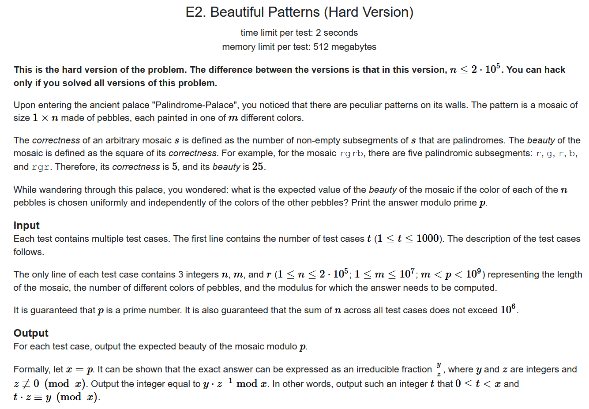
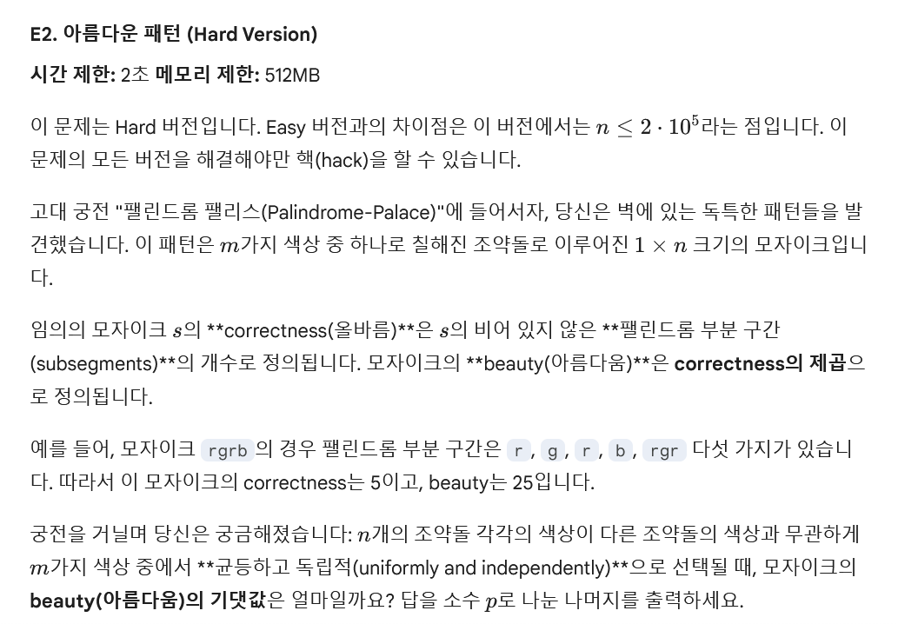

[상위 페이지 · Codeforce Round 1069 (Div. 2)](/study/algorithms/competitive-programming/codeforce-round-1069-div-2/)





E1과 E2는 동일한 문제이나 E2의 범위가 더 크다

## 문제 태그

- 수학
- 통계학

## 아이디어

### 1. 기본 개념

- 모자이크의 아름다움 = $$(correctness)^2$$
    - X = 모자이크 내 모든 팰린드롬 부분 문자열의 개수
    - 목표: $$E[X^2]$$ 계산하기

### 2. X를 중심별로 나누기

- 각 팰린드롬은 중심점을 가지고 있음
- $$N_c$$ = 중심이 c인 팰린드롬의 개수
- $$X = \underset{all\ center\ c}{\sum}N_c$$ (모든 중심의 팰린드롬 개수를 합침)

### 3. $$E[X^2]$$ 계산하기

$$X^2$$를 전개하면:

$$
X^2 = \left( \underset{c}{\sum} N_c\right)^2 = \underset{c}{\sum} N^2_c + \underset{c\not =d}{\sum} N_cN_d
$$

기대값을 취하면:

$$
E[X^2] = \underset{c}{\sum} E[N^2_c] + \underset{c\not =d}{\sum} E[N_cN_d]
$$

### 4. 핵심 아이디어: 독립성

서로 다른 중심 c와 d에 대해 $$N_c$$와 $$N_d$$는 독립적이다

- 이유:
    - 팰린드롬 확인은 $$S[l] == S[r]$$ 형태로 검사
    - 중심이 다르면 검사하는 인덱스 쌍 $$(l,r)$$이 완전히 다름
    - 색상은 독립적으로 선택되므로, 다른 쌍의 검사 결과도 독립적

따라서 $$E[N_c N_d] = E[N_c] \cdot E[N_d]$$가 성립

이를 이용하면:

$$
\underset{c\not =d}{\sum} E[N_cN_d] = \underset{c\not =d}{\sum} E[N_c]E[N_d] = \left( \underset{c} {\sum}E[N_c]\right )^2 - \underset{c} {\sum}(E[N_c])^2
$$

최종 공식:

$$
E[X^2]  = \left( \underset{c} {\sum}E[N_c]\right )^2 - \underset{c} {\sum}(E[N_c])^2 + \underset{c} {\sum}E[N^2_c]
$$

### 5. 각 값 계산하기

- $$E[N_c]$$ 계산 (V 값)
    - 중심 c에서 가능한 팰린드롬 개수의 기대값
    - 반지름 k까지 팰린드롬일 확률 = $$(1/m)^k$$
    
    $$
    E[N_c] = \underset{k}{\sum}(1/m)^k
    $$
    
- $$E[N_c^2]$$ 계산 (SV 값)
    - 반지름이 R이면 $$N_c = R + 1$$개의 팰린드롬 존재
        - 반지름 0: 길이 1 (1개)
        - 반지름 1: 길이 3 (2개)
        - 반지름 R: 길이 2R+1 (R+1개)
    - $$(R+1)^2 = \sum^{R}_{k=0}(2k+1)$$를 이용
        - 제곱의 합 공식: $$1 + 3 + 5 + ... + (2R+1) = (R+1)^2$$
        - 이를 이용하여 $$E[N_c^2]$$를 효율적으로 계산
    
    $$
    E[N_c^2] = \sum^{R}_{k=0}(2k+1) \cdot (1/m)^k
    $$
    
- 최적화: V와 SV를 누적합으로 미리 계산하면 각 중심마다 O(1)에 조회 가능

### 6. 홀수/짝수 길이 처리

- 홀수 길이 팰린드롬
    - 중심이 문자 위에 있음
    - 길이 1은 항상 팰린드롬 (확률 1)
    - V, SV 그대로 사용
- 짝수 길이 팰린드롬
    - 중심이 두 문자 사이에 있음
    - 길이 2부터 시작, $$S[i] == S[i+1]$$ 확인 필요 (확률 1/m)
    - V, SV에 $$1/m$$을 곱해서 사용

## 정답

```cpp
#include <bits/stdc++.h>

using namespace std;

using ll = long long;
using pii = pair<int, int>;
using vi = vector<int>;
using vll = vector<ll>;
using vpii = vector<pii>;

#define all(x) (x).begin(), (x).end()
#define rall(x) (x).rbegin(), (x).rend()
#define F first
#define S second
#define pb push_back
#define mp make_pair
#define lb lower_bound
#define ub upper_bound

#ifndef ONLINE_JUDGE
template <typename A, typename B>
ostream &operator<<(ostream &os, const pair<A, B> &p)
{
    return os << "{" << p.first << ", " << p.second << "}";
}
template <typename T>
ostream &operator<<(ostream &os, const vector<T> &v)
{
    os << "[";
    for (size_t i = 0; i < v.size(); ++i)
    {
        os << v[i];
        if (i != v.size() - 1)
            os << ", ";
    }
    return os << "]";
}

#define debug(...) cerr << "[DEBUG] " << #__VA_ARGS__ << ": ", DBG(__VA_ARGS__)
template <typename T>
void DBG(const T &v) { cerr << v << endl; }
template <typename T, typename... Args>
void DBG(const T &v, const Args &...args)
{
    cerr << v << ", ";
    DBG(args...);
}
#else
#define debug(...)
#endif

ll power(ll x, ll y, ll p)
{
    ll res = 1;
    x %= p;
    while (y)
    {
        if (y & 1)
            res = (res * x) % p;
        x = (x * x) % p;
        y >>= 1;
    }
    return res;
}

int main()
{
    ios::sync_with_stdio(0);
    cin.tie(0);

    int t;
    cin >> t;
    
    while (t--)
    {
        int n;
        ll m, p;
        cin >> n >> m >> p;

        ll inv_m = power(m, p - 2, p);

        vll V(n), SV(n);

        ll prob = 1;
        ll sum_prob = 0;
        ll sum_sq = 0;

        for (int k = 0; k < n; ++k)
        {
            sum_prob = (sum_prob + prob) % p;
            V[k] = sum_prob;

            ll term = (prob * (2 * k + 1)) % p;
            sum_sq = (sum_sq + term) % p;
            SV[k] = sum_sq;

            prob = (prob * inv_m) % p;
        }

        ll S1 = 0;
        ll S2 = 0;
        ll S3 = 0;

        for (int i = 0; i < n; ++i)
        {
            int max_k = min(i, n - 1 - i);

            ll current_val = V[max_k];
            ll current_sq_val = SV[max_k];

            S1 = (S1 + current_val) % p;
            S2 = (S2 + current_val * current_val) % p;
            S3 = (S3 + current_sq_val) % p;
        }

        for (int i = 0; i < n - 1; ++i)
        {
            int max_k = min(i, n - 2 - i);

            ll current_val = (V[max_k] * inv_m) % p;
            ll current_sq_val = (SV[max_k] * inv_m) % p;

            S1 = (S1 + current_val) % p;
            S2 = (S2 + current_val * current_val) % p;
            S3 = (S3 + current_sq_val) % p;
        }

        ll ans = (S1 * S1) % p;
        ans = (ans - S2 + p) % p;
        ans = (ans + S3) % p;

        cout << ans << "\n";
    }

    return 0;
}
```
