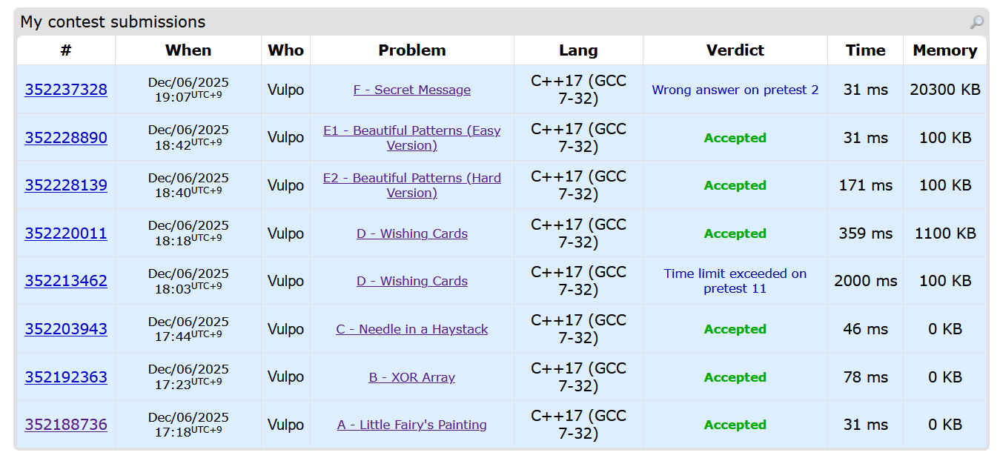
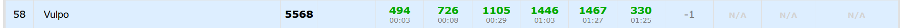

[상위 페이지 · Competitive Programming](/study/algorithms/competitive-programming/)

---

- [A. Little Fairy's Painting](/study/algorithms/competitive-programming/codeforce-round-1069-div-2/a-little-fairy-s-painting/)

- [B. XOR Array](/study/algorithms/competitive-programming/codeforce-round-1069-div-2/b-xor-array/)

- [C. Needle in a Haystack](/study/algorithms/competitive-programming/codeforce-round-1069-div-2/c-needle-in-a-haystack/)

- [D. Wishing Cards](/study/algorithms/competitive-programming/codeforce-round-1069-div-2/d-wishing-cards/)

- [E. Beautiful Patterns](/study/algorithms/competitive-programming/codeforce-round-1069-div-2/e-beautiful-patterns/)
