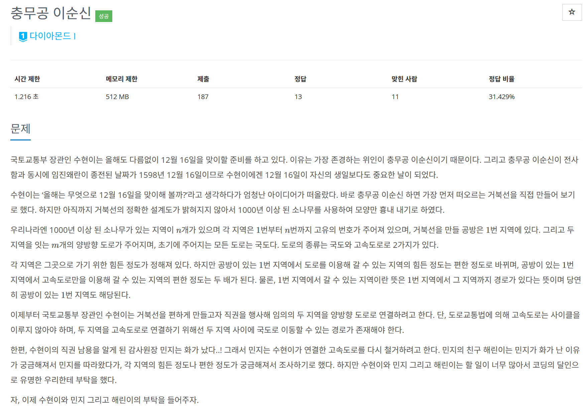
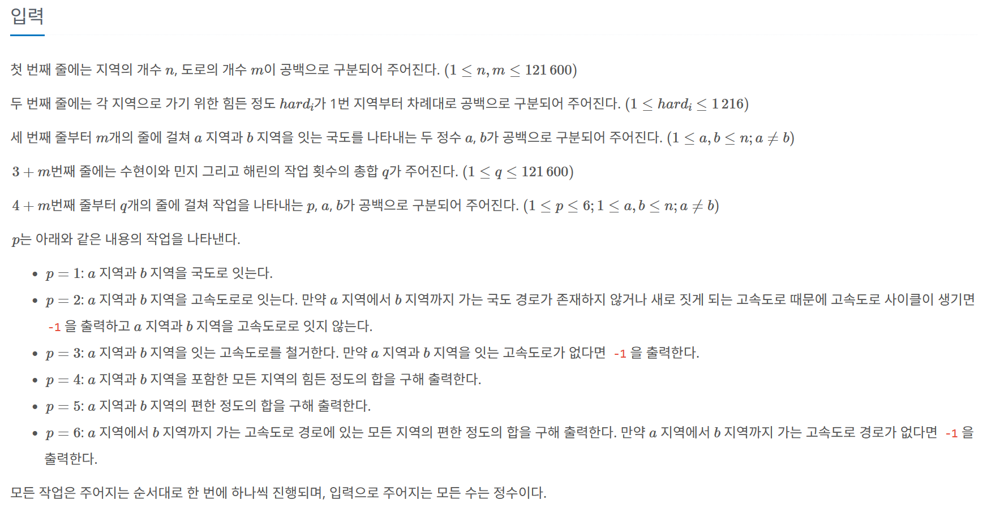

[상위 페이지 · 다이아](/study/algorithms/data-structure/diamond/)





## 문제 태그

- 자료 구조
- 트리
- 분리 집합
- 링크 컷 트리

## 아이디어

- 국도는 분리 집합으로, 고속도로는 LCT로 관리한다.
- 1번 쿼리
    - 국도를 연결하는 것이므로 분리 집합으로 a와 b를 묶어준다.
- 2번 쿼리
    - 고속도로를 연결하는 것이므로 이미 연결되어 있지 않다면 LCT로 연결해준다.
- 3번 쿼리
    - 고속도로에 대한 컷이므로 LCT를 이용해 cut해준다.
- 4번 쿼리
    - 분리 집합에서 1번 노드가 속한 대표 노드를 가져와서 1번 노드와 연결된 노드를 제외한 다른 노드들의 합을 구한다.
- 5번 쿼리
    - 우선 분리 집합으로 a→1, 1→b에 대한 경로가 존재하는지 확인하고 존재한다면 LCT에서 a→1, 1→b 경로 쿼리를 통해 두 배수를 할지 말지 결정한다.
- 6번 쿼리
    - a→1에 대한 경로가 있다면 a→b까지 경로를 쿼리하여 2배, 경로가 없다면 1배수로 출력한다.

## 정답

```python
import sys

class LinkCutNode:
    def __init__(self, val=0):
        self.left = None
        self.right = None
        self.parent = None
        self.path_parent = None
        self.rev = False
        self.val = val
        self.sum = val
        self.chain_sum = val
        self.size = 1

    def _is_root(self):
        return not self.parent or (self.parent.left is not self and self.parent.right is not self)

    def _update(self):
        self.sum = self.val
        self.chain_sum = self.val
        self.size = 1
        if self.left:
            self.sum += self.left.sum
            self.chain_sum += self.left.chain_sum
            self.size += self.left.size
        if self.right:
            self.sum += self.right.sum
            self.size += self.right.size
            self.chain_sum += self.right.chain_sum

    def _push(self):
        if self.rev:
            self.left, self.right = self.right, self.left
            if self.left:
                self.left.rev ^= True
            if self.right:
                self.right.rev ^= True
            self.rev = False

    def _rotate(self):
        p = self.parent
        g = p.parent
        if not p._is_root():
            if g.left is p:
                g.left = self
            else:
                g.right = self
        self.parent = g
        if p.left is self:
            p.left = self.right
            if self.right:
                self.right.parent = p
            self.right = p
        else:
            p.right = self.left
            if self.left:
                self.left.parent = p
            self.left = p
        p.parent = self
        self.path_parent = p.path_parent
        p.path_parent = None
        p._update()
        self._update()

    def splay(self):
        stack = []
        node = self
        while True:
            stack.append(node)
            if node._is_root():
                break
            node = node.parent
        for n in reversed(stack):
            n._push()
        while not self._is_root():
            p = self.parent
            g = p.parent
            if not p._is_root():
                if (p.left is self) == (g.left is p):
                    p._rotate()
                else:
                    self._rotate()
            self._rotate()

    def access(self):
        last = None
        x = self
        while x:
            x.splay()
            if x.right:
                x.right.path_parent = x
                x.right.parent = None
            x.right = last
            if last:
                last.parent = x
            x._update()
            last = x
            x = x.path_parent
        self.splay()
        return last

    def make_root(self):
        self.access()
        self.rev ^= True
        self._push()

    def find_root(self):
        self.access()
        x = self
        while True:
            x._push()
            if x.left:
                x = x.left
            else:
                break
        x.splay()
        return x

    def connected(self, other):
        return self.find_root() is other.find_root()

    def link(self, other):
        self.make_root()
        if self.find_root() is not other.find_root():
            self.path_parent = other

    def cut(self, other):
        self.make_root()
        other.access()
        other._push()
        if other.left is self and not self.left and not self.right:
            other.left.parent = None
            other.left = None
            other._update()
        elif other.right is self and not self.left and not self.right:
            other.right.parent = None
            other.right = None
            other._update()

    def query(self, other):
        self.make_root()
        other.access()
        return other.chain_sum

    def update(self, value):
        self.access()
        self.val = value
        self._update()

    def get_parent(self):
        self.access()
        if not self.left:
            return None
        parent = self.left
        parent._push()
        while parent.right:
            parent = parent.right
            parent._push()
        parent.splay()
        return parent

    def get_depth(self):
        self.access()
        if self.left:
            return self.left.size
        return 0

    def get_LCA(self, other):
        if not self.connected(other):
            return None
        self.access()
        last = other.access()
        self.splay()
        if self == last:
            return self
        return last

class UF:
    def __init__(self, n, hard):
        self.parent = list(range(n + 1))
        self.rank = [0] * (n + 1)
        self.comp_sum = [0] + hard[1:]
        self.comp_size = [1] * (n + 1)

    def find(self, x):
        if self.parent[x] != x:
            self.parent[x] = self.find(self.parent[x])
        return self.parent[x]

    def union(self, x, y):
        px = self.find(x)
        py = self.find(y)
        if px == py:
            return False
        if self.rank[px] < self.rank[py]:
            self.parent[px] = py
            self.comp_sum[py] += self.comp_sum[px]
            self.comp_size[py] += self.comp_size[px]
        elif self.rank[px] > self.rank[py]:
            self.parent[py] = px
            self.comp_sum[px] += self.comp_sum[py]
            self.comp_size[px] += self.comp_size[py]
        else:
            self.parent[py] = px
            self.comp_sum[px] += self.comp_sum[py]
            self.comp_size[px] += self.comp_size[py]
            self.rank[px] += 1
        return True

    def same(self, x, y):
        return self.find(x) == self.find(y)

def main():
    input = sys.stdin.readline
    n,m = map(int, input().split())
    hard = [0] + list(map(int, input().split()))
    total_hard = sum(hard[1:])
    uf = UF(n, hard)
    nodes = [None] * (n + 1)
    for i in range(1, n + 1):
        nodes[i] = LinkCutNode(hard[i])
    for _ in range(m):
        a,b = map(int, input().split())
        uf.union(a, b)
    q = int(input())
    outputs = []
    for _ in range(q):
        k,a,b = map(int, input().split())
        if k == 1:
            uf.union(a, b)
        elif k == 2:
            if not uf.same(a, b):
                outputs.append('-1')
                continue
            if nodes[a].connected(nodes[b]):
                outputs.append('-1')
                continue
            nodes[a].link(nodes[b])
        elif k == 3:
            pa = nodes[a].get_parent()
            pb = nodes[b].get_parent()
            if pa == nodes[b]:
                nodes[a].cut(nodes[b])
            elif pb == nodes[a]:
                nodes[b].cut(nodes[a])
            else:
                outputs.append('-1')
        elif k == 4:
            p1 = uf.find(1)
            s = uf.comp_sum[p1]
            outputs.append(str(total_hard - s))
        elif k == 5:
            sa = 0
            if uf.same(a, 1):
                mult = 2 if nodes[a].connected(nodes[1]) else 1
                sa = hard[a] * mult
            sb = 0
            if uf.same(b, 1):
                mult = 2 if nodes[b].connected(nodes[1]) else 1
                sb = hard[b] * mult
            outputs.append(str(sa + sb))
        elif k == 6:
            if not nodes[a].connected(nodes[b]):
                outputs.append('-1')
                continue
            mult = 2 if nodes[a].connected(nodes[1]) else 1
            path_sum = nodes[a].query(nodes[b])
            outputs.append(str(path_sum * mult))
    print('\n'.join(outputs))

if __name__ == "__main__":
    main()
```
