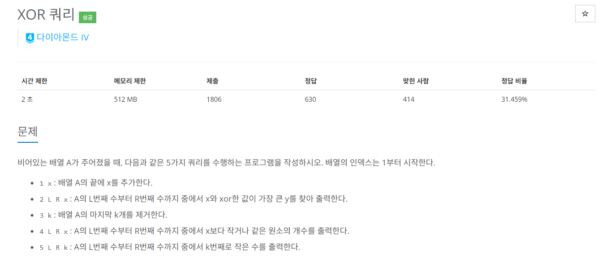
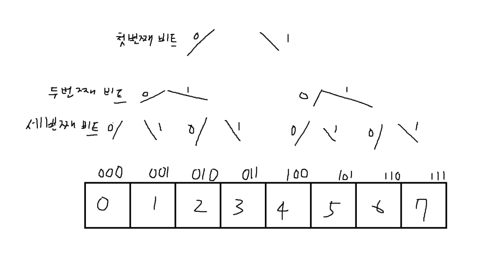

[상위 페이지 · 다이아](/study/algorithms/data-structure/diamond/)



## 문제 태그

- 자료구조
- 세그먼트 트리
- 영속적 세그먼트 트리

## 아이디어

- 문제를 분석해보면 이전 버전이 유지되어야 하므로 영속적 세그먼트 트리를 사용해야 함.
- 아래 연산 특징을 보면 알겠지만 리프 노드의 개수를 (1<<19)-1 개로 해야 함 (x의 범위가 500000이기 때문).
- 각 연산별 특징:
    - 연산 1: 요소 x를 추가할 때마다 트리의 버전이 증가함.
    - 연산 2: R버전-L버전 범위에서 XOR 값이 최대가 되는 요소를 찾는 비트 탐색.
        
        
        
        - 위 사진처럼 비트적인 특징을 이용해서:
        - x를 2진수로 표현했을 때, 현재 비트가 1이면 왼쪽(0) 노드로 이동.
        - 현재 비트가 0이면 오른쪽(1) 노드로 이동.
    - 연산 3: 트리를 k 버전만큼 롤백.
    - 연산 4: R버전-L버전 범위에서 0~x까지의 누적합 계산.
    - 연산 5: R버전-L버전 범위에서 k번째 요소 찾기.
        - 만약 왼쪽 자식 노드의 요소 개수가 k보다 크거나 같으면 왼쪽으로 탐색 진행.
        - 왼쪽 자식 노드의 요소 개수가 k보다 작으면 오른쪽으로 탐색하고, k값을 (k - 왼쪽 노드 요소 개수)로 업데이트.

## 정답

```python
END = (1<<19) - 1

class Node:
    def __init__(self):
        self.left = None
        self.right = None
        self.value = 0

def build(left, right):
    node = Node()
    if left == right:
        return node
    mid = (left + right) // 2
    node.left = build(left, mid)
    node.right = build(mid + 1, right)
    return node

root = [build(0, END)]

def update(x):
    root.append(_update(root[-1], 0, END, x))

def _update(node, left, right, x):
    if x < left or x > right:
        return node
    new_node = Node()
    if left == right:
        new_node.value = node.value + 1
        return new_node
    mid = (left + right) // 2
    new_node.left = _update(node.left, left, mid, x)
    new_node.right = _update(node.right, mid + 1, right, x)
    new_node.value = new_node.left.value + new_node.right.value
    return new_node

def query(version, left, right):
    return _query(root[version], 0, END, left, right)

def _query(node, left, right, ql, qr):
    if qr < left or right < ql:
        return 0
    if ql <= left and right <= qr:
        return node.value
    mid = (left + right) // 2
    return _query(node.left, left, mid, ql, qr) + _query(node.right, mid + 1, right, ql, qr)

def delete(x):
    for _ in range(x):
        root.pop()

def count(node):
    return node.value if node else 0

def xor(left, right, x):
    now_l = root[left - 1] if left > 0 else root[0]
    now_r = root[right]
    l, r = 0, END
    for i in range(18, -1, -1):  # 19비트
        bit = (x >> i) & 1
        mid = (l + r) // 2
        if bit == 0:
            if count(now_r.right) - count(now_l.right) > 0:
                now_l = now_l.right
                now_r = now_r.right
                l = mid + 1
            else:
                now_l = now_l.left
                now_r = now_r.left
                r = mid
        else:
            if count(now_r.left) - count(now_l.left) > 0:
                now_l = now_l.left
                now_r = now_r.left
                r = mid
            else:
                now_l = now_l.right
                now_r = now_r.right
                l = mid + 1
    return l

def _kth(left_root, right_root, left, right, k):
    if left == right:
        return left
    mid = (left + right) // 2
    left_count = count(right_root.left) - count(left_root.left)
    if k <= left_count:
        return _kth(left_root.left, right_root.left, left, mid, k)
    else:
        return _kth(left_root.right, right_root.right, mid + 1, right, k - left_count)

def kth(left,right,k):
    return _kth(root[left - 1], root[right], 0, END, k)

M = int(input())
result = []
for _ in range(M):
    cmd, *args = map(int, input().split())
    if cmd == 1:
        update(args[0])
    elif cmd == 2:
        result.append(xor(args[0], args[1], args[2]))
    elif cmd == 3:
        delete(args[0])
    elif cmd == 4:
        result.append(query(args[1], 0, args[2]) - query(args[0] - 1, 0, args[2]))
    elif cmd == 5:
        result.append(kth(args[0],args[1],args[2]))

print("\n".join(map(str, result)))

```
