[상위 페이지 · Data Structure](/study/algorithms/data-structure/)

힙은 완전 이진 트리(Complete Binary Tree)를 기본으로 하는 자료구조이다. 힙은 최댓값 또는 최솟값을 빠르게 찾아내는 연산을 위해 고안되었다.

## 힙의 종류

- **최대 힙(Max Heap)**: 부모 노드의 키 값이 자식 노드의 키 값보다 크거나 같은 완전 이진 트리이다.
- **최소 힙(Min Heap)**: 부모 노드의 키 값이 자식 노드의 키 값보다 작거나 같은 완전 이진 트리이다.

## 힙의 특징

- 힙은 완전 이진 트리이므로 배열로 표현하기 적합하다.
- 배열 인덱스가 0부터 시작할 경우:
    - 부모 노드 인덱스 = (자식 노드 인덱스 - 1) / 2
    - 왼쪽 자식 노드 인덱스 = (부모 노드 인덱스 * 2) + 1
    - 오른쪽 자식 노드 인덱스 = (부모 노드 인덱스 * 2) + 2
- 힙은 우선순위 큐(Priority Queue)를 구현하는 데 효율적이다.
- 힙의 높이는 O(log n)이며, 삽입과 삭제 연산의 시간 복잡도는 O(log n)이다.

## 힙의 주요 연산

### 요소 삽입

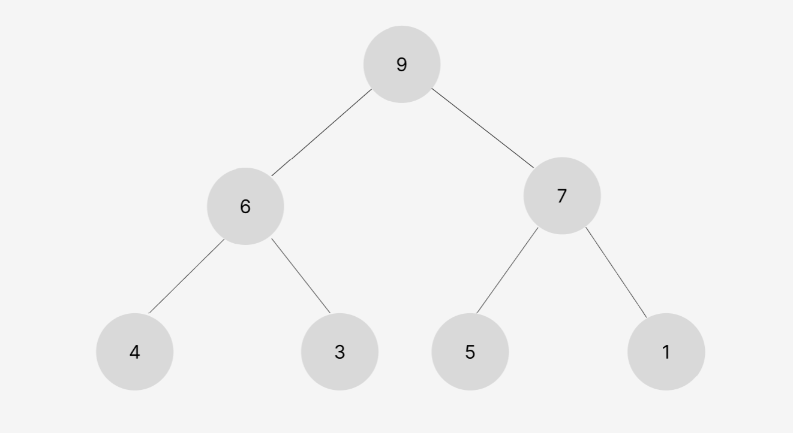

위와 같은 힙에 10을 삽입하는 과정을 나타내겠다. 힙은 완전 이진 트리여야 하므로 새로운 요소는 항상 제일 마지막 레벨의 가장 왼쪽 빈 자리에 삽입된다.

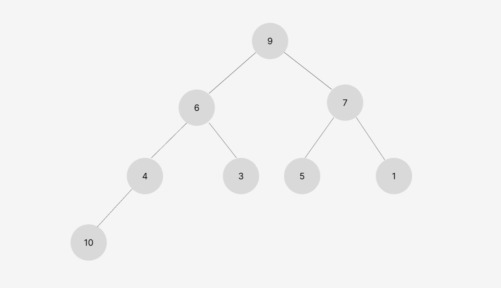

<aside markdown="1">
💡

**다른 케이스**

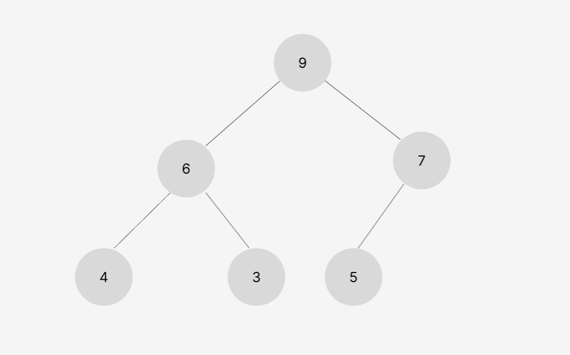

만약 요소 1 자리가 비어 있다면 요소 1자리로 가게 된다. 이는 완전 이진 트리의 속성을 유지하기 위함이다.

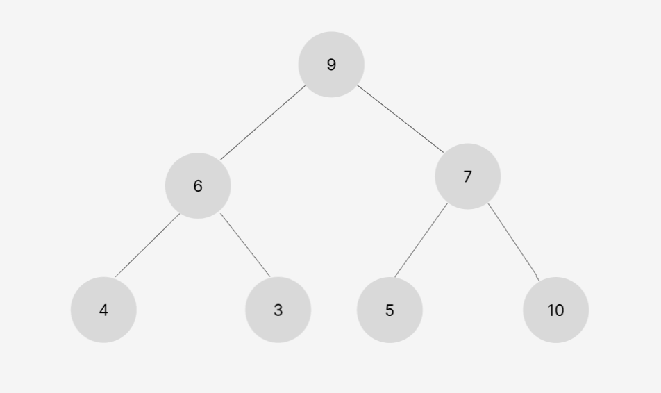

</aside>

마지막 위치에 새 요소를 삽입한 후에는 힙의 속성(부모 노드가 자식 노드보다 크거나 같음)을 유지하기 위해 부모 노드와 비교하면서 필요한 경우 위치를 교환한다. 이 과정을 삽입한 노드가 올바른 위치를 찾을 때까지 반복한다.

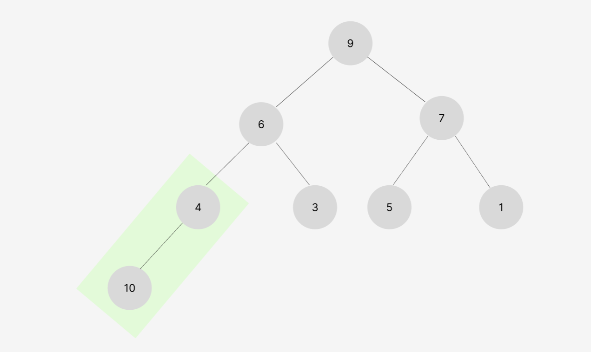

먼저, 10이 부모 노드 4보다 크므로 두 값을 교환한다.

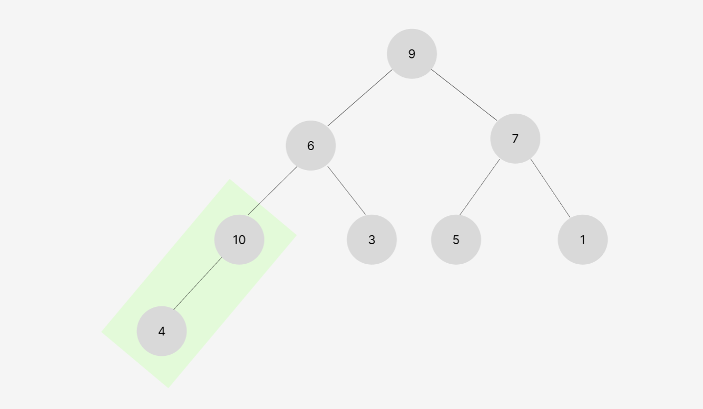

다음으로, 10이 새로운 부모 노드인 6보다 크므로 다시 두 값을 교환한다.

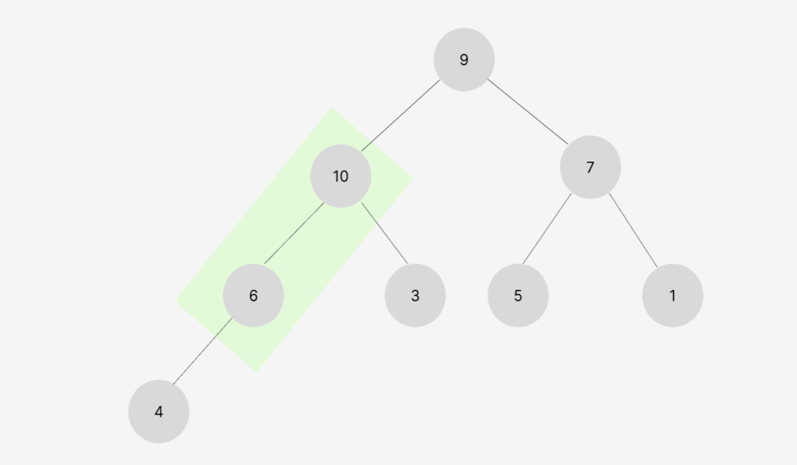

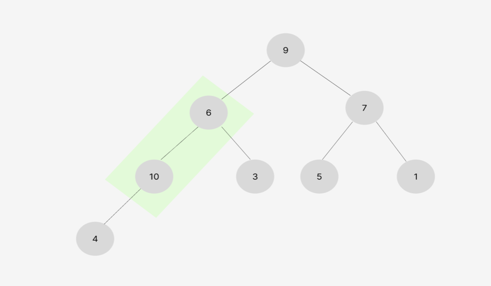

마지막으로, 10이 현재 부모 노드인 9보다 크므로 또 한 번 교환한다. 이로써 10은 새로운 루트 노드가 된다.

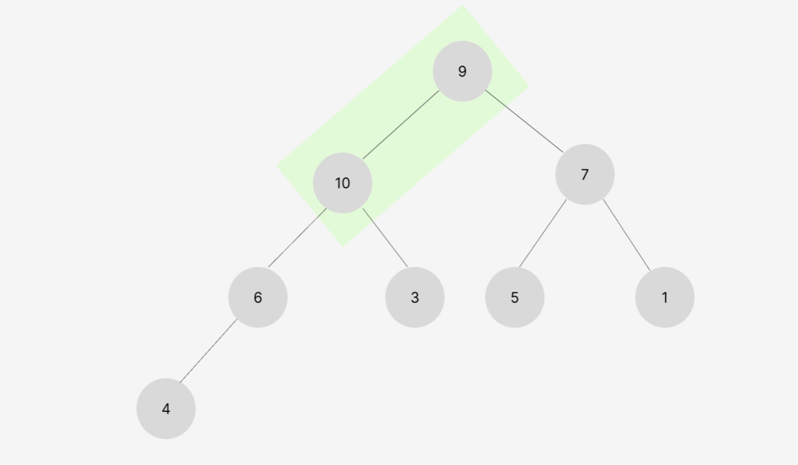

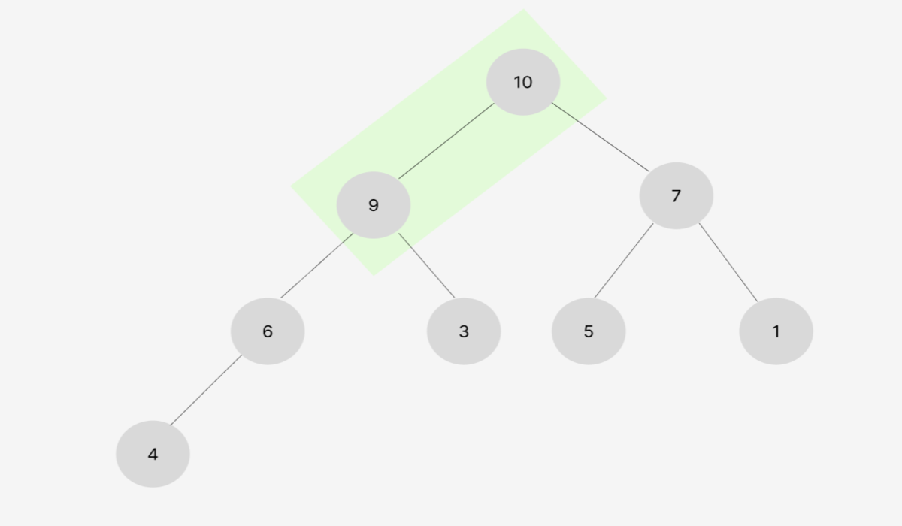

### 요소 삭제

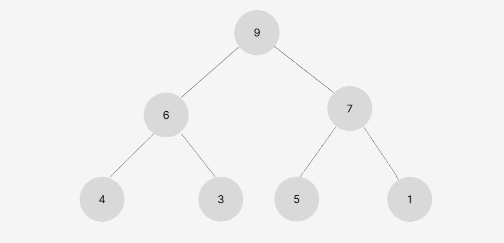

요소 삭제는 우선 루트 노드(최댓값)를 추출하고 힙의 가장 마지막 요소를 루트 위치로 이동시킨다. 이는 완전 이진 트리의 구조를 유지하기 위함이다.

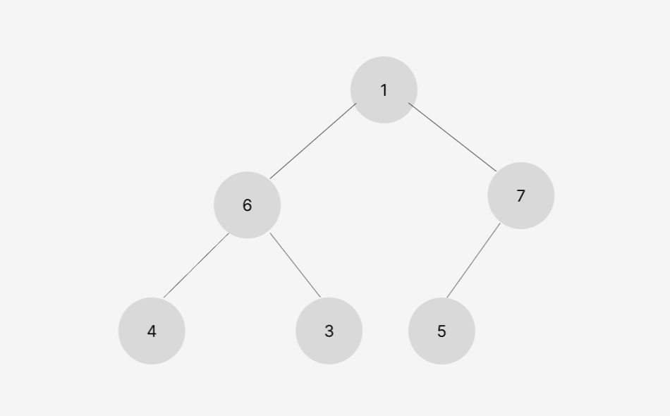

이후 루트로 올라온 값이 힙의 속성을 만족하도록 재정렬 과정을 시작한다. 현재 노드의 두 자식 노드 중 더 큰 값을 가진 자식과 비교하여, 자식이 더 크다면 두 노드를 교환한다.

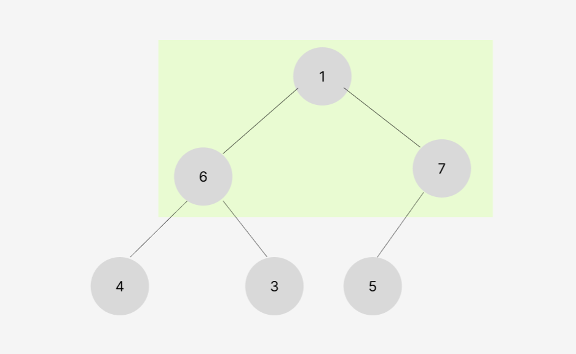

위 그림에서는 루트 노드 1의 자식 노드인 6과 7을 비교했을 때 7이 더 크므로, 1과 7을 교환한다.

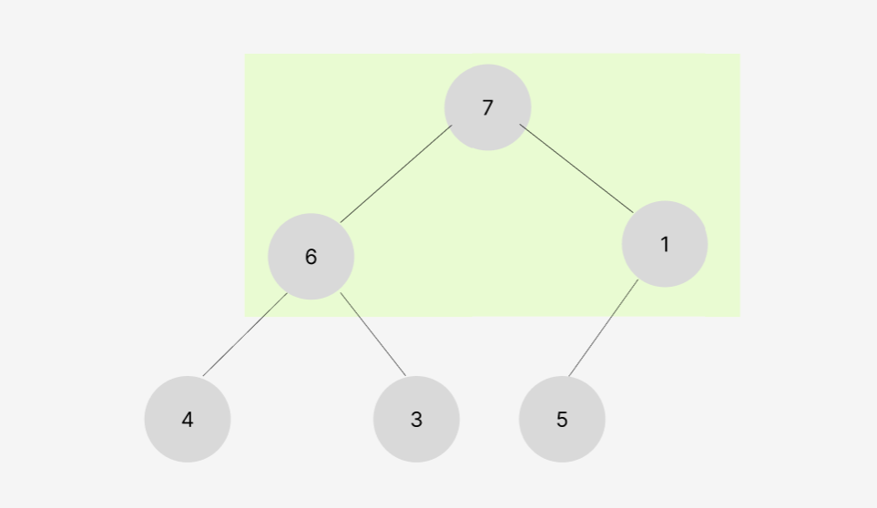

교환 후 1이 내려간 위치에서 다시 그 자식 노드들과 비교한다. 1의 자식인 4와 5 중에서 5가 더 크므로 1과 5를 교환한다.

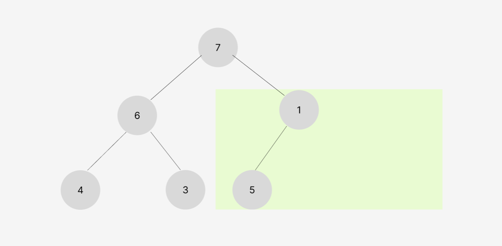

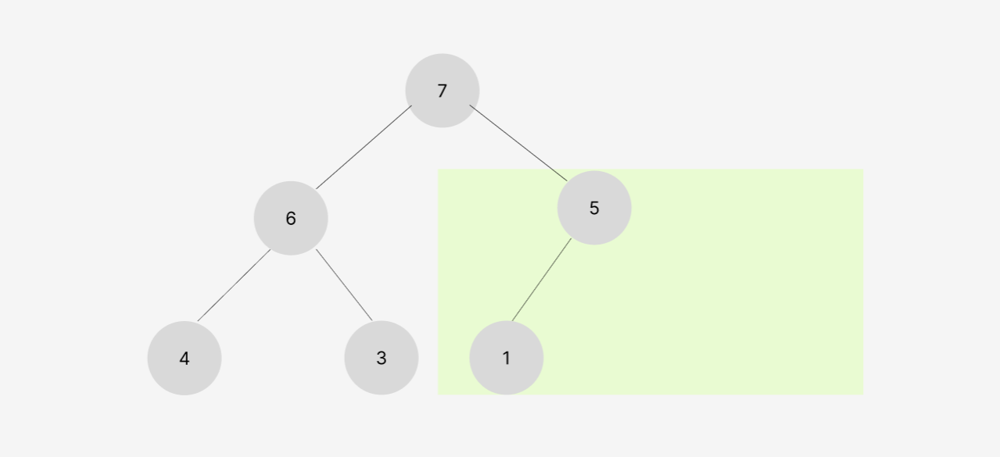

이러한 과정을 계속 반복하여 노드가 적절한 위치에 도달하거나 잎 노드에 도달할 때까지 진행한다. 결과적으로 힙의 속성이 다시 만족되어 최대 힙의 구조가 유지된다.

## 힙 구현

### 1. 힙의 구조 정의

```c
#define MAX_HEAP_SIZE 100

// 최대 힙 구조체 정의
typedef struct {
    int heap[MAX_HEAP_SIZE];
    int heap_size;
} MaxHeap;

// 힙 초기화 함수
void init_heap(MaxHeap *h) {
    h->heap_size = 0;
}
```

### 2. 요소 삽입 (insert) 메서드

힙에 새로운 요소를 삽입하는 과정은 다음과 같다:

- 힙의 마지막에 새로운 요소를 추가한다.
- 삽입한 요소와 부모 노드를 비교하면서 힙 속성을 만족할 때까지 위로 이동시킨다.

```c
// 최대 힙에 요소 삽입
void insert_max_heap(MaxHeap *h, int item) {
    int i;
    i = ++(h->heap_size);

    // 힙 속성을 만족할 때까지 부모 노드와 비교하며 위로 이동
    while((i != 1) && (item > h->heap[i/2])) {
        h->heap[i] = h->heap[i/2];
        i /= 2;
    }
    h->heap[i] = item;
}
```

### 3. 요소 삭제 (delete) 메서드

힙에서 최대/최소 요소(루트 노드)를 삭제하는 과정은 다음과 같다:

- 루트 노드를 삭제하고 그 값을 저장한다.
- 힙의 마지막 노드를 루트 위치로 이동시킨다.
- 루트부터 시작하여 자식 노드와 비교하면서 힙 속성을 만족할 때까지 아래로 이동시킨다.

```c
// 최대 힙에서 최댓값 삭제
int delete_max_heap(MaxHeap *h) {
    int item, temp;
    int parent, child;

    // 루트 노드 값 저장 (최댓값)
    item = h->heap[1];
    // 마지막 노드를 임시로 저장
    temp = h->heap[(h->heap_size)--];
    
    parent = 1;
    child = 2;
    
    while(child <= h->heap_size) {
        // 두 자식 중 더 큰 자식 선택
        if((child < h->heap_size) && (h->heap[child] < h->heap[child+1]))
            child++;
            
        // 힙 속성이 만족되면 종료
        if(temp >= h->heap[child])
            break;
            
        // 자식을 한 레벨 위로 이동
        h->heap[parent] = h->heap[child];
        parent = child;
        child *= 2;
    }
    
    h->heap[parent] = temp;
    return item;
}
```

### 5. 힙 구성 (Heapify) 메서드

배열을 힙으로 구성하는 과정은 다음과 같다. 이 방법은 선형 시간 O(n)에 힙을 구성할 수 있어 효율적이다.

```c
// 주어진 노드부터 힙 속성을 만족하도록 재구성
void heapify(int arr[], int n, int i) {
    int largest = i;   // 현재 노드를 가장 큰 값으로 초기화
    int left = 2 * i + 1;
    int right = 2 * i + 2;
    
    // 왼쪽 자식이 부모보다 크면 largest 갱신
    if (left < n && arr[left] > arr[largest])
        largest = left;
    
    // 오른쪽 자식이 현재까지의 가장 큰 값보다 크면 largest 갱신
    if (right < n && arr[right] > arr[largest])
        largest = right;
    
    // largest가 현재 노드가 아니라면 교환하고 해당 서브트리를 재귀적으로 heapify
    if (largest != i) {
        int temp = arr[i];
        arr[i] = arr[largest];
        arr[largest] = temp;
        
        heapify(arr, n, largest);
    }
}

// 배열을 힙으로 구성 (build heap)
void build_heap(int arr[], int n) {
    // 마지막 비단말 노드부터 시작하여 루트까지 heapify 수행
    for (int i = n / 2 - 1; i >= 0; i--)
        heapify(arr, n, i);
}
```

## 전체 코드

다음은 최대 힙의 모든 기능을 구현한 전체 코드

```c
#include <stdio.h>
#include <stdlib.h>

#define MAX_HEAP_SIZE 100

typedef struct {
    int heap[MAX_HEAP_SIZE];
    int heap_size;
} MaxHeap;

// 힙 초기화
void init_heap(MaxHeap *h) {
    h->heap_size = 0;
}

// 힙이 비었는지 확인
int is_empty(MaxHeap *h) {
    return h->heap_size == 0;
}

// 힙이 가득 찼는지 확인
int is_full(MaxHeap *h) {
    return h->heap_size == MAX_HEAP_SIZE - 1;
}

// 힙에 요소 삽입
void insert_max_heap(MaxHeap *h, int item) {
    if (is_full(h)) {
        printf("힙이 가득 찼습니다.\n");
        return;
    }
    
    int i = ++(h->heap_size);
    
    // 부모 노드와 비교하면서 적절한 위치를 찾음
    while ((i != 1) && (item > h->heap[i/2])) {
        h->heap[i] = h->heap[i/2];
        i /= 2;
    }
    h->heap[i] = item;
}

// 힙에서 최댓값 삭제
int delete_max_heap(MaxHeap *h) {
    if (is_empty(h)) {
        printf("힙이 비어있습니다.\n");
        return -1;
    }
    
    int item = h->heap[1];
    int temp = h->heap[(h->heap_size)--];
    
    int parent = 1;
    int child = 2;
    
    while (child <= h->heap_size) {
        // 두 자식 중 더 큰 자식 선택
        if ((child < h->heap_size) && (h->heap[child] < h->heap[child+1]))
            child++;
        
        // 힙 속성이 만족되면 종료
        if (temp >= h->heap[child])
            break;
        
        // 자식을 한 레벨 위로 이동
        h->heap[parent] = h->heap[child];
        parent = child;
        child *= 2;
    }
    
    h->heap[parent] = temp;
    return item;
}

// 힙 출력
void print_heap(MaxHeap *h) {
    printf("힙 내용: ");
    for (int i = 1; i <= h->heap_size; i++)
        printf("%d ", h->heap[i]);
    printf("\n");
}

// 메인 함수
int main() {
    MaxHeap heap;
    init_heap(&heap);
    
    // 힙에 요소 삽입
    insert_max_heap(&heap, 10);
    insert_max_heap(&heap, 5);
    insert_max_heap(&heap, 30);
    insert_max_heap(&heap, 8);
    insert_max_heap(&heap, 9);
    insert_max_heap(&heap, 3);
    insert_max_heap(&heap, 7);
    
    print_heap(&heap);
    
    // 힙에서 요소 삭제 및 출력
    printf("삭제된 최댓값: %d\n", delete_max_heap(&heap));
    print_heap(&heap);
    
    printf("삭제된 최댓값: %d\n", delete_max_heap(&heap));
    print_heap(&heap);
    
    return 0;
}
```

## 힙의 시간 복잡도

| 연산 | 시간 복잡도 |
| --- | --- |
| 삽입 (Insert) | O(log n) |
| 삭제 (Delete) | O(log n) |
| 최댓값/최솟값 검색 | O(1) |
| 힙 구성 (Heapify) | O(n) |
| 힙 정렬 (Heap Sort) | O(n log n) |
