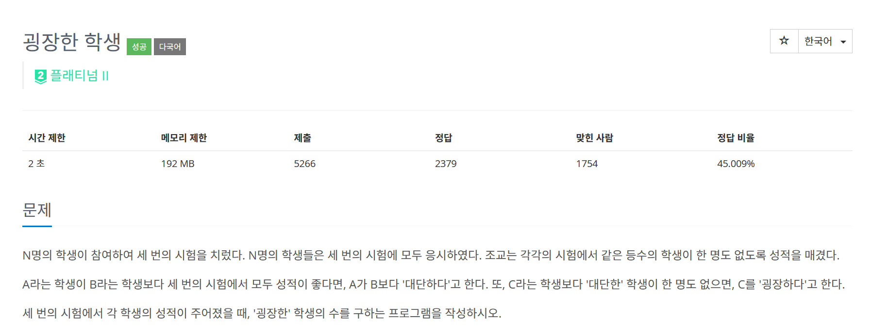

[상위 페이지 · 플래티넘](/study/algorithms/data-structure/platinum/)



## 문제 태그

- 자료구조
- 세그먼트 트리

## 아이디어

중요한건 굉장한 학생을 찾는것보다 굉장하지 않은 학생을 찾는것 그를 위한 방법은

1. **시험1 등수(a) 기준 오름차순 정렬** → 현재 학생보다 시험1 등수가 낮은 학생만 앞에 위치
2. 정렬 순서대로 처리하며, **이전 학생들의 시험2 등수(b) 기준으로 b 이하 구간에서 시험3 등수(c)의 최소값 추적**
3. 만약 b 이하 구간의 시험3 최소값이 현재 학생의 c보다 작거나 같다면 → **"굉장하지 않음"** (더 뛰어난 학생 존재)
4. 그런 학생이 없다면 → **"굉장함"** (현재까지 최상위)
5. **세그먼트 트리/펜윅 트리** 사용: 시험2 등수를 인덱스로, 시험3 최소값 관리 → tree[0~자기 시험2등수] = min(시험3 등수) < 자기 시험3등수

## 정답

```jsx
import sys
input = sys.stdin.readline

N = int(input())

exam1 = list(map(int, input().split()))
exam2 = list(map(int, input().split()))
exam3 = list(map(int, input().split()))

student_ranks = [None] * (N + 1)

for rank, student in enumerate(exam1, 1):
    if student_ranks[student] is None:
        student_ranks[student] = [0, 0, 0]
    student_ranks[student][0] = rank

for rank, student in enumerate(exam2, 1):
    student_ranks[student][1] = rank

for rank, student in enumerate(exam3, 1):
    student_ranks[student][2] = rank

students = sorted(student_ranks[1:])
size = ((N + 1)*4)
tree = [sys.maxsize] * size

def update(idx, value):
    while idx < size:
        tree[idx] = min(tree[idx], value)
        idx += idx & -idx

def query(idx):
    res = sys.maxsize
    while idx > 0:
        res = min(res, tree[idx])
        idx -= idx & -idx
    return res

count = 0
for first, second, third in students:
    if query(second) < third:
        continue
    else:
        count += 1
    update(second,third)

print(count)
```
