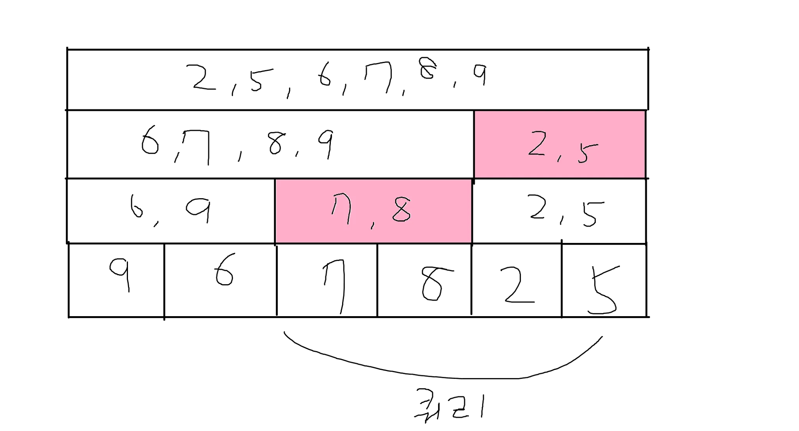

[상위 페이지 · Segment Tree](/study/algorithms/data-structure/segment-tree/)

머지 소트 트리는 정렬된 배열들을 세그먼트 트리 형태로 저장하여 구간 쿼리를 효율적으로 처리하는 자료구조이다.

## 배경

세그먼트 트리의 확장된 형태로, 각 노드가 해당 구간의 원소들을 정렬된 상태로 저장하는 특징이 있다. 구간에서 특정 값보다 작거나 큰 원소의 개수를 빠르게 찾을 수 있다는 장점이 있다.

## 장단점

### 장점

- 구간 내의 정렬된 상태를 유지하므로 이진 탐색이 가능하다
- 구간 쿼리를 효율적으로 처리할 수 있다
- 값의 범위에 제한이 없다

### 단점

- 공간 복잡도가 O(NlogN)으로 큰 편이다
- 구현이 복잡하다
- 수정 연산이 어렵다

## 구현 (Python)

```python
class MergeSortTree:
    def __init__(self, arr):
        self.n = len(arr)
        self.tree = [[] for _ in range(4 * self.n)]
        self._build(arr, 1, 0, self.n - 1)
    
    def _build(self, arr, node, start, end):
        if start == end:
            self.tree[node] = [arr[start]]
            return
        
        mid = (start + end) // 2
        self._build(arr, node * 2, start, mid)
        self._build(arr, node * 2 + 1, mid + 1, end)
        self.tree[node] = self._merge(self.tree[node * 2], self.tree[node * 2 + 1])
        
    def _merge(self, left, right):
        result = []
        i = j = 0
        while i < len(left) and j < len(right):
            if left[i] <= right[j]:
                result.append(left[i])
                i += 1
            else:
                result.append(right[j])
                j += 1
        result.extend(left[i:])
        result.extend(right[j:])
        return result
    
    def query(self, left, right, k):
        return self._query(1, 0, self.n - 1, left, right, k)
    
    def _query(self, node, start, end, left, right, k):
        if right < start or end < left:
            return 0
        if left <= start and end <= right:
            return self._count_less_equal(self.tree[node], k)
        
        mid = (start + end) // 2
        return (self._query(node * 2, start, mid, left, right, k) +
                self._query(node * 2 + 1, mid + 1, end, left, right, k))
    
    def _count_less_equal(self, arr, k):
        left, right = 0, len(arr)
        while left < right:
            mid = (left + right) // 2
            if arr[mid] <= k:
                left = mid + 1
            else:
                right = mid
        return left

```

## 주요 함수 설명

### 1. 초기화 함수 (**init**)

```python
def __init__(self, arr):
    self.n = len(arr)
    self.tree = [[] for _ in range(4 * self.n)]
    self._build(arr, 1, 0, self.n - 1)

```

- 입력 배열의 길이를 저장한다
- 세그먼트 트리를 위한 공간을 할당한다
- build 함수를 호출하여 트리를 구성한다

### 2. 트리 구축 함수 (_build)

```python
def _build(self, arr, node, start, end):
    if start == end:
        self.tree[node] = [arr[start]]
        return
    
    mid = (start + end) // 2
    self._build(arr, node * 2, start, mid)
    self._build(arr, node * 2 + 1, mid + 1, end)
    self.tree[node] = self._merge(self.tree[node * 2], self.tree[node * 2 + 1])

```

- 재귀적으로 트리를 구축한다
- 리프 노드에는 단일 원소를 저장한다
- 내부 노드는 자식 노드들의 정렬된 배열을 병합한다

### 3. 배열 병합 함수 (_merge)

```python
def _merge(self, left, right):
    result = []
    i = j = 0
    while i < len(left) and j < len(right):
        if left[i] <= right[j]:
            result.append(left[i])
            i += 1
        else:
            result.append(right[j])
            j += 1
    result.extend(left[i:])
    result.extend(right[j:])
    return result

```

- 두 정렬된 배열을 하나의 정렬된 배열로 병합한다
- 병합 정렬의 merge 과정과 동일하다

### 4. 쿼리 함수 (query)

```python
def query(self, left, right, k):
    return self._query(1, 0, self.n - 1, left, right, k)

```

- 주어진 구간 [left, right]에서 k보다 작거나 같은 원소의 개수를 반환한다

## 그림 표현




## 시간 복잡도

1. 트리 구축: O(NlogN)
2. 쿼리 처리: O(log²N)
3. 공간 복잡도: O(NlogN)

## 적용 사례

- 구간에서 K번째 수 찾기 문제
- 구간에서 특정 값보다 작은/큰 원소의 개수 구하기
- 구간에서 중앙값(median) 찾기

예시 문제:

- BOJ 13537: 수열과 쿼리 1
- BOJ 13544: 수열과 쿼리 3
- BOJ 7469: K번째 수
