[상위 페이지 · Data Structure](/study/algorithms/data-structure/)

## 배경지식

이는 배경지식이 필요한 알고리즘으로 학습하기 전에 다음 알고리즘들에 대한 사전 지식이 필요하다.

- [Link-Cut Tree (링크 컷 트리)](/study/algorithms/unsorted/link-cut-tree-ringkeu-keos-teuri/)
- [Splay Tree](/study/algorithms/data-structure/splay-tree/)
- [*Dynamic Tree DP*](/study/algorithms/unsorted/dynamic-tree-dp/)

내용은 다음 논문을 기반으로 한다.

[Top-trees and dynamic graph algorithms.pdf](/assets/images/study/algorithms/top-trees-and-dynamic-graph-algorithms-86ce8b43.pdf)

[Maintaining Information in Fully-Dynamic.pdf](/assets/images/study/algorithms/maintaining-information-in-fully-dynamic-0ec38a6c.pdf)

[self-adjusting-top-tree.pdf](/assets/images/study/algorithms/self-adjusting-top-tree-f83a8798.pdf)

## 개요

대게 **동적 그래프(dynamic graph) 문제에서는** 간선의 삽입이나 삭제와 같은 변화가 발생할 때 데이터 구조를 처음부터 다시 계산하지 않고 **동적**으로 **간선을 관리**하여 특정 쿼리를 **효율적으로 처리**하고자 한다.

예를 들어, 중계기지국을 노드로 통신 회선을 간선으로 표현하는 통신 네트워크 그래프에서 다음과 같은 질문들을 해결할 수 있다:

1. 회선이 끊기거나 복구되었을 때 모든 기지국이 여전히 연결되어 있는가?
2. 회선이 끊어졌을 때 기존 회선을 수리하는 것보다 새 회선을 건설하는 것이 더 비용 효율적인가?
    1. 만약 새 회선을 건설해야 한다면 어느 회선을 건설해야 하는가?
3. 어떤 회선이 끊어지더라도 모든 기지국이 연결된 상태를 유지하려면 어떤 회선을 추가로 건설해야 하는가?
4. 기지국 하나가 작동을 멈추었을 때 나머지 기지국들이 서로 연결되어 있는가?

동적 그래프 알고리즘은 동적 트리 데이터 구조를 기반으로 작동한다. 토폴로지 트리가 대표적인 예시이나 이는 최대 차수가 3인 삼진트리에만 적용되고 일반 트리에는 적용할 수 없다는 한계가 있었다. 이러한 한계를 극복하기 위해 탑트리(Top-tree)가 개발되었다.

**탑-트리**는 루트가 없는 **동적 트리**를 위한 자료구조이며 **분할 정복 알고리즘으로 구현**된다. 핵심 개념은 원본 트리 T를 '클러스터'라는 서브 트리들로 재귀적으로 분해하고 이 **클러스터들을 높이가 O(logn)인 이진트리** 형태로 유지하는 것이다.

## 간단한 정리

### 용어

이후 목차에서 더 상세한 설명이 제공될 예정

- **경계 노드(Boundary Node)**:
    - 서브 트리 내부 노드 중 서브트리 외부로 연결된 간선이 하나만 있는 노드
- **클러스터 (Cluster)**:
    - 최대 두 개의 경계 노드를 가지는 서브 트리
- **클러스터 경로 (Cluster Path)**:
    - 경계 노드가 두 개인 경우 이들을 잇는 경로
    - 경로에 간선이 있으면 path-cluster
    - 없으면 leaf-cluster
- **병합 가능성 (Mergeable)**:
    - 두 클러스터 C, D가 정확히 한 노드를 공유하고 그 합집합이 다시 클러스터가 되는 경우
- **조상/자손(Ancestor/Descendant) 관계**:
    - 클러스터 트리상의 관계를 그대로 클러스터 간 관계에 대응

### 외부 연산

- **Link(u,v):**
    - 서로 다른 탑-트리에 있는 두 노드 u와 v를 새로운 간선으로 연결하여 하나의 트리로 통합
- **Cut(e):**
    - 간선 e를 삭제하여 하나의 트리를 두 개의 독립된 트리로 분할
- **Expose(u,v):**
    - 두 노드 u와 v를 외부 경계 노드로 지정하고 이들을 연결하는 최상위 클러스터를 반환
    - Link-Cut 트리의 access 연산처럼 u-v 사이의 경로를 루트 클러스터로 만들어 후속 연산을 최적화함

### 내부 연산

- Create(edge):
    - 새로운 간선으로부터 단일 leaf-edge-cluster를 생성
- Eradicate(edge):
    - 지정된 edge-cluster를 제거
- Merge(C,D):
    - 병합 가능한 두 클러스터 C와 D를 하나의 상위 클러스터로 결합
- Split(C):
    - 클러스터 C를 하위 클러스터들로 분리

## 탑-트리 분할 전략

원본 트리를 (경계 노드 2개 이하, 간선 1~2개인) 클러스터로 어떻게 분할하고, 이 클러스터들을 다시 간선으로 치환하여 상위 레벨 트리를 구성하는지 형식적으로 설명하겠다.

- 클러스터의 정확한 정의
    - 트리 T의 부분트리로, 나머지 T와는 최대 두 개의 경계 노드로만 연결된다
    - 내부에 포함된 간선 수는 1개(simple cluster) 또는 2개(path cluster)로 제한된다
- 클러스터-파티션 트리 $$(CPT_{\phi}(T))$$
    - 어떤 분할 전략 $$\phi$$에 따라 T를 위의 클러스터들로 나눈 뒤
    - 각 클러스터를 하나의 간선으로 치환하여 만든 새 트리
    - 이 새 트리에서는
        - 원본 클러스터가 간선 하나면 단순(simple) 간선
        - 두 개면 합성(composite) 간선으로 표시
- 분할 전략 요구조건
    - 분할 전략 $$\phi$$는 다음 두 가지를 만족해야 함
    - 수축 비율(R1)
        - 모든 트리 T에 대해
        
        $$
        |CPT_{\phi}(T)| ≤ \alpha|T|, 0<\alpha < 1
        $$
        
        - 상수 $$\alpha$$만큼 트리 크기가 줄어들어야 함
    - 국소 갱신(R2)
        - 최하위 레벨에서 간선 하나가 삽입, 삭제될 때 상위 모든 레벨의 CPT를 상수 개의 간선 삽입, 삭제만으로 갱신할 수 있어야 함
    - 이 분할 전략으로 분할의 레벨 수가 O(logn)로 제한되고 삽입, 삭제 시에도 각 레벨당 O(1) 작업만 필요함이 보장됨

### Maxmimal Restricted Partition (MRP)

가장 널리 쓰이는 분할 전략은 MRP이다.

- Good Cluster 정의
    - 단순 클러스터(simple): 엣지 하나만 포함
    - 짝 클러스터(pair): 서로 인접한 두 엣지를 포함
- 최대 제한 분할(maximal)
    - 가능한 모든 인접 엣지 쌍을 겹치지 않게 묶고 남은 엣지는 단독 클러스터로 둠
    - 이 과정을 국소적 탐욕 알고리즘으로 O(n) 시간에 구할 수 있음

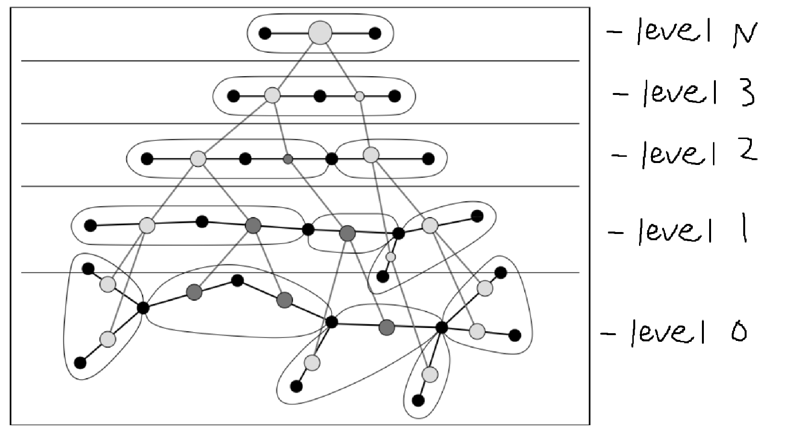

탑 트리 분할 전략 예시

위 그림은 MRP 전략을 다단계 분할 형태로 적용한 예시이다.

- Level 0에서 MRP 규칙에 따라 "인접한 엣지 쌍은 최대한 많이, 서로 겹치지 않게" 묶고 남은 엣지는 단독 클러스터로 둔다.
- Level 1은 Level 0에서 만들었던 클러스터들을 하나의 엣지로 치환한 트리이다.
- 이 MRP 과정을 더 이상 반복할 수 없을 때까지 적용하여 최종적으로 Level N까지 치환한다.

## 원본 트리를 “작은 클러스터” 단위로 병합 연산

 이 단락에서는 어떤 방식으로 간선을 병합하는지 보여준다.

### Compress 연산

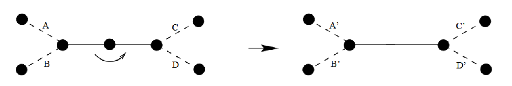

> **목적** : 경로(path) 위에 인접한 두 클러스터를 하나의 더 긴 경로 클러스터로 합친다.
> 
1. 대상 클러스터
    - 두 클러스터 C, D
        - 서로 한개의 경계노드 x를 공유하고,
        - 각자 두 개의 경계노드 (C:{a,x},D:{x,b})를 가진다.
2. 병합 후 경계
    - 새 클러스터 C’는 경계노드 {a,b}를 가진다
    - 내부에 포함된 원본 간선은 C와 D 두 클러스터의 간선을 모두 포함하는 하나의 경로가 된다
3. 효과
    - 경로 길이가 늘어나며 트리 높이를 줄이는 핵심 수단이다
    - “경로 전체를 하나의 클러스터로 본다”는 Expose 연산의 내부 동작

### Rake 연산

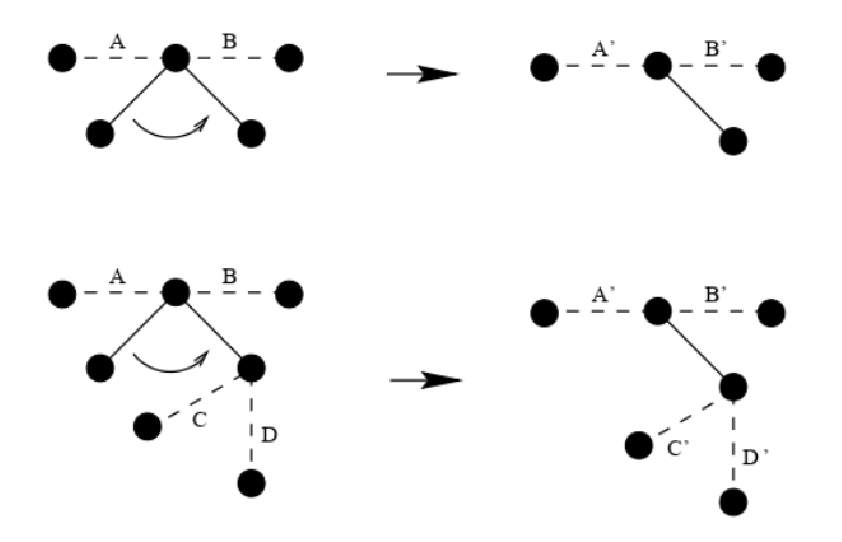

> **목적**: 주 경로(spine)에 리프 클러스터 하나를 걸어 붙여 사이드 가지(branch)를 통합한다
> 
1. 대상 클러스터
    - 리프 클러스터 L은 경계 노드 하나({v})만을 갖는다.
    - 경로 클러스터 P는 경계 노드 두개({u,w})를 갖고 v가 P의 내부 노드 중 하나와 인접해 있다
2. 병합 후 경계
    - 새 클러스터 P’은 P와 같은 경계 {u,w}를 유지한다.
    - 내부에서 P의 간선 + L의 간선을 모두 포함하되 잎 쪽 가지가 걸어 붙여진 형태의 서브트리를 이룬다
3. 효과
    - 주 경로에 사이드 브랜치 하나를 붙여서 한 클러스터로 통합된다
    - 트리의 가지를 모아두었다가 Expose 과정 중 경로 위로 올리는데에 사용된다

---

이러한 두 연산을 통해 최종적으로는 이러한 트리가 완성 된다.

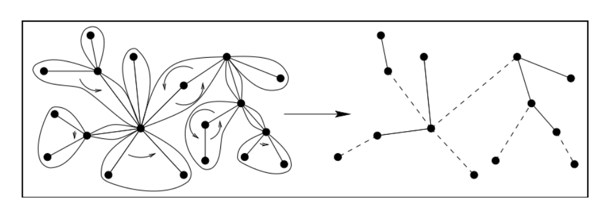

## Self‑Adjusting Top Trees

Self‑Adjusting Top Trees는 Splay Tree의 **자기 조정** 기법을 탑‑트리에 접목한 자료구조로 별도의 균형 인자 없이도 모든 동적 연산 후에 트리 높이가 O(log n)에 유지되도록 설계되었다

### 초기화

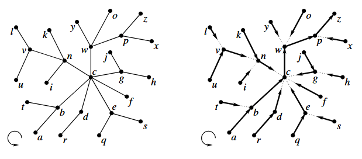

- 루트선택
    - 트리 T에서 임의의 리프 z를 골라 루트로 삼는다.
- 경로 분할
    - T의 모든 간선 집합을 “리프에서 루트 방향으로 가는 경로들”로 나눈다.
    - 단 하나의 경로만이 루트 z에서 끝나는데 이를 root path라고 한다.
    - 나머지 경로들은 모두 다른 경로의 내부 정점에서 끝나며 이 끝점을 기준으로 “path들로 이루어진 트리” 구조를 형성한다.
- 재귀적 초기화
    1. Root path 전체를 하나의 Root cluster로 묶는다.
    2. 그 경로 p의 각 자식 path에 대해 재귀적으로 초기화를 수행하면 해당 자식 subtree가 하나의 간선으로 압축 된다.
    3. 경로 p위에 달린 클러스터들을 rake 연산으로 모은다.
- 순수 경로 압축
    - p에 클러스터가 하나도 없으면 경로 상 홀수 번째 정점을 반복 압축함으로써  p를 하나의 클러스터로 만들 수 있음.
- 클러스터 제거 규칙
    - p에 클러스터가 있으면 압축 직전마다 정점 v에 붙은 두 클러스터를
        - 오른쪽 클러스터 A → v - w에 rake
        - 왼쪽 클러스터 B→ u-v에 rake
        - 후 v를 compress

### 연산

- Handle $$N_v$$
    - Top tree는 간선을 관리하는 자료이기에 정점 표현을 지원하지 않는다. 하지만 Top tree의 일부 연산은 간선이 아닌 정점에 대한 연산이기 때문에 정점 표현이 가능해야한다. 이를 위해 정점 v를 대신할 $$N_v$$를 정의한다.
    - 비리프 노드 v: 마지막으로 compress(v) 된 클러스터 노드
    - 리프 노드 v: “v에서 시작하는 path의 루트”에 해당하는 top-most non-rake 노드
- Guarded Splay
    - Splay 연산을 통해 Top-tree 전체가 아니라 각 Rake/Compress 서브트리 내에서만 구조를 바꿈
    - Splay 노드를 전체 Top tree의 루트로 만드는것이 아니라 그 노드가 포함된 Rake/Compress tree의 루트로 만드는 것
    - Top-tree의 amortized O(logn)을 보장
    - Spaly 연산을 올바르게 적용하기 위해서는 Top tree가 올바른 순서를 가지고 있도록 조정 해줄 필요가 있다. 순서가 올바름을 판별하는 방법은 다음과 같다
        - $$N_x$$가 Compress tree의 루트가 아닐 경우: $$N_x$$의 부모를 $$N_y$$. $$N_x$$의 오른쪽 proper child를 R이라고 하자. R의 양 끝점이 x,y일 경우 순서가 올바름
        - $$N_x$$가 Compress tree의 루트일 경우 : $$N_x$$의 오른쪽 proper child를 R이라 하자. R의 x가 아닌 끝 정점이 리프가 아닐 경우 순서가 올바르다.
        - $$N_x$$가 전체 Top tree의 루트일 경우: 두 자식을 바꿔도, 바꾸지 않아도 된다. 두 자식을 바꾼다면 루트 정점이 바뀌게
- Splice
    - Link-Cut Tree의 Access를 Top-tree에 원자적으로 적용
    
    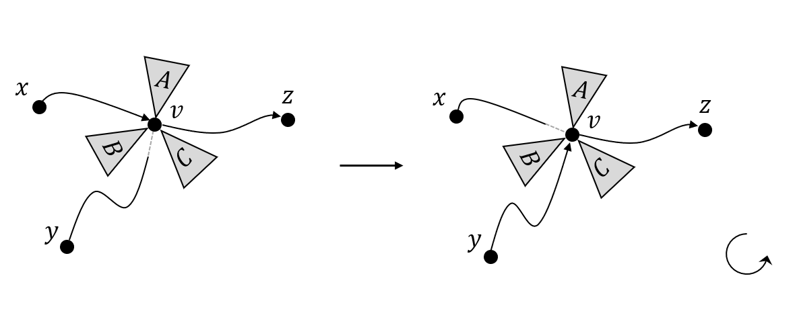
    
    - splice 연산은 트리의 경로 파티션을 바꾼다. 위 그림에서 Splice(y)를 수행하면 경로를 x…v와 v…z로 나누어 둘 중 루트와 가까운 경로를 y가 포함된 경로 $$P_y$$에 연결한다. 이 연산을 y가 루트 정점과 이어질때까지 반복한다.
    - 세세한 과정
        1. p₁, p₂, …, pₖ를 루트→v로 가는 internal path들의 순서라 할 때,
        2. 가장 가까운 pₖ부터 pₖ₋₁을 분할(split)
        3. 루트에 가까운 조각을 pₖ에 **rake** 또는 **compress** 방식으로 붙여 internal path 수열 길이를 1 줄임
        4. p₁이 남을 때까지 반복
        
        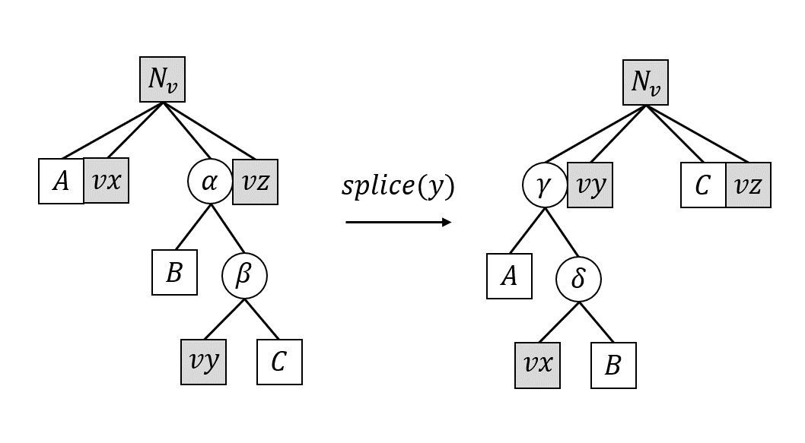
        
    - 실제 splice(y)를 행하면 vx가 vy로 루트에 가깝게 붙어야한다.
    - 다시 한번 얘기하지만 중요한건 A-vx-B-vy-C의 순서는 유지되어야 한다.
    - splice 예시)
    
    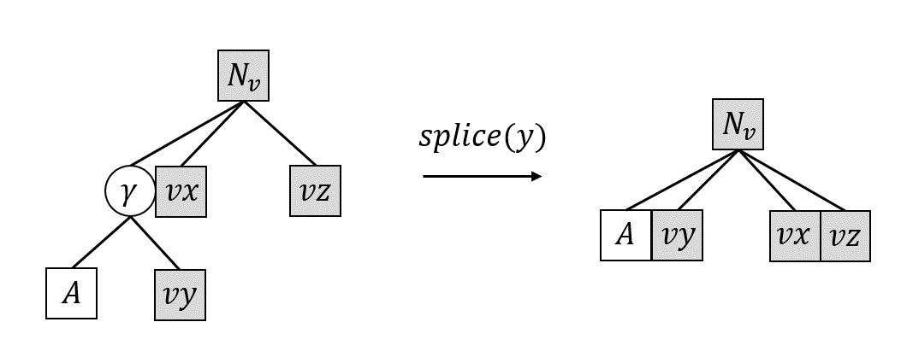
    
    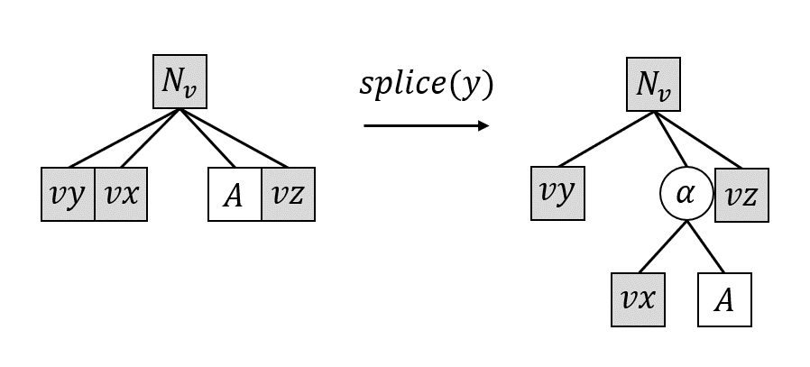
    
- Soft Expose(u, v)
    - 이 연산은 $$N_w$$를 Top tree의 루트로 만들고 $$N_v$$를 루트에 최대한 가깝게 노출시키는 방식으로 진행된다
    - 과정
        1. u의 handle $$N_v$$를 Splice
        2. 경로 반전으로 u가 루트가 되도록 rerooting
        3. $$N_v$$를 Splice 하여 u-v 경로를 최대한 루트 근처로 노출
    - 이 과정 이후 $$N_w$$부터 루트까지의 Compress 노드들은 모두 Compress tree의 루트가 되며 Rake 노드들은 연속으로 3번 이상 등장하지 않게 된다
- Hard Expose
    - 이는 선택적인 옵션, 구현 복잡도에 비해 이득이 크지 않음
    - 잠시 연결을 끊고 최상위로 경로를 완전하게 올리는 방식
- Cut(v,w)
    
    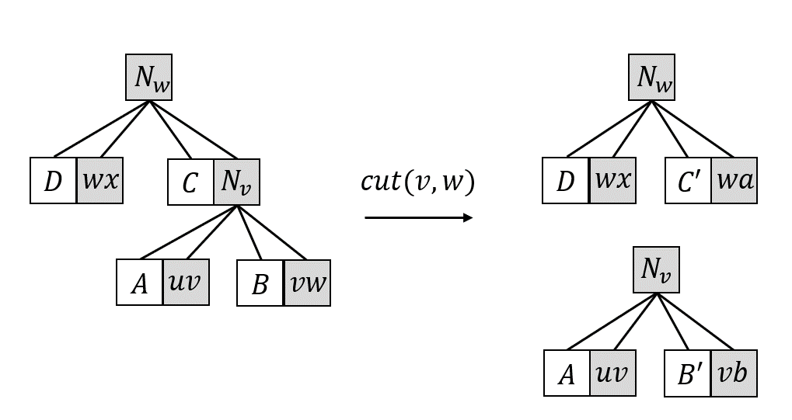
    
    1. Soft Expose로 v-w 클러스터를 루트 근처에 노출
    2. 해당 edge-cluster를 Split→Eradicate
    3. 비어 있는 child 슬롯에 인접한 두 edge를 rake
- Link(u,v)
    
    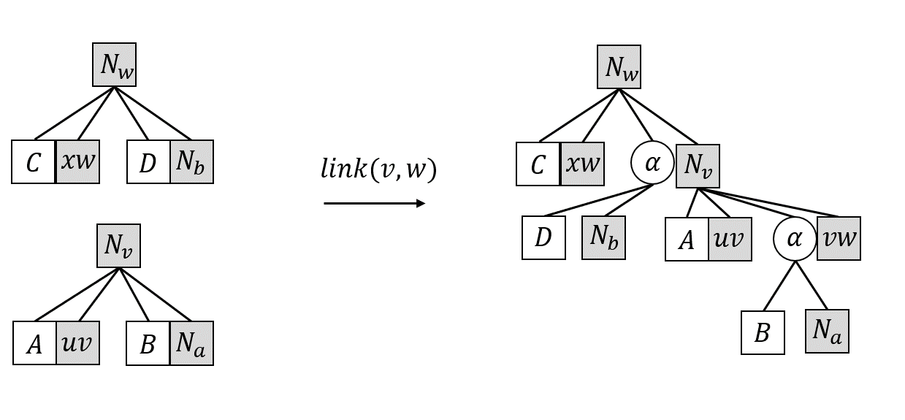
    
    1. Soft Expose(u, u)와 Soft Expose(v, v)를 호출하여 두 트리를 분리
    2. 새로운 **leaf‑cluster** (간선 u−v)를 **Create**
    3. Merge 연산을 통해 하나의 Top‑Tree로 결합

## Lazy Propagation

- Compress tree가 경로를 관리하고 Rake Tree가 나머지 서브트리를 관리한다
- 경로에 가중치를 더하고 싶으면 Compree 노드 즉 proper child에만 전파하고 서브트리에 Lazy를 전파하고 싶은 경우 proper child와 foster child 모두 전파하면 된다
- 어떤 노드에 접근할 때 조상들의 Lazy가 모두 전파되었는지 확인할것

## 코드 구현

```python
import sys
from enum import Enum

class Vertex:
    """그래프의 정점을 나타낸다."""
    def __init__(self, id_val=0):
        self.id = id_val
        self.handle = None

    def __repr__(self):
        return f"Vertex({self.id})"

class Cluster:
    """경로나 서브트리의 집계 데이터를 나타낸다. 이 예제에서는 가중치의 합이다."""
    def __init__(self, v=0):
        self.value = v
        self.subtree_value = v

    def toggle(self):
        """경로의 방향을 반전시킨다. 단순 합계의 경우 아무 작업도 하지 않는다."""
        pass

    @staticmethod
    def compress(L, mid_vertex, R):
        """두 경로 클러스터를 하나로 결합한다. L-mid-R."""
        res = Cluster(L.value + R.value)
        res.subtree_value = L.subtree_value + R.subtree_value
        return res

    @staticmethod
    def rake(path_part, side_subtree):
        """경로와 측면 서브트리를 결합한다. 경로 합계의 경우 측면 서브트리는 무시된다."""
        res = Cluster(path_part.value)
        res.subtree_value = path_part.subtree_value + side_subtree.subtree_value
        return res

    def __repr__(self):
        return f"Cluster({self.value})"

class Type(Enum):
    """TopTree의 다양한 노드 유형에 대한 열거형이다."""
    Compress = 0
    Rake = 1
    Edge = 2

class Node:
    """TopTree의 내부 노드를 나타내며, 경로나 서브트리에 해당한다."""
    def __init__(self):
        self.vs = [None, None]  # 경로의 끝 정점들
        self.dat = Cluster()  # 집계된 클러스터 데이터
        self.p = None  # 부모 포인터
        self.q = None  # 레이크된 자식 포인터
        self.ch = [None, None]  # 압축 자식 포인터들
        self.rev = False  # 경로 반전을 위한 지연 플래그
        self.guard = False  # 스플레이를 위한 가드
        self.type = None  # 노드 유형 (Compress, Rake, Edge)

class TopTree:
    def __init__(self):
        self.id_cluster = Cluster()  # 식별 클러스터

    def create(self, *args, **kwargs):
        """새로운 정점을 생성하고, 사소한 트리로 적절히 초기화한다."""
        t = Vertex(*args, **kwargs)
        dummy = Vertex()
        self.link(t, self.id_cluster, dummy)
        return t

    def edge(self, u, w, v):
        """새로운 Edge 노드를 생성한다."""
        t = Node()
        t.vs[0], t.vs[1] = u, v
        t.dat = w
        t.type = Type.Edge
        return self.pushup(t)

    def compress(self, l, r):
        """새로운 Compress 노드를 생성한다."""
        t = Node()
        t.ch[0], t.ch[1] = l, r
        t.type = Type.Compress
        return self.pushup(t)

    def rake(self, l, r):
        """새로운 Rake 노드를 생성한다."""
        t = Node()
        t.ch[0], t.ch[1] = l, r
        t.type = Type.Rake
        return self.pushup(t)

    def parent_dir(self, t):
        """부모로부터 t의 방향을 가져오며, 가드된 부모는 무시한다."""
        p = t.p
        if not p or p.guard:
            return -1
        if p.ch[0] == t:
            return 0
        if p.ch[1] == t:
            return 1
        return -1

    def parent_dir_ignore_guard(self, t):
        """부모로부터 t의 방향을 가져오며, 가드된 부모라도 고려한다."""
        p = t.p
        if not p:
            return -1
        if p.ch[0] == t:
            return 0
        if p.ch[1] == t:
            return 1
        return -1

    def pushup(self, t):
        """노드 t의 데이터를 자식에 기반하여 재계산한다."""
        if not t:
            return None
        l, r = t.ch[0], t.ch[1]
        if t.type == Type.Compress:
            assert l.vs[1] == r.vs[0]
            t.vs[0], t.vs[1] = l.vs[0], r.vs[1]
            lf = l.dat
            if t.q:
                assert l.vs[1] == t.q.vs[1]
                lf = Cluster.rake(l.dat, t.q.dat)
            t.dat = Cluster.compress(lf, r.vs[0], r.dat)
            l.vs[1].handle = t
        elif t.type == Type.Rake:
            self.propagate(t)
            assert l.vs[1] == r.vs[1]
            t.vs[0], t.vs[1] = l.vs[0], l.vs[1]
            t.dat = Cluster.rake(l.dat, r.dat)
        if t.type != Type.Rake:
            if not t.p:
                t.vs[0].handle = t
            t.vs[1].handle = t
        else:
            if t.p:
                if t.p.type == Type.Compress:
                    if self.parent_dir(t) == -1:
                        t.vs[0].handle = t
                elif t.p.type == Type.Rake:
                    t.vs[0].handle = t
        return t

    def toggle(self, t):
        """노드에 경로 반전을 적용한다."""
        if t.type == Type.Edge:
            t.vs[0], t.vs[1] = t.vs[1], t.vs[0]
            t.dat.toggle()
        elif t.type == Type.Compress:
            t.vs[0], t.vs[1] = t.vs[1], t.vs[0]
            t.dat.toggle()
            t.rev = not t.rev
        elif t.type != Type.Rake:
            raise Exception("토글에 대한 유효하지 않은 노드 유형")

    def propagate(self, t):
        """지연 플래그(예: 반전)를 자식으로 푸시한다."""
        if not t:
            return
        if t.type == Type.Compress and t.rev:
            assert t.ch[0] and t.ch[1]
            t.ch[0], t.ch[1] = t.ch[1], t.ch[0]
            self.toggle(t.ch[0])
            self.toggle(t.ch[1])
            t.rev = False

    def set_toggle(self, v):
        """노드를 토글하고 즉시 전파하는 헬퍼이다."""
        self.toggle(v)
        self.propagate(v)

    def pushdown(self, t):
        """t의 모든 조상이 지연 플래그를 전파하도록 한다."""
        if not t:
            return
        path = []
        curr = t
        while curr:
            path.append(curr)
            curr = curr.p
        for node in reversed(path):
            self.propagate(node)

    def rotate(self, t, x, dir):
        """스플레이 트리 회전을 수행한다."""
        y = x.p
        par = self.parent_dir_ignore_guard(x)
        x.ch[dir ^ 1] = t.ch[dir]
        if t.ch[dir]:
            t.ch[dir].p = x
        t.ch[dir] = x
        x.p = t
        t.p = y
        if par != -1:
            if y:
                y.ch[par] = t
        elif y and y.type == Type.Compress:
            y.q = t
        self.pushup(x)
        self.pushup(t)
        if y and not y.guard:
            self.pushup(y)

    def splay(self, t):
        """노드 t를 동일 유형 노드의 스플레이 트리 최상단으로 스플레이한다."""
        assert t.type != Type.Edge
        self.pushdown(t)
        while self.parent_dir(t) != -1:
            q = t.p
            if q.type != t.type:
                break
            if self.parent_dir(q) != -1 and q.p and q.p.type == q.type:
                r = q.p
                qt_dir = self.parent_dir(t)
                rq_dir = self.parent_dir(q)
                if rq_dir == qt_dir:
                    self.rotate(q, r, rq_dir ^ 1)
                    self.rotate(t, q, qt_dir ^ 1)
                else:
                    self.rotate(t, q, qt_dir ^ 1)
                    self.rotate(t, r, rq_dir ^ 1)
            else:
                qt_dir = self.parent_dir(t)
                self.rotate(t, q, qt_dir ^ 1)

    def expose(self, t_or_v):
        """주요 연산: 정점에서 루트까지의 경로를 선호 경로로 만든다."""
        t = t_or_v.handle if isinstance(t_or_v, Vertex) else t_or_v
        self.pushdown(t)
        while True:
            assert t.type != Type.Rake
            if t.type == Type.Compress:
                self.splay(t)
            p = t.p
            if not p:
                break
            n = None
            if p.type == Type.Rake:
                self.propagate(p)
                self.splay(p)
                n = p.p
            elif p.type == Type.Compress:
                self.propagate(p)
                if p.guard and self.parent_dir_ignore_guard(t) != -1:
                    break
                n = p
            if not n:
                break
            self.splay(n)
            dir = self.parent_dir_ignore_guard(n)
            if dir == -1 or (n.p and n.p.type == Type.Rake):
                dir = 0
            c = n.ch[dir]
            if dir == 1:
                self.set_toggle(c)
                self.set_toggle(t)
            n_dir = self.parent_dir(t)
            if n_dir != -1:
                r_node = t.p
                self.propagate(c)
                self.propagate(r_node)
                r_node.ch[n_dir] = c
                if c:
                    c.p = r_node
                n.ch[dir] = t
                t.p = n
                self.pushup(c)
                self.pushup(r_node)
                self.pushup(t)
                self.pushup(n)
                self.splay(r_node)
            else:
                self.propagate(c)
                n.q = c
                if c:
                    c.p = n
                n.ch[dir] = t
                t.p = n
                self.pushup(c)
                self.pushup(t)
                self.pushup(n)
        return t

    def soft_expose(self, u, v):
        """u에서 루트까지 경로를 노출한 후, v에서 루트까지 경로를 노출하여 연결한다."""
        self.pushdown(u.handle)
        self.pushdown(v.handle)
        rt = self.expose(u)
        if u.handle == v.handle:
            if rt.vs[1] == u or rt.vs[0] == v:
                self.set_toggle(rt)
            return
        rt.guard = True
        soft = self.expose(v)
        rt.guard = False
        self.pushup(rt)
        if self.parent_dir(soft) == 0:
            self.set_toggle(rt)

    def bring(self, rt):
        """컷 연산 후 노드를 재구조화한다."""
        rk = rt.q
        if not rk:
            ll = rt.ch[0]
            ll.p = None
            self.pushup(ll)
        elif rk.type in (Type.Compress, Type.Edge):
            nr = rk
            self.set_toggle(nr)
            rt.ch[1] = nr
            nr.p = rt
            rt.q = None
            self.pushup(nr)
            self.pushup(rt)
        elif rk.type == Type.Rake:
            self.propagate(rk)
            while rk.ch[1] and rk.ch[1].type == Type.Rake:
                self.propagate(rk.ch[1])
                rk = rk.ch[1]
            self.pushdown(rk)
            rt.guard = True
            self.splay(rk)
            rt.guard = False
            ll, rr = rk.ch[0], rk.ch[1]
            self.propagate(ll)
            self.set_toggle(rr)
            rt.ch[1] = rr
            rr.p = rt
            rt.q = ll
            if ll:
                ll.p = rt
            self.pushup(ll)
            self.pushup(rr)
            self.pushup(rt)

    def link(self, u, w, v):
        """두 정점 u와 v를 새로운 가중치 w의 에지로 연결한다."""
        nnu, nnv = u.handle, v.handle
        if not nnu and not nnv:
            return self.edge(u, w, v)
        ee = self.edge(u, w, v)
        ll = None
        if nnv:
            vv = self.expose(nnv)
            self.propagate(vv)
            if vv.vs[1] == v:
                self.set_toggle(vv)
            if vv.vs[0] == v:
                nv = self.compress(ee, vv)
                ee.p = nv
                vv.p = nv
                self.pushup(ee)
                self.pushup(vv)
                self.pushup(nv)
                ll = nv
            else:
                nv = vv
                ch = nv.ch[0]
                self.propagate(ch)
                nv.ch[0] = ee
                ee.p = nv
                self.pushup(ee)
                bt = nv.q
                rk = self.rake(bt, ch) if bt else ch
                if bt:
                    bt.p = rk
                    ch.p = rk
                    self.pushup(bt)
                    self.pushup(ch)
                nv.q = rk
                if rk:
                    rk.p = nv
                self.pushup(rk)
                self.pushup(nv)
                ll = nv
        else:
            ll = ee
        if nnu:
            uu = self.expose(nnu)
            self.propagate(uu)
            if uu.vs[0] == u:
                self.set_toggle(uu)
            if uu.vs[1] == u:
                tp = self.compress(uu, ll)
                uu.p = tp
                ll.p = tp
                self.pushup(uu)
                self.pushup(ll)
                self.pushup(tp)
            else:
                nu = uu
                ch = nu.ch[1]
                if ch:
                    self.toggle(ch)
                    self.propagate(ch)
                nu.ch[1] = ll
                ll.p = nu
                self.pushup(ll)
                al = nu.q
                rk = self.rake(al, ch) if al else ch
                if al:
                    al.p = rk
                    ch.p = rk
                    self.pushup(al)
                    self.pushup(ch)
                nu.q = rk
                if rk:
                    rk.p = nu
                self.pushup(rk)
                self.pushup(nu)
        return ee

    def cut(self, u, v):
        """정점 u와 v 사이의 에지를 컷한다."""
        self.soft_expose(u, v)
        rt = u.handle
        self.propagate(rt)
        rr = rt.ch[1]
        rr.p = None
        self.set_toggle(rr)
        assert rr.ch[1].type == Type.Edge
        self.bring(rr)
        self.bring(rt)

    def path(self, u, v):
        """u와 v 사이 경로를 나타내는 내부 노드를 반환한다."""
        assert u != v
        self.soft_expose(u, v)
        rt = u.handle
        self.propagate(rt)
        if rt.ch[1]:
            self.propagate(rt.ch[1])
            if rt.ch[1].ch[0]:
                return rt.ch[1].ch[0]
        return None

    def set_edge(self, u, v, w):
        """u와 v 사이 에지의 데이터를 업데이트한다."""
        t = self.path(u, v)
        assert t.type == Type.Edge
        t.dat = w
        while t:
            self.pushup(t)
            t = t.p

    def get_path(self, u, v):
        """u와 v 사이 경로의 집계된 클러스터 데이터를 가져온다."""
        p = self.path(u, v)
        return p.dat if p else Cluster()

    def get_subtree(self, p, v):
        """v를 루트로 하는 서브트리의 집계된 서브트리 값을 가져온다. p로의 에지는 제외한다."""
        self.soft_expose(p, v)
        rt = p.handle
        self.propagate(rt)
        q_sub = rt.q.dat.subtree_value if rt.q else 0
        edge_value = self.get_path(p, v).value
        if not rt.ch[0]:
            return rt.dat.subtree_value - q_sub - edge_value
        left = rt.ch[0]
        self.propagate(left)
        return rt.dat.subtree_value - left.dat.subtree_value - q_sub - edge_value

def test_star():
    print("--- Running star test ---")
    tp = TopTree()
    v1 = tp.create(1)
    v2 = tp.create(2)
    v3 = tp.create(3)
    tp.link(v2, Cluster(4), v1)
    tp.link(v3, Cluster(6), v1)
    path_val = tp.get_path(v2, v3).value
    print(f"Path value between v2 and v3: {path_val}")
    assert path_val == 10, f"Expected 10, got {path_val}"
    print("Star test passed\n")

def test_complex():
    print("--- Running complex test ---")
    tp = TopTree()
    v1 = tp.create(1)
    v2 = tp.create(2)
    v3 = tp.create(3)
    v4 = tp.create(4)
    v5 = tp.create(5)
    tp.link(v2, Cluster(5), v1)
    tp.link(v2, Cluster(3), v3)
    tp.link(v3, Cluster(7), v4)
    tp.link(v2, Cluster(2), v5)
    assert tp.get_path(v1, v4).value == 15
    assert tp.get_path(v5, v4).value == 12
    assert tp.get_path(v5, v1).value == 7
    print("Initial path queries passed.")
    tp.cut(v3, v2)
    print("Cut edge between v3 and v2.")
    assert tp.get_path(v3, v4).value == 7
    tp.link(v2, Cluster(1), v3)
    print("Relinked edge between v2 and v3 with new weight 1.")
    assert tp.get_path(v1, v4).value == 13
    assert tp.get_path(v5, v3).value == 3
    print("Complex test passed\n")

def custom():
    tp = TopTree()
    v1 = tp.create(1)
    v2 = tp.create(2)
    v3 = tp.create(3)
    v4 = tp.create(4)
    v5 = tp.create(5)
    tp.link(v2, Cluster(5), v1)
    tp.link(v2, Cluster(3), v3)
    tp.link(v2, Cluster(2), v4)
    tp.link(v4, Cluster(10), v5)
    print(tp.get_path(v2,v1).value)
    print(tp.get_path(v2, v5).value)
    print(tp.get_subtree(v1, v2))
    print(tp.get_subtree(v2, v4))

if __name__ == "__main__":
    test_star()
    test_complex()
    custom()
```

## 코드 리뷰

### 자료의 형태

```python
class Vertex:
    """그래프의 정점을 나타낸다."""
    def __init__(self, id_val=0):
        self.id = id_val
        self.handle = None  # Node 객체를 가리킬 것이다

    def __repr__(self):
        return f"Vertex({self.id})"
        
class Cluster:
    """경로나 서브트리의 집계 데이터를 나타낸다. 이 예제에서는 가중치의 합이다."""
    def __init__(self, v=0):
        self.value = v
        self.subtree_value = v
        
class Node:
    """TopTree의 내부 노드를 나타내며, 경로나 서브트리에 해당한다."""
    def __init__(self):
        self.vs = [None, None]  # 경로의 끝 정점들
        self.dat = Cluster()  # 집계된 클러스터 데이터
        self.p = None  # 부모 포인터
        self.q = None  # 레이크된 자식 포인터
        self.ch = [None, None]  # 압축 자식 포인터들
        self.rev = False  # 경로 반전을 위한 지연 플래그
        self.guard = False  # 스플레이를 위한 가드
        self.type = None  # 노드 유형 (Compress, Rake, Edge)
        
class TopTree:
    """TopTree 데이터 구조의 Python 구현이다. 링크, 컷, 경로 쿼리와 같은 동적 트리 연산을 지원한다."""
    def __init__(self):
        self.id_cluster = Cluster()  # 식별 클러스터
```

- 주요 클래스로는 총 4가지 종류가 있다
- Vertex (정점)
    - 사용자가 다루는 실제 그래프의 정점(노드)을 나타냄
    - 주요 속성
        - id : 정점을 식별하기 위한 값
        - handle : 중요한 포인터. 이 정점이 Top tree 내부의 어떤 Node에 해당하는지를 가리킨다. Top tree의 대한 모든 연산은 handle로부터 시작
- Cluster (클러스터)
    - Top tree의 핵심 클래스
    - 어떤 데이터를 집계하고 그 데이터를 어떻게 합칠지 정의
    - 내부 속성을 추가하여 경로의 합계 뿐만 아닌 경로의 최소, 최대값도 계산 가능
- Node (내부 노드)
    - Top tree 자료구조를 구성하는 내부적인 노드
    - Vertex와 다른점은 실제 정점이 아닌 Top tree에서 사용하는 Edge, Compress, Rake를 뜻함
    - 주요 속성
        - vs : 이 노드가 나타내는 경로의 양 끝 Vertex
        - dat : 이 노드가 집계한 Cluster 데이터
        - p, ch : 부모와 자식 노드
        - rev : 경로 뒤집기 같은 연산을 효율적으로 처리하기 위한 지연 플래그
- TopTree
    - 전체 자료구조를 관리하고 사용자가 사용할 api를 제공하는 메인 컨트롤러

### Splay

```python
def splay(self, t):
    """노드 t를 동일 유형 노드의 스플레이 트리 최상단으로 스플레이한다."""
    assert t.type != Type.Edge
    self.pushdown(t) # 1. t까지의 경로에 있는 지연 플래그(lazy flag)를 모두 처리
    while self.parent_dir(t) != -1: # 2. t가 루트가 아닐 동안 반복
        q = t.p
        if q.type != t.type: # 3. 다른 종류의 트리 경계에 도달하면 중단
            break
        if self.parent_dir(q) != -1 and q.p and q.p.type == q.type: # 조부모가 있는 경우 (Zig-Zig 또는 Zig-Zag)
            r = q.p
            qt_dir = self.parent_dir(t)
            rq_dir = self.parent_dir(q)
            if rq_dir == qt_dir: # 4. Zig-Zig Case
                self.rotate(q, r, rq_dir ^ 1)
                self.rotate(t, q, qt_dir ^ 1)
            else: # 5. Zig-Zag Case
                self.rotate(t, q, qt_dir ^ 1)
                self.rotate(t, r, rq_dir ^ 1)
        else: # 6. Zig Case (조부모가 없거나 다른 종류의 트리)
            qt_dir = self.parent_dir(t)
            self.rotate(t, q, qt_dir ^ 1)
            
```

- amortized O(log n)의 시간복잡도를 가능하게 해주는 함수
- Top tree 내부 경로를 동적으로 재구성하여 특정 경로에 대한 접근과 연산을 도움
- 과정
    1. splay 시작전 루트부터 t까지의 경로에 있는 노드들의 상태를 최신화
    2. t가 루트가 될때까지 회전을 반복한다
    3. Top tree는 Compress 노드들로 이루어진 트리와 Rake 노드들로 이루어진 트리를 따로 관리하기에 splay는 같은 종류의 노드 그룹 안에서만 수행하도록 함
    4. splay 방법 ([Splay Tree](/study/algorithms/data-structure/splay-tree/) 참조)
        - t와 q의 방향이 같으면 zig-zig로 splay
        - t와 q의 방향이 다르면 zig-zag로 splay
        - 조부모가 없다면 zig로 splay

### Expose

```python
def expose(self, t_or_v):
    """주요 연산: 정점에서 루트까지의 경로를 선호 경로로 만든다."""
    # 1. 시작 노드 't'를 확정하고, 루트에서 t까지의 경로상 모든 노드의 상태를 최신화한다.
    t = t_or_v.handle if isinstance(t_or_v, Vertex) else t_or_v
    self.pushdown(t)

    # 2. t가 전체 트리의 루트가 될 때까지 상위 경로와 합치는 과정을 반복한다.
    while True:
        # 현재 t가 속한 경로 조각(스플레이 트리) 안에서 t를 루트로 만들어 대표 노드로 삼는다.
        if t.type == Type.Compress:
            self.splay(t)
        
        # 부모 p를 찾는다. p가 없으면 t가 루트이므로 루프를 종료한다.
        p = t.p
        if not p:
            break
        
        # n은 t가 연결될 상위 경로 조각의 루트 노드이다. p의 타입에 따라 n을 찾는다.
        n = None
        if p.type == Type.Rake: # 부모가 곁가지(Rake)인 경우
            self.propagate(p)   # p의 상태를 최신화하고
            self.splay(p)       # 곁가지 그룹 내에서 p를 루트로 만든 뒤
            n = p.p             # p의 부모, 즉 실제 상위 경로 노드를 n으로 삼는다.
        elif p.type == Type.Compress: # 부모가 경로의 일부(Compress)인 경우
            self.propagate(p)
            # soft_expose 연산을 위한 보호 장치(guard)가 설정되어 있으면 루프를 중단한다.
            if p.guard and self.parent_dir_ignore_guard(t) != -1:
                break
            n = p # p 자신이 상위 경로 조각의 일부이므로 n으로 삼는다.
        
        if not n:
            break

        # 3. 상위 경로 조각의 루트 n을 splay하여 t를 연결하기 쉽게 만든다.
        self.splay(n)
        
        # n의 자식 중, t가 연결될 방향(dir)을 결정한다.
        dir = self.parent_dir_ignore_guard(n)
        if dir == -1 or (n.p and n.p.type == Type.Rake):
            dir = 0
            
        # c는 n의 기존 주 경로 자식이다. 이 연결은 곧 끊어지고 c는 곁가지가 된다.
        c = n.ch[dir]
        
        # 경로 방향이 뒤집혀야 하는 경우, 관련 노드들을 토글(toggle)한다.
        if dir == 1:
            self.set_toggle(c)
            self.set_toggle(t)
            
        n_dir = self.parent_dir(t)
        
        # 4. 포인터를 조작하여 t를 n의 새로운 주 경로 자식으로 연결하고, 기존 자식 c는 분리한다.
        if n_dir != -1: # t가 Compress 노드의 자식이었을 경우 (경로끼리의 연결)
            r_node = t.p # t의 원래 부모
            self.propagate(c)
            self.propagate(r_node)
            r_node.ch[n_dir] = c # t의 원래 부모가 c를 새로운 자식으로 입양한다.
            if c: c.p = r_node
            n.ch[dir] = t # n은 t를 새로운 주 경로 자식으로 입양한다.
            t.p = n
            
            # 포인터가 변경된 모든 노드의 집계 데이터를 업데이트(pushup)한다.
            self.pushup(c)
            self.pushup(r_node)
            self.pushup(t)
            self.pushup(n)
            self.splay(r_node) # 구조 변경 후 안정화를 위해 splay를 수행한다.
        else: # t가 Rake 노드의 자식이었을 경우 (곁가지에서 주 경로로 승격)
            self.propagate(c)
            n.q = c # n의 기존 자식 c를 곁가지(q)로 강등시킨다.
            if c: c.p = n
            n.ch[dir] = t # n은 t를 새로운 주 경로 자식으로 승격시킨다.
            t.p = n

            # 포인터가 변경된 노드들의 집계 데이터를 업데이트한다.
            self.pushup(c)
            self.pushup(t)
            self.pushup(n)
            
    # 5. expose 작업이 완료된 경로의 루트(원래 t)를 반환한다.
    return t
```

- expose는 정점이나 내부 노드를 인자로 받아 시작 노드 t를 결정한다
- pushdown(t)를 통해 t로 가는 경로상의 모든 노드 상태를 최신으로 업데이트한다
- t가 전체 트리의 루트 즉 부모 p가 None이 될때까지 반복하며 한번의 루프는 경로의 한조각을 상위 경로와 합치는 과정에 해당됨
- splay를 통해 t를 연결할 상위 경로 조각을 재구성하며 t를 붙이기 쉬운 형태로 만듬
- 4번 주석이 expose의 핵심. 포인터 조작을 통해 경로의 소속을 바꿈
- 이 expose 연산을 통해 시작 정점 t에서부터 루트까지의 모든 노드들은 거대한 스플레이 트리로 연결 되며 그 외의 모든 서브트리들은 이 주 경로의 Rake자식으로 붙어있는 형태가 됨

### Link

```python
def link(self, u, w, v):
    """두 정점 u와 v를 새로운 가중치 w의 에지로 연결한다."""
    # 1. u와 v의 내부 노드(handle)를 가져온다.
    nnu, nnv = u.handle, v.handle

    # u와 v가 모두 독립된 정점일 경우, 그냥 둘을 잇는 간선 노드를 생성하고 반환한다.
    if not nnu and not nnv:
        return self.edge(u, w, v)
        
    # u와 v를 연결할 새로운 간선(Edge) 노드를 생성한다.
    ee = self.edge(u, w, v)
    
    # ll은 v쪽에 연결된 후, 최종적으로 u쪽에 연결될 경로 조각을 저장할 변수이다.
    ll = None
    
    # 2. v가 이미 트리에 속해 있는 경우, v쪽에 새로운 간선을 연결한다.
    if nnv:
        # v에서 루트까지의 경로를 expose하여 v를 다루기 쉬운 위치(경로의 끝점)로 만든다.
        vv = self.expose(nnv)
        self.propagate(vv) # 경로 상태 최신화
        
        # v가 경로의 끝점(vs[1])이 되도록 필요하면 경로를 뒤집는다.
        if vv.vs[1] == v:
            self.set_toggle(vv)
            
        # v가 경로의 시작점(vs[0])인 경우 (v의 차수가 1이었던 경우)
        if vv.vs[0] == v:
            # 새로운 간선(ee)과 기존 경로(vv)를 이어붙여(compress) 더 긴 경로를 만든다.
            nv = self.compress(ee, vv)
            ee.p = nv
            vv.p = nv
            self.pushup(ee)
            self.pushup(vv)
            self.pushup(nv)
            ll = nv # u에 연결할 경로 조각은 새로 만들어진 nv가 된다.
        else: # v가 경로의 중간에 있는 경우 (v의 차수가 1보다 컸던 경우)
            nv = vv
            ch = nv.ch[0] # v에 원래 연결되어 있던 자식 경로
            self.propagate(ch)
            nv.ch[0] = ee # 원래 자식 대신 새로운 간선 ee를 주 경로에 연결한다.
            ee.p = nv
            self.pushup(ee)
            bt = nv.q # v에 원래 붙어있던 곁가지(rake) 그룹
            # 원래 자식(ch)과 원래 곁가지(bt)를 합쳐 새로운 곁가지 그룹(rk)을 만든다.
            rk = self.rake(bt, ch) if bt else ch
            if bt:
                bt.p = rk
                ch.p = rk
                self.pushup(bt)
                self.pushup(ch)
            nv.q = rk # v에 새로운 곁가지 그룹을 연결한다.
            if rk: rk.p = nv
            self.pushup(rk)
            self.pushup(nv)
            ll = nv # u에 연결할 경로 조각은 기존 경로인 nv가 된다.
    else: # v가 독립된 정점이었을 경우
        ll = ee # u에 연결할 경로 조각은 새 간선 ee 자체가 된다.

    # 3. u가 이미 트리에 속해 있는 경우, 위에서 만들어진 경로 조각(ll)을 u에 연결한다.
    # 이 과정은 v에 연결했던 과정과 대칭적으로 동작한다.
    if nnu:
        uu = self.expose(nnu) # u에서 루트까지 경로를 expose
        self.propagate(uu)
        
        # u가 경로의 시작점(vs[0])이 되도록 필요하면 경로를 뒤집는다.
        if uu.vs[0] == u:
            self.set_toggle(uu)
            
        # u가 경로의 끝점(vs[1])인 경우 (u의 차수가 1이었던 경우)
        if uu.vs[1] == u:
            # 기존 u의 경로(uu)와 v쪽에서 온 경로(ll)를 이어붙인다(compress).
            tp = self.compress(uu, ll)
            uu.p = tp
            ll.p = tp
            self.pushup(uu)
            self.pushup(ll)
            self.pushup(tp)
        else: # u가 경로의 중간에 있는 경우 (u의 차수가 1보다 컸던 경우)
            nu = uu
            ch = nu.ch[1]
            if ch:
                self.toggle(ch)
                self.propagate(ch)
            nu.ch[1] = ll # 기존 자식 대신 v쪽 경로 ll을 주 경로에 연결한다.
            ll.p = nu
            self.pushup(ll)
            al = nu.q
            # 원래 자식(ch)과 원래 곁가지(al)를 합쳐 새로운 곁가지 그룹(rk)을 만든다.
            rk = self.rake(al, ch) if al else ch
            if al:
                al.p = rk
                ch.p = rk
                self.pushup(al)
                self.pushup(ch)
            nu.q = rk # u에 새로운 곁가지 그룹을 연결한다.
            if rk: rk.p = nu
            self.pushup(rk)
            self.pushup(nu)
            
    return ee # 생성된 간선 노드를 반환한다.
```

- link 함수는 먼저 두 정점 u,v를 잇는 새로운 간선(Edge) 노드를 생성하는 것으로 시작
- expose(v)를 호출하여 v를 경로의 끝점으로 만든다. 이는 v에 무언가를 붙이기 위한 사전작업임
- v의 연결 상태에 따라 두가지 방식으로 간선을 연결
    - 만약 v가 경로의 끝점(차수 1)이라면, compress 연산을 통해 새 간선을 기존 경로에 그대로 이어 붙인다
    - 만약 v가 경로의 중간점 (차수 2 이상) 이라면, rake 연산을 통해 새 간선을 곁가지 형태로 붙인다
- v쪽에 연결된 결과물을 다시 u쪽에 연결한다. expose(u)를 호출하여 u를 준비시키고 위와 동일한 compress 또는 rake 로직을 대칭적으로 적용한다

### Cut/Bring

```python
def cut(self, u, v):
    """정점 u와 v 사이의 에지를 컷한다."""
    # 1. u와 v 사이의 경로를 expose하여 u-v 간선을 다루기 쉬운 위치로 만든다.
    self.soft_expose(u, v)
    rt = u.handle # u를 포함하는 경로 조각의 루트
    self.propagate(rt)
    
    # soft_expose의 결과로, u-v 간선을 포함하는 v쪽 경로는 rt의 오른쪽 자식(ch[1])이 된다.
    rr = rt.ch[1]
    
    # 2. 실제 간선을 끊는 작업. rr의 부모 포인터를 제거하여 rt와 분리한다.
    rr.p = None
    
    # 경로 방향을 맞추기 위해 토글하고, u-v 간선이 예상 위치에 있는지 확인한다.
    self.set_toggle(rr)
    assert rr.ch[1].type == Type.Edge
    
    # 3. 간선이 끊어진 두 개의 트리(rr과 rt)가 올바른 구조를 갖도록 복구(bring)한다.
    self.bring(rr)
    self.bring(rt)

def bring(self, rt):
    """컷 연산 후 노드를 재구조화한다."""
    # rt에서 주 경로가 끊겼으니, 곁가지(q) 중에서 새로운 주 경로를 찾아 "승격"시킨다.
    rk = rt.q
    
    if not rk: # 곁가지가 없는 경우
        ll = rt.ch[0]
        ll.p = None # 남은 왼쪽 자식이 새로운 트리의 루트가 된다.
        self.pushup(ll)
    elif rk.type in (Type.Compress, Type.Edge): # 곁가지가 단순 경로인 경우
        nr = rk
        self.set_toggle(nr)
        rt.ch[1] = nr # 해당 곁가지를 새로운 오른쪽 주 경로 자식으로 승격시킨다.
        nr.p = rt
        rt.q = None # 곁가지 목록은 비운다.
        self.pushup(nr)
        self.pushup(rt)
    elif rk.type == Type.Rake: # 곁가지가 복잡한 그룹(Rake 트리)인 경우
        # 곁가지 그룹 내에서 가장 적절한 경로를 찾아 splay로 위로 올린다.
        self.propagate(rk)
        while rk.ch[1] and rk.ch[1].type == Type.Rake:
            self.propagate(rk.ch[1])
            rk = rk.ch[1]
        self.pushdown(rk)
        rt.guard = True
        self.splay(rk)
        rt.guard = False
        
        # splay된 곁가지 그룹을 분해하여 일부는 새로운 주 경로로, 나머지는 곁가지로 재구성한다.
        ll, rr = rk.ch[0], rk.ch[1]
        self.propagate(ll)
        self.set_toggle(rr)
        rt.ch[1] = rr # rr을 새로운 주 경로 자식으로 승격시킨다.
        rr.p = rt
        rt.q = ll # ll은 여전히 곁가지로 남는다.
        if ll:
            ll.p = rt
        
        # 변경된 모든 노드의 데이터를 업데이트한다.
        self.pushup(ll)
        self.pushup(rr)
        self.pushup(rt)
```

- cut 함수는 먼저 soft_expose(u,v)를 호출하여 u-v 경로를 자료구조 최상단으로 끌어 올림. 이 과정을 통해 u,v를 잇는 간선이 특정 위치(rt의 자식 rr의 자식)에 오게 됨
- rr.p = None을 통해 두 경로 조각의 부모-자식 관계를 끊음
- 절단 후에는 두개의 독립된 트리가 남지만 이들의 구조는 비정상적일 수 있음 (예: 주 경로 자식(ch[1])이 사라진 노드가 생김)
- bring(rt)를 통하여 주경로를 잃어버린 노드 rt를 인자로 받아 그 노드에 곁가지(q)로 붙어있던 다른 경로들 중에서 하나 골라 새로운 주 경로로 승격시키는 역할을 함
- 결론적으로 cut은 자르는 행위, bring은 자른 후 뒷정리를 담당

## 문제

- [17936. 트리와 쿼리 13](/study/algorithms/data-structure/ruby/boj-17936/) - 트릭을 이용하여 Link Cut Tree를 마치 Top tree처럼 다룸
- [1921. 트리와 쿼리 20](/study/algorithms/unsorted/boj-1921/) - Tree의 1 median 구하기
