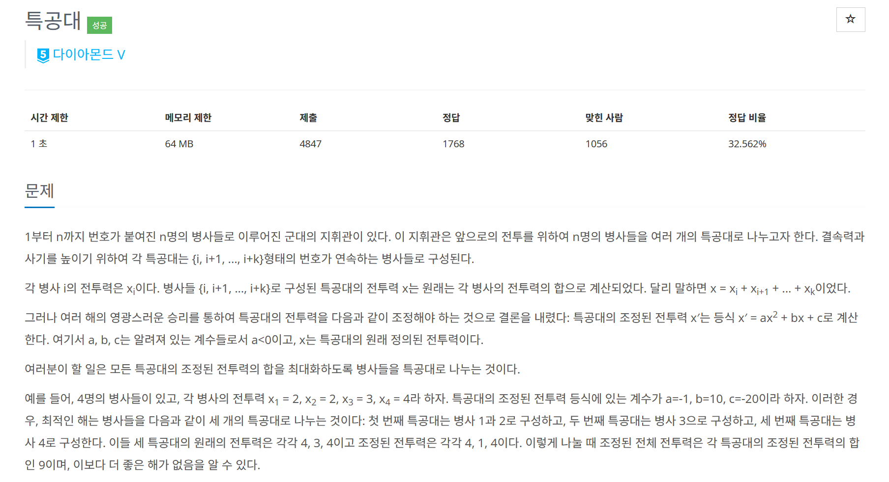

[상위 페이지 · 다이아](/study/algorithms/dynamic-programming/diamond/)



## 문제 태그

- DP
- 볼록껍질을 이용한 DP 최적화

## 아이디어

1. 점화식 유도

$$
P[i] = \sum_{k=1}^ix_k \ ...\ prefix\ sum
\\
dp[i] = \max_{0\le j < i}(dp[j] + a(P[i] - P[j])^2 + b(P[i]- P[j]) + c

$$

이를 전개하면

$$
dp[i] = \max_{0\le j < i}(dp[j] + aP[i]^2 + aP[j]^2 + -2aP[j]P[i] + bP[i]-bP[j] + c)
$$

여기서 max에 영향을 끼치지 못하는 항은 밖으로 빼준다

$$
dp[i] = aP[i]^2 + bP[i] + c +   \max_{0\le j < i}(dp[j] + aP[j]^2 -2aP[j]P[i] + -bP[j])
$$

여기서 조금 더 식에 변형을 가하면

$$
P[i] = x
\\
m_j(기울기) = -2aP[j]
\\
b_j(절편) = dp[j] + aP[j]^2 - bP[j]
\\
dp[i] = aP[i]^2 + bP[i] + c +   \max_{0\le j < i}(dp[j] + aP[j]^2 -2aP[j]P[i] + -bP[j])
\\
= dp[i] = aP[i]^2 + bP[i] + c +   \max_{0\le j < i}(m_jx + b_j)
$$

최종적으로 a<0이므로 max 함수에 기울기가 증가하는 일차 함수가 만들어진다. → 볼록껍질을 이용한 dp 최적화가 가능함.

그리고 j도 증가하고 P[i]도 증가 하므로 단조 슬로프 + 단조 쿼리 조건을 만족하여 덱으로 관리가 가능

1. 볼록껍질을 이용한 최적화라는걸 알고 끼워맞추는거지 태그 안까고 하면 어캐 품?

## 정답

```python
import sys
from collections import deque

input = sys.stdin.readline

n = int(input())
A, B, C = map(int, input().split())
xs = list(map(int, input().split()))

P = [0] * (n + 1)
for i in range(1, n + 1):
    P[i] = P[i - 1] + xs[i - 1]

dp = [0] * (n + 1)
dq = deque()
dq.append((0, 0))  # (slope m, intercept b)

for i in range(1, n + 1):
    X = P[i]
    while len(dq) >= 2 and dq[0][0] * X + dq[0][1] <= dq[1][0] * X + dq[1][1]:
        dq.popleft()
    best = dq[0][0] * X + dq[0][1]
    dp[i] = A * X * X + B * X + C + best

    M = P[i]
    m = -2 * A * M
    b = dp[i] + A * M * M - B * M

    while len(dq) >= 2:
        m1, b1 = dq[-2]
        m2, b2 = dq[-1]
        if (b - b1) * (m1 - m2) <= (b2 - b1) * (m1 - m):
            dq.pop()
        else:
            break
    dq.append((m, b))

print(dp[n])

```
