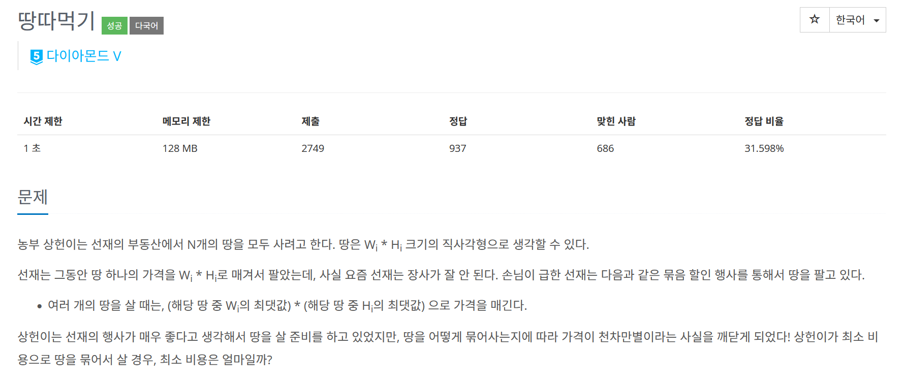

[상위 페이지 · 다이아](/study/algorithms/dynamic-programming/diamond/)



## 문제 태그

- DP
- CHT

## 아이디어

- 우선 당연히 W기준 오름차순으로, H는 내림차순으로 정렬하는것이 최소일 것이다
    - 여기서 i<j, $$H_i$$ ≥ $$H_j$$는 고려할 필요가 없음 → H는 단조 감소함
- dp상태 정의
    - dp[i] = 1번째 땅부터 i번째 땅까지 모두 구매하는데 드는 최소 비용
- dp 점화식
    
    $$
    dp[i]= \underset{0\le j < i}{\text{min}}(W_i \cdot H_{j+1}+dp[j])
    $$
    
    - 위 식을 다음과 같이 정의할 수 있음
        - $$W_i$$ = x
        - $$H_{j+1}$$ = a
        - d[j] = b
    - $$H_{j+1}$$은 전처리에서 단조감소함을 증명하였음 → CHT 적용 가능

## 정답

```python
import sys
from collections import deque

input = sys.stdin.readline

class ConvexHullTrick:
    def __init__(self):
        self.hull = deque()

    def check(self, l1, l2, l3):
        return (l2[1] - l1[1]) * (l2[0] - l3[0]) >= (l3[1] - l2[1]) * (l1[0] - l2[0])

    def add(self, m, b):
        line = (m, b)
        while len(self.hull) >= 2 and self.check(self.hull[-2], self.hull[-1], line):
            self.hull.pop()
        self.hull.append(line)

    def get(self, line, x):
        return line[0] * x + line[1]

    def query(self, x):
        while len(self.hull) >= 2 and self.get(self.hull[0], x) >= self.get(self.hull[1], x):
            self.hull.popleft()
        return self.get(self.hull[0], x)

N = int(input())
lands = []
for _ in range(N):
    w, h = map(int, input().split())
    lands.append((w, h))

lands.sort(key=lambda x: x[0])

new_lands = []
prev_w = -1
max_h = 0
for w, h in lands:
    if w == prev_w:
        max_h = max(max_h, h)
    else:
        if prev_w != -1:
            new_lands.append((prev_w, max_h))
        prev_w = w
        max_h = h
if prev_w != -1:
    new_lands.append((prev_w, max_h))

useful = []
for w, h in new_lands:
    while useful and useful[-1][1] <= h:
        useful.pop()
    useful.append((w, h))

M = len(useful)
if M == 0:
    print(0)
    sys.exit()

cht = ConvexHullTrick()
cht.add(useful[0][1], 0)

ans = 0
for i in range(M):
    wi, hi = useful[i]
    dp_i = cht.query(wi)
    ans = dp_i
    if i < M - 1:
        cht.add(useful[i + 1][1], dp_i)

print(ans)
```
