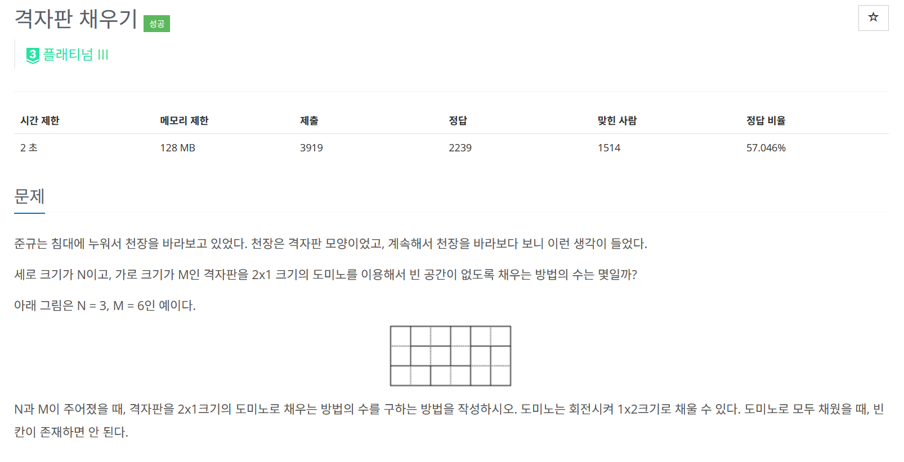

[상위 페이지 · 플레티넘](/study/algorithms/dynamic-programming/platinum/)



## 문제 태그

- DP
- 비트마스킹

## 아이디어

1. DFS로 한 열 안을 스캔하며 빈 칸(`0`)에는
    
    **세로 타일**(2×1) → 같은 열 바로 아래(pos+1)와 함께 채우고 pos+2로 건너뛰는 방법이다.
    
    **가로 타일**(1×2) → 현재 칸만 채우고, 다음 열의 같은 행(next_mask에 해당 비트 켜기)으로 이동하는 방법이다.
    
    열 끝(pos = rows)까지 다 채우면 하나의 (next_mask, count)를 기록하는 것이다.
    
2. **DP 업데이트**
    
    dp[mask]에 저장된 방법의 수를, for (next_mask, cnt) in trans[mask]에 곱해서 dp_next[next_mask]에 더해주는 것이다.
    
    cols번 반복한 후 dp[0]이 총 경우의 수가 된다.
    

## 정답

```python
import sys

sys.setrecursionlimit(10**6)

input = sys.stdin.readline
N, M = map(int, input().split())
rows, cols = min(N, M), max(N, M)
MAX_MASK = 1 << rows

from collections import Counter

trans = [None] * MAX_MASK

def build_transitions(start_mask):
    cnt = Counter()

    def dfs(pos, cur_mask, next_mask):
        if pos == rows:
            cnt[next_mask] += 1
            return
        if cur_mask & (1 << pos):
            dfs(pos + 1, cur_mask, next_mask)
        else:
            if pos + 1 < rows and not (cur_mask & (1 << (pos + 1))):
                dfs(pos + 2, cur_mask, next_mask)
            dfs(pos + 1, cur_mask, next_mask | (1 << pos))

    dfs(0, start_mask, 0)
    return list(cnt.items())

for mask in range(MAX_MASK):
    trans[mask] = build_transitions(mask)

dp = {0: 1}
for _ in range(cols):
    nxt = {}
    for mask, ways in dp.items():
        for nm, cnt in trans[mask]:
            nxt[nm] = nxt.get(nm, 0) + ways * cnt
    dp = nxt
print(dp.get(0, 0) % 9901)

```
