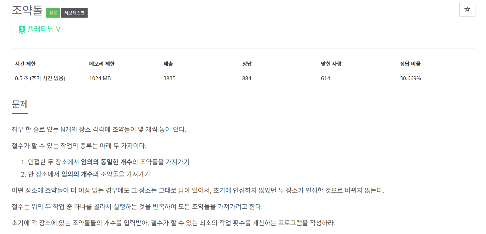

[상위 페이지 · 플레티넘](/study/algorithms/dynamic-programming/platinum/)



## 문제 태그

- DP

## 아이디어

1. remain[i] = {stone_list[i] - remain[j]} ( j는 remain i-1에 존재하는 모든 값을 가져옴)
    1. 앞의 조약돌이 더 많으면 i의 조약돌은 가져오지 않음 이는 양쪽의 조약돌을 한번에 가져오기 위함
    2. 만약 i의 조약돌이 j개에 의해 다 가져갈 수 있다면 그 즉시 그만 봐도 됨 → 작업 개수가 하나 줄었다는 뜻임
2. 아래는 예시

| 인덱스 | 0 | 1 | 2 | 3 | 4 | count |
| --- | --- | --- | --- | --- | --- | --- |
| 돌 개수 | 2 | 3 | 6 | 10 | 5 | 5 |
| remain | {2} | {3} | {6} | {10} | {5} | 5 |
| i = 1 | {2} | {3,1} | {6} | {10} | {5} | 5 |
| i = 2 | {2} | {3,1} | {6,3,5} | {10} | {5} | 5 |
| i= 3 | {2} | {3,1} | {6,3,5} | {10,4,7,5} | {5} | 5 |
| i = 4 | {2} | {3,1} | {6,3,5} | {10,4,7,5} | {1,0} 0이 존재 = {} | 4 |

## 정답

```python
n = int(input())

stone_list = list(map(int, input().split()))
remain = [[i] for i in stone_list]
count = n

for i in range(1, n):
    for j in remain[i - 1]:
        if j < stone_list[i]:
            remain[i].append(stone_list[i] - j)
        if j == stone_list[i]:
            remain[i] = []
            count -= 1
            break
print(count)
```
