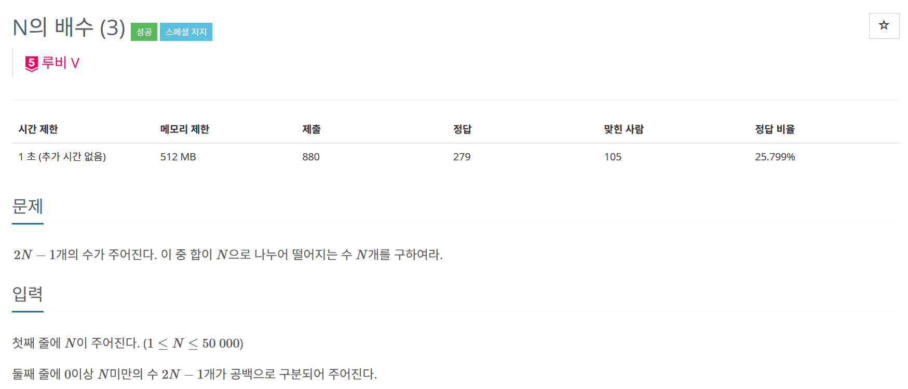

[상위 페이지 · 루비](/study/algorithms/dynamic-programming/ruby/)



## 문제 태그

- EGZ 정리
- 구성적 재귀 (합성수 분해)
- subset sum mod p
- 비트셋 순환 DP

---

## 문제 요약

### 입력

- 정수 N이 주어지고, 길이 2N-1 배열 a가 주어진다.
- 각 원소는 $$0 <= a_i < N.$$

### 출력

- 원소 N개를 출력하되, 합이 N으로 나누어떨어져야 한다.
- 가능한 답이 여러 개면 아무거나 출력해도 된다.

### 제약

- 1 <= N <= 50000
- 시간 제한 1초, 메모리 제한 512MB

### 목표 재정의

- 길이 2N-1에서 합이 0 mod N인 크기 N 부분수열을 실제 인덱스로 구성한다.

---

## 아이디어

### 1) 핵심 관찰

- EGZ 정리에 의해 정답은 항상 존재한다.
- N이 합성수이면 N=a*b로 분해해서 두 단계 모듈러 문제로 재귀 처리할 수 있다.
- N이 소수 p이면 정렬 + 페어링으로 diff 부분합 모듈러 문제로 바뀐다.

<aside markdown="1">
💡

**왜 이 관찰이 성립하는가?**

- 합성수 분해에서는 각 그룹 합을 먼저 a의 배수로 만들고, 그룹 합의 몫에 대해 b 모듈러를 맞추면 전체가 ab 모듈러로 맞는다.
- 소수 케이스에서는 각 페어에서 아래 값/위 값을 고르는 선택이 diff를 더할지 말지의 선택과 동치다.
</aside>

### 2) 정리/성질/공식

- EGZ 정리: 길이 2m-1 수열에는 합이 m의 배수인 m개 부분수열이 존재한다.
- 소수 p에서 정렬 배열 $$x_0..x_{2p-2}$$에 대해
    
    $$d_j = x_{j+p-1} - x_j (1<=j<=p-1)$$를 두면,
    
    목표는 $$d_j$$의 부분합을 맞추는 문제로 환원된다.
    

$$
\left(x_0 + \sum_{j=1}^{p-1} x_j\right) + \sum_{j \in T} d_j \equiv 0 \pmod p
$$

### 3) 알고리즘 설계

1. spf를 만들어 소수/합성수를 분기한다.
2. solve_rec(n, arr):
    - n이 합성수면 x=spf[n], y=n/x로 두고 길이 2x-1 블록에서 x개씩 뽑아 2y-1개 그룹을 만든다.
    - 그룹 값 $$carry_i=(GroupSum_i/x)\%y$$에 대해 재귀 호출해서 그룹을 선택한다.
3. n이 소수 p면 solve_prime:
    - 정렬 후 $$x_i==x_{i+p-1}$$인 구간이 있으면 바로 반환
    - 없으면 diff를 만들고 회전 비트셋 DP로 target 나머지 도달 여부를 찾는다.
    - parent 배열로 선택한 diff를 복원해 실제 인덱스를 만든다.

### 4) 케이스 분기

- N=1: 유일한 원소 1개 출력
- N=2: 3개 중 같은 홀짝 2개를 선택
- N 소수: 정렬-페어링 + 비트셋 DP
- N 합성수: 소인수 분해 재귀

### 5) 정당성 요약

- 합성수 분기에서 각 그룹 합은 x의 배수이고, 상위 재귀에서 그룹 몫 합을 y의 배수로 맞춘다.
- 따라서 선택된 전체 원소 합은 x*y=N의 배수다.
- 소수 분기에서 페어 선택은 diff 부분합 선택과 정확히 대응한다.
- 회전 비트셋 DP는 가능한 모듈러 부분합 집합을 완전하게 계산한다.
- parent 역추적은 실제 선택 집합을 구성하므로 출력은 항상 유효하다.

---

## 구현 포인트

### 자료구조 선택

- deque<int>: 합성수 재귀에서 블록 처리 후 남는 원소를 앞에 되돌려야 해서 사용
- vector<unsigned long long>: 소수 케이스 모듈러 부분합 비트셋
- vector<int> par/prv: 부분합 복원

### 인덱싱/경계

- 전부 0-based 인덱스로 관리한다.
- 회전 비트셋에서 마지막 워드(p 초과 비트)는 마스크로 제거한다.

### 오버플로우/정밀도

- 합은 최대 N*(N-1) 수준이므로 그룹 합/중간 합은 ll 사용
- 모듈러 계산은 모두 int 범위에서 안전

### 디버깅 포인트

- keep를 push_front로 되돌릴 때 역순으로 넣어야 블록 순서가 유지된다.
- target 복원 루프에서 pre=(cur-d+p)%p 형태 음수 보정이 필수다.

---

## 정답

```cpp
#include <bits/stdc++.h>

using namespace std;

using ll = long long;
using pii = pair<int, int>;
using vi = vector<int>;
using vll = vector<ll>;
using vpii = vector<pii>;

#define all(x) (x).begin(), (x).end()
#define rall(x) (x).rbegin(), (x).rend()
#define sz(x) (int)(x).size()
#define F first
#define S second
#define pb push_back
#define mp make_pair
#define lb lower_bound
#define ub upper_bound

#ifndef ONLINE_JUDGE
template<typename A, typename B>
ostream& operator<<(ostream& os, const pair<A, B>& p) {
    return os << "{" << p.first << ", " << p.second << "}";
}
template<typename T>
ostream& operator<<(ostream& os, const vector<T>& v) {
    os << "[";
    for (size_t i = 0; i < v.size(); ++i) {
        os << v[i];
        if (i != v.size() - 1) os << ", ";
    }
    return os << "]";
}
#define debug(...) cerr << "[DEBUG] " << #__VA_ARGS__ << ": ", DBG(__VA_ARGS__)
template<typename T> void DBG(const T& v) { cerr << v << '\n'; }
template<typename T, typename... Args> void DBG(const T& v, const Args&... args) { cerr << v << ", "; DBG(args...); }
#else
#define debug(...)
#endif

using ull = unsigned long long;

vi spf;

inline bool bit_get(const vector<ull>& b, int pos) {
    return (b[pos >> 6] >> (pos & 63)) & 1ULL;
}

void shl_bits(const vector<ull>& src, vector<ull>& dst, int sh) {
    int W = (int)src.size();
    fill(all(dst), 0ULL);
    int ws = sh >> 6;
    int bs = sh & 63;
    for (int i = W - 1; i >= 0; --i) {
        ull v = 0;
        int j = i - ws;
        if (j >= 0) {
            v |= (src[j] << bs);
            if (bs && j - 1 >= 0) v |= (src[j - 1] >> (64 - bs));
        }
        dst[i] = v;
    }
}

void shr_bits(const vector<ull>& src, vector<ull>& dst, int sh) {
    int W = (int)src.size();
    fill(all(dst), 0ULL);
    int ws = sh >> 6;
    int bs = sh & 63;
    for (int i = 0; i < W; ++i) {
        ull v = 0;
        int j = i + ws;
        if (j < W) {
            v |= (src[j] >> bs);
            if (bs && j + 1 < W) v |= (src[j + 1] << (64 - bs));
        }
        dst[i] = v;
    }
}

void rotl_bits(const vector<ull>& src, vector<ull>& dst, int d, int nbits, ull last_mask, vector<ull>& t1, vector<ull>& t2) {
    if (d == 0) {
        dst = src;
        return;
    }
    shl_bits(src, t1, d);
    shr_bits(src, t2, nbits - d);
    int W = (int)src.size();
    for (int i = 0; i < W; ++i) dst[i] = t1[i] | t2[i];
    dst.back() &= last_mask;
}

vi solve_rec(int n, const vi& a);

vi solve_prime(int p, const vi& a) {
    vector<pair<int, int>> s;
    s.reserve((int)a.size());
    for (int i = 0; i < (int)a.size(); ++i) s.pb({a[i], i});
    sort(all(s));

    for (int i = 0; i < p; ++i) {
        if (s[i].F == s[i + p - 1].F) {
            vi res;
            res.reserve(p);
            for (int j = i; j <= i + p - 1; ++j) res.pb(s[j].S);
            return res;
        }
    }

    int m = p - 1;
    vi diff(m);
    int base = s[0].F % p;
    for (int j = 1; j < p; ++j) {
        base += s[j].F;
        if (base >= p) base %= p;
        diff[j - 1] = s[j + p - 1].F - s[j].F;
        if (diff[j - 1] >= p) diff[j - 1] %= p;
    }
    int target = (p - base) % p;

    int W = (p + 63) >> 6;
    ull last_mask = (p & 63) ? ((1ULL << (p & 63)) - 1ULL) : ~0ULL;

    vector<ull> reach(W, 0ULL), rot(W), t1(W), t2(W), nw(W);
    reach[0] |= 1ULL;

    vi par(p, -1), prv(p, -1);

    for (int i = 0; i < m; ++i) {
        int d = diff[i];
        rotl_bits(reach, rot, d, p, last_mask, t1, t2);
        for (int w = 0; w < W; ++w) nw[w] = rot[w] & ~reach[w];
        nw.back() &= last_mask;

        for (int w = 0; w < W; ++w) {
            ull x = nw[w];
            while (x) {
                int b = __builtin_ctzll(x);
                int r = (w << 6) + b;
                if (r < p) {
                    par[r] = i;
                    int pre = r - d;
                    if (pre < 0) pre += p;
                    prv[r] = pre;
                }
                x &= x - 1;
            }
        }
        for (int w = 0; w < W; ++w) reach[w] |= rot[w];
    }

    if (!bit_get(reach, target)) {
        debug(p, target);
        return {};
    }

    vector<char> take(m, 0);
    int cur = target;
    while (cur != 0) {
        int id = par[cur];
        if (id < 0) return {};
        take[id] = 1;
        cur = prv[cur];
    }

    vi res;
    res.reserve(p);
    res.pb(s[0].S);
    for (int j = 1; j < p; ++j) {
        if (take[j - 1]) res.pb(s[j + p - 1].S);
        else res.pb(s[j].S);
    }
    return res;
}

vi solve_rec(int n, const vi& a) {
    if (n == 1) return {0};
    if (n == 2) {
        for (int i = 0; i < 3; ++i) {
            for (int j = i + 1; j < 3; ++j) {
                if (((a[i] + a[j]) & 1) == 0) return {i, j};
            }
        }
        return {};
    }

    if (spf[n] == n) return solve_prime(n, a);

    int x = spf[n];
    int y = n / x;

    deque<int> pool;
    for (int i = 0; i < (int)a.size(); ++i) pool.pb(i);

    int k = 2 * x - 1;
    vector<vi> bucket;
    bucket.reserve(2 * y - 1);
    vi carry;
    carry.reserve(2 * y - 1);

    for (int it = 0; it < 2 * y - 1; ++it) {
        vi pack(k), small(k);
        for (int i = 0; i < k; ++i) {
            pack[i] = pool.front();
            pool.pop_front();
            small[i] = a[pack[i]] % x;
        }

        vi pick = solve_rec(x, small);
        if ((int)pick.size() != x) {
            debug(n, x, y);
            return {};
        }

        vector<char> mk(k, 0);
        for (int id : pick) mk[id] = 1;

        vi keep, grp;
        keep.reserve(x - 1);
        grp.reserve(x);
        ll s = 0;

        for (int i = 0; i < k; ++i) {
            if (mk[i]) {
                grp.pb(pack[i]);
                s += a[pack[i]];
            } else keep.pb(pack[i]);
        }

        for (int i = (int)keep.size() - 1; i >= 0; --i) pool.push_front(keep[i]);

        bucket.pb(move(grp));
        carry.pb((int)((s / x) % y));
    }

    vi take_group = solve_rec(y, carry);
    if ((int)take_group.size() != y) return {};

    vi ans;
    ans.reserve(n);
    for (int g : take_group) {
        for (int idx : bucket[g]) ans.pb(idx);
    }
    return ans;
}

int main() {
    ios::sync_with_stdio(0);
    cin.tie(0);

    int N;
    cin >> N;
    vi a(2 * N - 1);
    for (int i = 0; i < 2 * N - 1; ++i) cin >> a[i];

    spf.assign(N + 1, 0);
    for (int i = 0; i <= N; ++i) spf[i] = i;
    for (int i = 2; (ll)i * i <= N; ++i) {
        if (spf[i] != i) continue;
        for (int j = i * i; j <= N; j += i) {
            if (spf[j] == j) spf[j] = i;
        }
    }

    vi pick = solve_rec(N, a);

    if ((int)pick.size() != N) {
        cout << -1 << '\n';
        return 0;
    }

    for (int i = 0; i < N; ++i) {
        if (i) cout << ' ';
        cout << a[pick[i]];
    }
    cout << '\n';

    return 0;
}
```

---

## 검증

### 시간복잡도

- 소수 `p` 처리: `O(p^2 / 64)`
- 전체 재귀: 합성수 분해 오버헤드는 선형에 가깝고, 병목은 소수 케이스
- 최악은 `N`이 큰 소수일 때이며 `N<=50000` 범위에서는 통과 가능하다.

### 공간복잡도

- `O(N)`
- 비트셋, parent 배열, 재귀 중간 버퍼를 모두 포함해도 메모리 제한 내

### 코너 케이스

- `N=1`: 바로 1개 출력
- `N=2`: 같은 홀짝 2개를 찾는 베이스 케이스
- 정렬 후 `x_i==x_{i+p-1}`가 존재하는 경우: DP 없이 즉시 종료
- 합성수 분해에서 되돌려 넣는 순서가 깨지는 경우: 오답 발생 가능

### 테스트 체크

- `N=4, a=[1,2,3,0,1,2,3]` -> 길이 4 출력, 합 `%4==0`
- `N=7, a=[0,0,0,0,0,0,0,1,1,1,2,2,2]` -> 길이 7 출력, 합 `%7==0`

---

## 참고 개념정리

- [EGZ 구성적 재귀](/study/algorithms/math/egz-guseongjeog-jaegwi/)
- [소수 모듈러 Subset Sum 최적화](/study/algorithms/dynamic-programming/sosu-modyulreo-subset-sum-coejeoghwa/)
- 본 문제에서는 소수 케이스를 전부 아이템(`p-1`)으로 처리하는 버전을 사용한다.

---

## 참고 자료

- [Erdős–Ginzburg–Ziv theorem (Wikipedia)](https://en.wikipedia.org/wiki/Erd%C5%91s%E2%80%93Ginzburg%E2%80%93Ziv_theorem) - 존재성 정리 진술 확인
- [BOJ 18792](https://www.acmicpc.net/problem/18792) - 문제 원문/제약 확인
