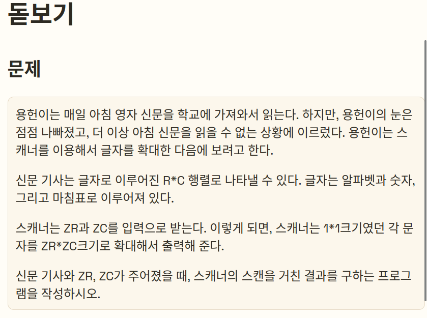

[상위 페이지 · 동아리 코테 정답](/study/algorithms/etc/dongari-kote-jeongdab/)



## 문제 태그

- [Implementation](/study/algorithms/implementation/)
- 문자열 시뮬레이션

## 예시 워크스루

입력이 3 3 1 2 이고 첫 줄이 .x. 인 경우를 기준으로 본다.

1. 가로 확대 배율이 2이므로 점은 두 개, x도 두 개로 늘린다.
2. .x. 는 ..xx.. 으로 바뀐다.
3. 세로 확대 배율이 1이므로 같은 줄을 한 번만 출력한다.
4. 모든 원본 줄에 동일 작업을 반복한다.

## 아이디어

각 줄에 대해 문자 단위 가로 확대를 먼저 만든 뒤, 완성된 줄을 세로 배율만큼 반복 출력하면 된다.

## Cpp 코드

```cpp
#include <bits/stdc++.h>
using namespace std;

int main() {
    ios::sync_with_stdio(0);
    cin.tie(0);

    int r, c, zr, zc;
    cin >> r >> c >> zr >> zc;

    vector<string> a(r);
    for (int i = 0; i < r; i++) cin >> a[i];

    string ans;
    for (int i = 0; i < r; i++) {
        string row;
        for (char ch : a[i]) row += string(zc, ch);
        for (int k = 0; k < zr; k++) ans += row + '\n';
    }

    cout << ans;
}
```

## 파이썬 코드

```python
import sys
input = sys.stdin.readline

r, c, zr, zc = map(int, input().split())
a = [input().strip() for _ in range(r)]

ans = []
for s in a:
    row = ''.join(ch * zc for ch in s)
    for _ in range(zr):
        ans.append(row)

print('\n'.join(ans))
```

## 파이썬 숏코딩 코드

```python
r,c,zr,zc=map(int,input().split())
a=[input().strip() for _ in range(r)]
print('\n'.join(''.join(ch*zc for ch in s) for s in a for _ in range(zr)))
```

## 검증

- 시간복잡도: O(R x C x ZR x ZC)
- 공간복잡도: O(R x C x ZR x ZC)
- 코너 케이스: ZR이나 ZC가 1인 경우 원본 축 그대로 출력된다.

## 참고 개념정리

- [Implementation](/study/algorithms/implementation/)
