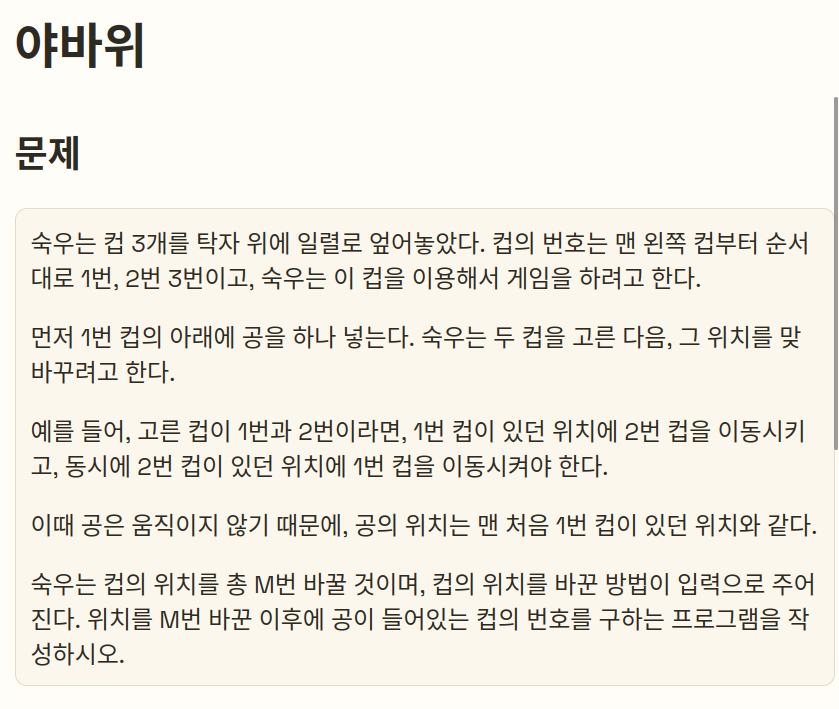

[상위 페이지 · 동아리 코테 정답](/study/algorithms/etc/dongari-kote-jeongdab/)



## 문제 태그

- [Implementation](/study/algorithms/implementation/)
- 상태 시뮬레이션

## 예시 워크스루

입력이 두 번 스왑이고 순서가 1 2 다음 3 1 인 경우를 기준으로 본다.

1. 시작 상태에서 공이 들어있는 컵 번호는 1이다.
2. 1번과 2번 컵을 바꾸면 공 컵 번호는 2가 된다.
3. 3번과 1번 컵을 바꾸면 공 컵 번호는 2로 유지된다.
4. 최종 출력은 2이다.

## 아이디어

공이 들어있는 컵 번호 하나만 추적하면 된다. 스왑 입력마다 현재 번호가 두 컵 중 하나일 때만 반대편으로 바꾼다.

## CPP 코드

```cpp
#include <bits/stdc++.h>
using namespace std;

int main() {
    ios::sync_with_stdio(0);
    cin.tie(0);

    int m;
    cin >> m;

    int ans = 1;
    while (m--) {
        int x, y;
        cin >> x >> y;
        if (ans == x) ans = y;
        else if (ans == y) ans = x;
    }

    cout << ans << '\n';
}
```

## 파이썬 코드

```python
import sys
input = sys.stdin.readline

m = int(input())
ans = 1

for _ in range(m):
    x, y = map(int, input().split())
    if ans == x:
        ans = y
    elif ans == y:
        ans = x

print(ans)
```

## 파이썬 숏코딩 코드

```python
b=1
for _ in range(int(input())):
 x,y=map(int,input().split())
 b=y if b==x else x if b==y else b
print(b)
```

## 검증

- 시간복잡도: O(M)
- 공간복잡도: O(1)
- 코너 케이스: X와 Y가 같은 입력은 상태 변화가 없어서 그대로 처리된다.

## 참고 개념정리

- [Implementation](/study/algorithms/implementation/)
