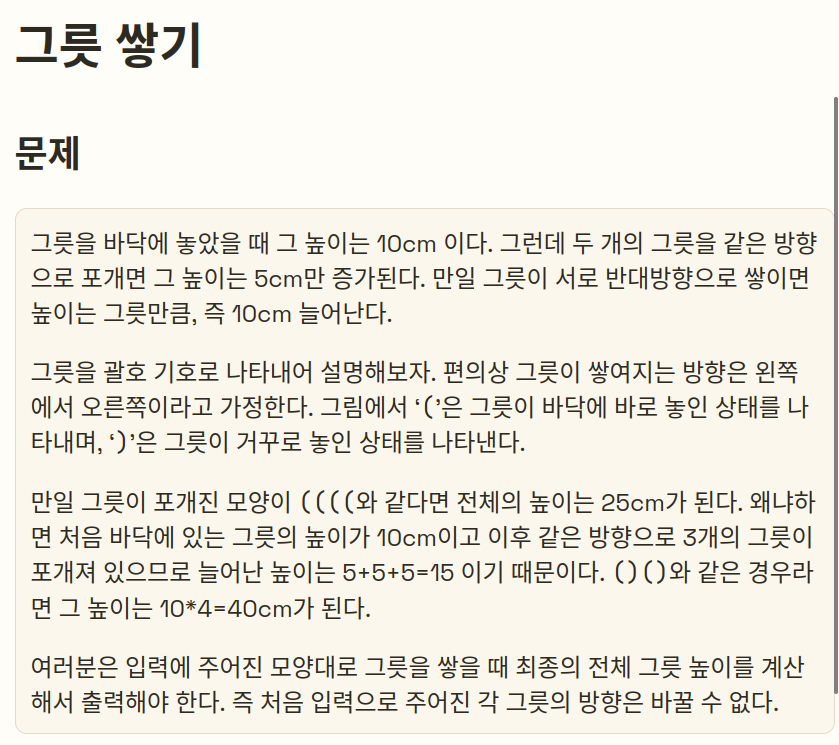

[상위 페이지 · 동아리 코테 정답](/study/algorithms/etc/dongari-kote-jeongdab/)



## 문제 태그

- [Implementation](/study/algorithms/implementation/)
- 연속 비교

## 예시 워크스루

입력이 (((( 인 경우를 기준으로 본다.

1. 첫 그릇 높이 10으로 시작한다.
2. 두 번째 그릇은 직전과 방향이 같아서 5가 늘어난다.
3. 세 번째와 네 번째도 같은 규칙으로 각각 5씩 늘어난다.
4. 최종 높이는 10 + 5 + 5 + 5 이므로 25이다.

## 아이디어

첫 문자로 10을 시작하고, 두 번째 문자부터 직전 문자와 같은지 비교해서 같으면 5, 다르면 10을 더한다.

## Cpp 코드

```cpp
#include <bits/stdc++.h>
using namespace std;

int main() {
    ios::sync_with_stdio(0);
    cin.tie(0);

    string s;
    cin >> s;

    int ans = 10;
    for (int i = 1; i < (int)s.size(); i++) {
        if (s[i] == s[i - 1]) ans += 5;
        else ans += 10;
    }

    cout << ans << '\n';
}
```

## 파이썬 코드

```python
import sys
input = sys.stdin.readline

s = input().strip()
ans = 10

for i in range(1, len(s)):
    if s[i] == s[i - 1]:
        ans += 5
    else:
        ans += 10

print(ans)
```

## 파이썬 숏코딩 코드

```python
s=input().strip()
print(10+sum(5 if a==b else 10 for a,b in zip(s,s[1:])))
```

## 검증

- 시간복잡도: O(문자열 길이)
- 공간복잡도: O(1)
- 코너 케이스: 길이 최솟값에서도 첫 그릇 10 시작 규칙이 그대로 맞는다.

## 참고 개념정리

- [Implementation](/study/algorithms/implementation/)
