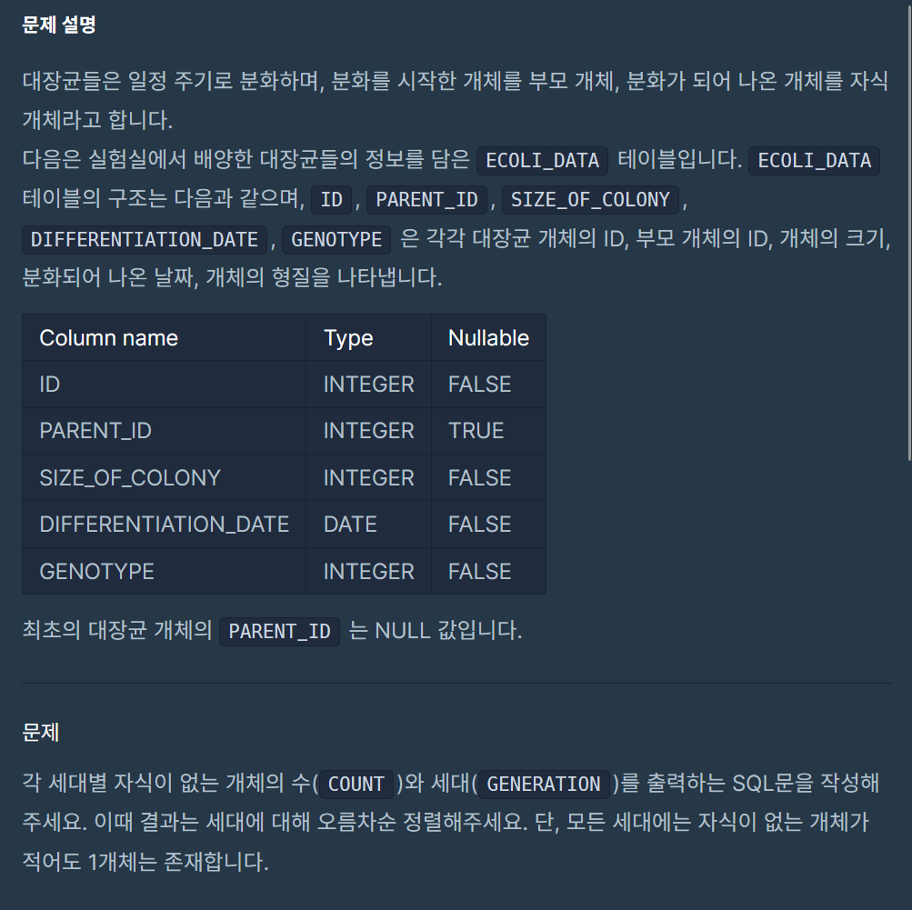

[상위 페이지 · 레벨 5](/study/algorithms/etc/sql/rebel-5/)



## 문제 태그

- 재귀
- 서브쿼리
- SELECT

## 아이디어

1. n세대 → parent_id에 n세대 ID를 가지고 있는 행을 불러오며 n세대에 맞게 재귀 cte를 함
2. WHERE로 세대별 자식이 없는것을 필터링 → 1번에서 만든 테이블 parent_id 목록에 내가 없다 
3. 세대열을 기준으로 그룹으로 묶고 정렬

## 정답

```sql
WITH RECURSIVE GENERATION_TABLE AS (
    SELECT ID, PARENT_ID, 1 AS GEN
    FROM ECOLI_DATA
    WHERE PARENT_ID IS NULL
    UNION
    SELECT a.ID, a.PARENT_ID, b.GEN + 1
    FROM ECOLI_DATA a 
    INNER JOIN GENERATION_TABLE b
    ON a.PARENT_ID = b.ID
)
SELECT COUNT(*) AS COUNT, GEN AS GENERATION
FROM GENERATION_TABLE
WHERE ID NOT IN (
    SELECT DISTINCT PARENT_ID
    FROM ECOLI_DATA
    WHERE PARENT_ID IS NOT NULL
)
GROUP BY GENERATION
ORDER BY GENERATION
```
