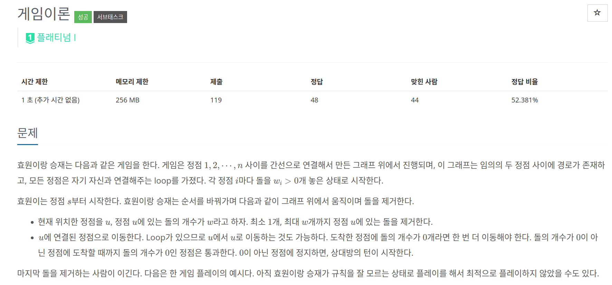
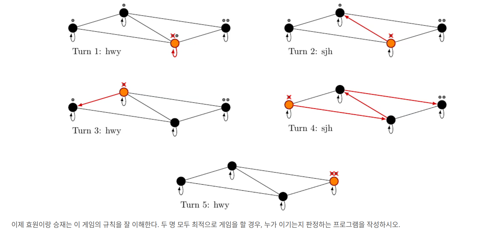

[상위 페이지 · 플레](/study/algorithms/game-theory/platinum/)





## 문제 태그

- [스프라그 - 그런디](/study/algorithms/game-theory/seupeurageu-geureondi/)
- [Graph](/study/algorithms/graph/)
- 컴포넌트 홀짝 판정

## 문제 요약

### 입력

- 연결된 무방향 그래프와 시작 정점이 주어진다.
- 모든 정점에는 초기에 돌이 1개 이상 있다.
- 모든 정점에는 자기 자신으로 가는 루프가 있다.

### 출력

- 두 사람이 최적으로 플레이할 때 승자를 출력한다.

### 목표 재정의

- 시작 정점에서 출발하는 상태가 선공 필승인지 판정한다.

## 예시 워크스루

예시는 정점이 2개이고 시작 정점이 1이며 돌 개수가 1, 2인 경우를 본다.

1. 초기 상태에서 정점 1의 돌은 1개라서 반드시 1개를 제거해야 한다.
2. 정점 1이 0이 되면 돌이 남아 있는 정점 2로 이동해 턴을 넘긴다.
3. 상대는 정점 2에서 2개를 전부 제거할 수 있으므로 마지막 돌을 가져간다.
4. 이 경우 선공은 패배한다.

## 아이디어

### 핵심 관찰

1. 현재 정점의 돌이 2개 이상이면 선공이 항상 유리하다.
2. 실제 패배 상태는 현재 정점 돌이 1개인 경우에서만 나온다.
3. 돌이 1개인 정점만 남긴 유도 그래프를 보면 승패를 연결요소 홀짝으로 정리할 수 있다.
4. 모든 정점의 돌이 1개인 경우는 총 턴 수가 정점 수와 같아서 정점 수 홀짝으로 바로 결정된다.

### 판정 규칙

- 시작 정점 돌이 2개 이상이면 선공 승리
- 모든 정점 돌이 1개이면 정점 수가 홀수일 때 선공 승리, 짝수일 때 선공 패배
- 그 외에는 시작 정점이 속한 1-정점 연결요소 크기가 짝수면 선공 승리, 홀수면 선공 패배

## 구현 포인트

- 간선을 읽을 때 양 끝 정점이 모두 돌 1개인 간선만 따로 저장한다.
- 시작 정점에서 1-정점 그래프 BFS를 한 번만 수행해 연결요소 크기를 구한다.
- 루프 간선은 연결요소 크기에 영향이 없으므로 무시한다.

## 정답

```cpp
#include <bits/stdc++.h>

using namespace std;

using ll = long long;
using pii = pair<int, int>;
using vi = vector<int>;
using vll = vector<ll>;
using vpii = vector<pii>;

#define all(x) (x).begin(), (x).end()
#define rall(x) (x).rbegin(), (x).rend()
#define sz(x) ((int)((x).size()))
#define F first
#define S second
#define pb push_back
#define mp make_pair
#define lb lower_bound
#define ub upper_bound

#ifndef ONLINE_JUDGE
template<typename A, typename B>
ostream& operator<<(ostream& os, const pair<A, B>& p) {
    return os << "{" << p.first << ", " << p.second << "}";
}
template<typename T>
ostream& operator<<(ostream& os, const vector<T>& v) {
    os << "[";
    for (size_t i = 0; i < v.size(); ++i) {
        os << v[i];
        if (i != v.size() - 1) os << ", ";
    }
    return os << "]";
}

#define debug(...) cerr << "[DEBUG] " << #__VA_ARGS__ << ": ", DBG(__VA_ARGS__)
template<typename T> void DBG(const T& v) { cerr << v << endl; }
template<typename T, typename... Args> void DBG(const T& v, const Args&... args) { cerr << v << ", "; DBG(args...); }
#else
#define debug(...)
#endif

int main() {
    ios::sync_with_stdio(0);
    cin.tie(0);

    int n, m, s;
    cin >> n >> m >> s;

    vi w(n + 1);
    bool all_one = 1;
    for (int i = 1; i <= n; i++) {
        cin >> w[i];
        if (w[i] != 1) all_one = 0;
    }

    if (w[s] >= 2) {
        cout << "hwy\n";
        return 0;
    }

    vector<vi> one_adj(n + 1);
    for (int i = 0; i < m; i++) {
        int u, v;
        cin >> u >> v;
        if (u == v) continue;
        if (w[u] == 1 && w[v] == 1) {
            one_adj[u].pb(v);
            one_adj[v].pb(u);
        }
    }

    if (all_one) {
        if (n & 1) cout << "hwy\n";
        else cout << "sjh\n";
        return 0;
    }

    vi vis(n + 1, 0);
    queue<int> q;
    q.push(s);
    vis[s] = 1;
    int cnt = 0;

    while (!q.empty()) {
        int cur = q.front();
        q.pop();
        cnt++;
        for (int nxt : one_adj[cur]) {
            if (vis[nxt]) continue;
            vis[nxt] = 1;
            q.push(nxt);
        }
    }

    string ans;
    if (cnt & 1) ans = "sjh";
    else ans = "hwy";
    cout << ans << '\n';

    return 0;
}

```

## 검증

### 시간복잡도

- O(n + m)

### 공간복잡도

- O(n + m)

### 코너 케이스

- 시작 정점 하나만 있는 경우
- 시작 정점 돌이 1이고 다른 정점이 모두 2 이상인 경우
- 모든 정점 돌이 1인 경우
- 1-정점 연결요소가 여러 개로 분리된 경우

## 참고 개념정리

- [스프라그 - 그런디](/study/algorithms/game-theory/seupeurageu-geureondi/)
