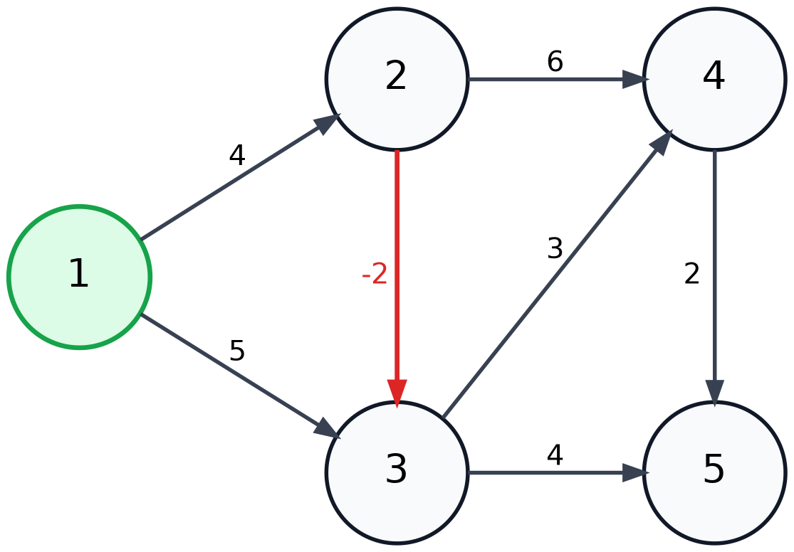
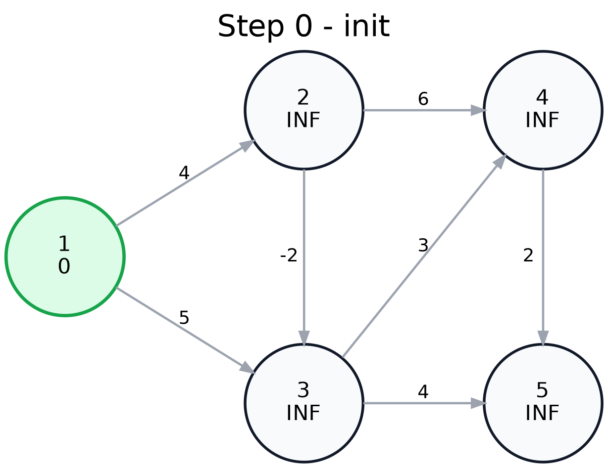
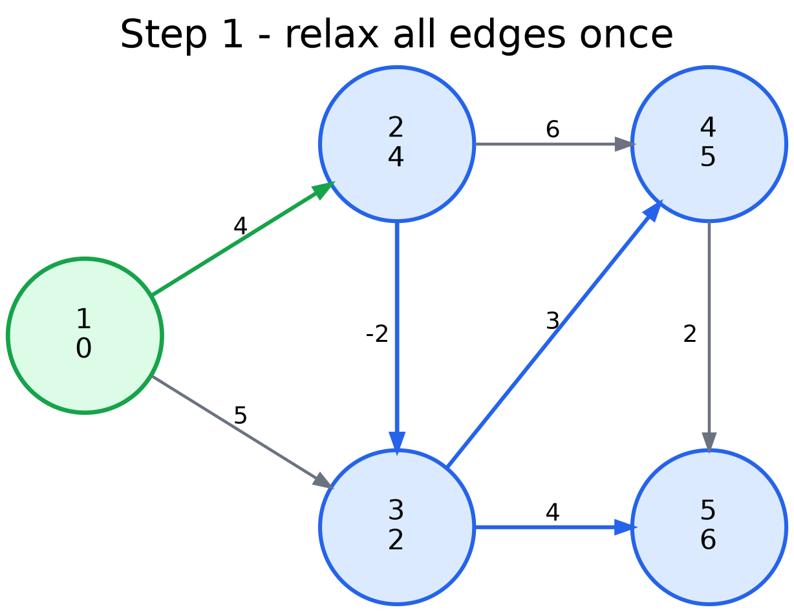
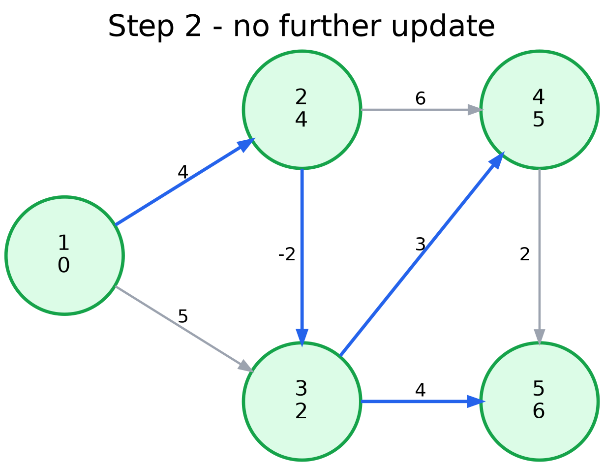
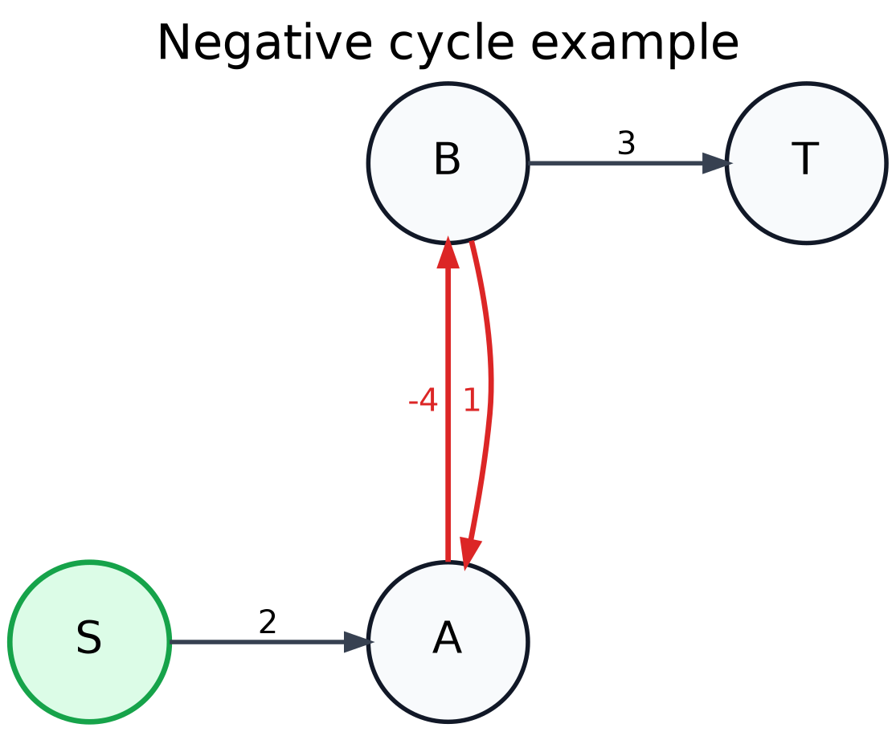

[상위 페이지 · Graph](/study/algorithms/graph/)

## 선행지식

- [Graph](/study/algorithms/graph/)
- [Dijkstra](/study/algorithms/graph/dijkstra/)

## 기본 개념

벨만 포드 알고리즘은 시작 정점 하나에서 모든 정점까지의 최단 거리를 구하는 알고리즘이다.

다익스트라와 달리 음수 가중치 간선을 허용하고, 음수 사이클 존재 여부까지 판별할 수 있다.

## 예시 워크스루



시작 정점을 1로 둔다.

- 간선: 1→2(4), 1→3(5), 2→3(-2), 2→4(6), 3→4(3), 3→5(4), 4→5(2)

### 초기화



- 거리 배열: [0, INF, INF, INF, INF]

### 1회차 전체 간선 완화



- 2: 4
- 3: min(5, 4-2)=2
- 4: min(INF, 2+3)=5
- 5: min(INF, 2+4)=6
- 결과: [0, 4, 2, 5, 6]

### 2회차 전체 간선 완화



- 모든 간선을 다시 확인해도 갱신이 발생하지 않는다.
- 따라서 최단 거리 수렴이 끝난다.

### 음수 사이클 확인

- 간선을 한 번 더 순회했을 때 갱신이 발생하면 음수 사이클이 존재한다.

## 성립 조건 / 정리

### 조건

- 그래프는 방향 그래프와 무방향 그래프 모두 가능하다.
- 음수 가중치 간선이 있어도 된다.

### 정리

- 전체 간선 완화를 정점 수-1번 수행하면 최단 거리가 수렴한다.
- 정점 수번째 확인에서 갱신이 생기면 시작 정점에서 도달 가능한 음수 사이클이 존재한다.

$$
\text{if } d[v] > d[u] + w(u,v),\ \ d[v] = d[u] + w(u,v)
$$

## 동작 원리

### 전체 흐름

1. 시작 정점은 0, 나머지는 INF로 초기화한다.
2. 전체 간선을 정점 수-1번 순회하며 완화를 수행한다.
3. 한 번 더 전체 간선을 순회해 음수 사이클 존재 여부를 검사한다.

### 불변식

- k회차가 끝나면 간선 수가 k개 이하인 모든 경로에 대한 최단 거리가 반영된다.
- 음수 사이클이 없으면 정점 수-1회 이후 더 이상 거리 갱신이 일어나지 않는다.

### 왜 맞는가

최단 경로는 단순 경로 기준으로 최대 정점 수-1개의 간선을 사용한다.

따라서 정점 수-1회 완화면 최단 경로 후보가 모두 반영되고, 이후 갱신이 남아 있으면 음수 사이클의 영향이라고 볼 수 있다.

## 절차(구현 기준)

1. 간선 리스트를 구성한다.
2. 거리 배열을 INF로 초기화하고 시작 정점만 0으로 둔다.
3. 정점 수-1회 반복하면서 모든 간선을 순회한다.
4. 완화가 한 번도 발생하지 않으면 조기 종료한다.
5. 마지막으로 전체 간선을 한 번 더 확인해 음수 사이클을 판별한다.

## 복잡도

- 시간복잡도: O(VE)
- 공간복잡도: O(V)
- 병목 구간: 전체 간선 완화 반복

## 실패/반례 패턴



- 음수 사이클이 있을 때 최단 거리값을 그대로 출력하면 오답이 된다.
- 도달 불가능 정점을 INF 처리하지 않으면 잘못된 합 연산이 발생한다.
- 완화 반복 횟수를 정점 수-2 또는 정점 수로 잘못 잡으면 결과가 틀어진다.

## 구현

```python
import sys

input = sys.stdin.readline
INF = 10**18

def bellman_ford(n, edges, start):
    dist = [INF] * (n + 1)
    dist[start] = 0

    for _ in range(n - 1):
        updated = False
        for u, v, w in edges:
            if dist[u] == INF:
                continue
            if dist[v] > dist[u] + w:
                dist[v] = dist[u] + w
                updated = True
        if not updated:
            break

    for u, v, w in edges:
        if dist[u] == INF:
            continue
        if dist[v] > dist[u] + w:
            return None

    return dist

def solve():
    n, m = map(int, input().split())
    start = int(input())
    edges = [tuple(map(int, input().split())) for _ in range(m)]

    dist = bellman_ford(n, edges, start)
    if dist is None:
        print("negative cycle")
        return

    out = []
    for i in range(1, n + 1):
        if dist[i] == INF:
            out.append("INF")
        else:
            out.append(str(dist[i]))
    print("\n".join(out))

if __name__ == "__main__":
	    solve()
```
