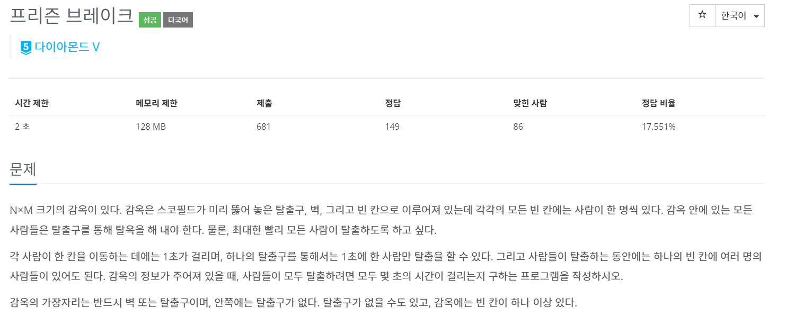

[상위 페이지 · 다이아](/study/algorithms/graph/diamond/)

[https://www.acmicpc.net/problem/1886](https://www.acmicpc.net/problem/1886)



## 아이디어

bfs, dfs, 최대유량, 이분매칭 문제
일단 위 문제를 해결하기 위해서 생각한 방법은

1. 각 죄수들을 bfs 돌리면서 문을 찾고 그 문까지의 거리를 기록한다. 문과 죄수의 거리가 같을 수도 있으니 미리 널널하게 160초까지 그 문으로 탈출 할 수 있는 경로(그 자리에서 n초 가만히 있는것도 하나의 경로)를 만들어둔다. <- 이분매칭 할 때 죄수끼리 겹치는 경로가 나오면 다시 매칭 시켜주기 위함
2. 1번중에 문까지 매칭이 되지 않은 죄수가 있다면 impossible을 출력한다
3. 만약 모든 죄수가 문으로 통하는 길이 있다면 파라메트릭 서치로 low가 high를 넘는 즉 최대시간을 조절해주면서 죄수가 모두 탈출 할 수 있으면서 걸리는 시간이 최소인 하나의 값으로 수렴할 때 까지 4번을 반복한다
4. 조절한 최대시간을 경로 가중치의 리밋으로 이분 매칭을 시작하는데 모든 죄수가 동시에 탈출 할 수 있는것이 조건이 걸린 이분매칭으로 넘어감. 여기서 유량은 죄수가 탈출한 수. 만약 flow가 죄수와 같다면 모든 죄수가 문과 매칭 돼 탈출 한것

## 정답

```python
from collections import defaultdict, deque

dir = [[0,1], [0,-1], [1,0], [-1,0]]

def id(i, j): # 이차원 배열 값을 1차원의 n으로 변경
    return i * n + j

def bfs(x, y):
    queue = deque([(x, y)])
    visited = [[-1 for _ in range(m)] for _ in range(n)] #방문체크 & 죄수로부터 각 타일에 대한 시간
    visited[x][y] = 0
    unique_id = id(x, y) # 현재 죄수의 n위치
    isEscapalbe = False # 탈출 가능 여부
    while queue:
        r, c = queue.popleft()

        for dr,dc in dir:
            ddr = r + dr
            ddc = c + dc

            if 0 <= ddr < n and 0 <= ddc < m and visited[ddr][ddc] == -1:
                if board[ddr][ddc] == '.':
                    queue.append((ddr, ddc))
                    visited[ddr][ddc] = visited[r][c] + 1
                elif board[ddr][ddc] == 'D':
                    isEscapalbe = True
                    visited[ddr][ddc] = visited[r][c] + 1
                    for j in range(visited[ddr][ddc], 160): # 각 죄수로부터 발견한 문까지의 모든 경로를 다 딕셔너리로 만들어준다? 만약 그 거리에 벽이있다면???
                        path[unique_id].append((j * sink + id(ddr, ddc), j))
    return isEscapalbe

def dfs(here, limit, visited, matched): # 이분매칭
    if visited[here]:
        return False
    visited[here] = True
    for i in range(len(path[here])):
        next, cost = path[here][i]
        if cost > limit:
            continue
        # 이미 그곳에 매칭된 결과가 있다면  -> 매치 다시 요청 이마저도 실패시 매칭 실패로 리턴
        if matched[next] == -1 or dfs(matched[next], limit, visited, matched):
            matched[next] = here
            return True
    return False

def check_escape(limit): # 유량 체크
    matched = [-1] * (sink * 160 + 1)
    flow = 0
    for i in range(n):
        for j in range(1, m+1):
            visited = [False] * (sink * 160 + 1)
            if dfs(id(i, j), limit,visited,matched):
                flow += 1
    return flow == cnt

n, m = map(int, input().split())
sink = id(n - 1, m) + 1
board = [input().strip() for _ in range(n)]
path = defaultdict(list)

cnt = sum(row.count('.') for row in board) # 범죄자 수

if not all(bfs(i, j) for i in range(n) for j in range(m) if board[i][j] == '.'): #bfs에서 한번이라도 탈출 불가능 사인이 나오면 탈출 불가능
    print("impossible")
else:
    # 둘다 가능
    for i in range(161):
        if check_escape(i):
            print(i)
            break
    # low, high = 0, 161
    # while low + 1 < high:
    #     mid = (low + high) // 2
    #     if check_escape(mid):
    #         high = mid
    #     else:
    #         low = mid
    # print(high)
```
