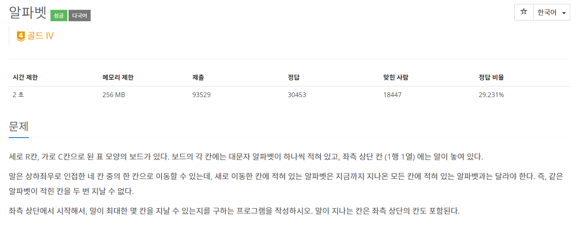

[상위 페이지 · 골드/레벨3](/study/algorithms/graph/gold-level-3/)

[https://www.acmicpc.net/problem/1987](https://www.acmicpc.net/problem/1987)



## 아이디어

입력값:

```
2 4
CAAB
ADCB
```

경로가 CAA.CADC 이런식으로 되면 안된다는 얘기이다. 경로가 중요한 문제기 때문에 DFS로 푸는것이 더 바람직하다.

방문리스트에 경로를 저장해줘도 되지만 그렇게 하는것보다 백트래킹이라는 기술을 사용하여 푸는것이 더 바람직하다

재귀 4번째단계에서 경로가 ABWS가 나왔다면 다시 3번째 재귀로 돌아갈때 4번째 단계에서 사용했던 S를 지워주어 다시 3번째 원 상태로 만들어주는것이 백트래킹이다.

하지만 이렇게 해서는 시간초과를 해결할 수가 없었다. 파이썬의 문제로 너무 너무 느리다는것이다.

그래서 문자열에 문자열을 더하는건 시간을 많이 잡아 먹으니 문자열을 아스키코드로 변환하여 방문처리를 해줬다

## 첫번째 시도

```python
import sys

input = sys.stdin.readline
R,C = list(map(int,input().split()))
miro = []
dir = [[1,0],[-1,0],[0,-1],[0,1]]
for i in range(R):
    temp = input()
    miro.append(list(temp))

alphabet = set()

max = 0
def dfs(pos,count):
    global max
    if count > max:
        max = count
    r,c = pos
    for dr,dc in dir:
        ddr = dr + r
        ddc = dc + c
        if 0<=ddr<R and 0<=ddc<C and miro[ddr][ddc] not in alphabet:
            alphabet.add(miro[ddr][ddc])
            dfs((ddr,ddc),count + 1)
            alphabet.remove(miro[ddr][ddc])

alphabet.add(miro[0][0])
dfs((0,0),1)
print(max)
```

## 정답

```python
# 시간제한 계속 나길래 전혀 모르겠어서 블로그 보니 아스키코드를 사용하라는 아이디어를 봄
import sys

input = sys.stdin.readline
R,C = list(map(int,input().split()))
miro = [list(map(lambda x: ord(x)-65, sys.stdin.readline().rstrip())) for _ in range(R)]
dir = [[1,0],[-1,0],[0,-1],[0,1]]

# 알파벳 방문 여부를 체크하는 리스트
alphabet = [0] * 26

max = 0
def dfs(pos,count):
    global max
    if count > max:
        max = count
    r,c = pos
    for dr,dc in dir:
        ddr = dr + r
        ddc = dc + c
        # 인덱스 범위 체크 및 해당 알파벳 방문 여부 체크
        if 0<=ddr<R and 0<=ddc<C and alphabet[miro[ddr][ddc]] == 0:
            alphabet[miro[ddr][ddc]] = 1
            dfs((ddr,ddc),count + 1)
            alphabet[miro[ddr][ddc]] = 0

# 시작점 방문 체크
alphabet[miro[0][0]] = 1
dfs((0,0),1)
print(max)
```
