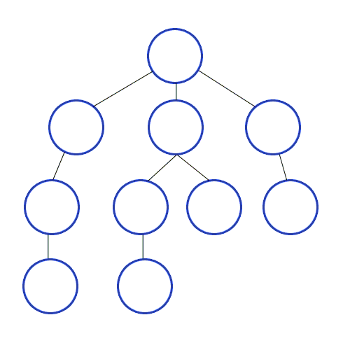

[상위 페이지 · 알고리즘](/study/algorithms/)

## 그래프

그래프는 정점과 간선으로 이루어진 자료구조로, 여러 개의 정점과 이를 연결하는 간선들로 구성된다. 이를 통해 객체와 객체 간의 관계를 표현할 수 있다.

프로그래밍에서 그래프는 일반적으로 인접 행렬(adjacency matrix)이나 인접 리스트(adjacency list)로 구현된다. 인접 행렬은 2차원 배열로 정점과 간선의 연결 여부를 표현하는 방식이며, 인접 리스트는 연결된 간선들을 리스트 형태로 저장하는 방식이다.

그래프를 인접 행렬로 구현한 예시

| row   \ column | 1 | 2 | 3 | 4 | 5 |
| --- | --- | --- | --- | --- | --- |
| 1 | 0 | 1 | 0 | 1 | 0 |
| 2 | 1 | 0 | 1 | 1 | 0 |
| 3 | 0 | 1 | 0 | 0 | 1 |
| 4 | 1 | 1 | 0 | 0 | 1 |
| 5 | 0 | 0 | 1 | 1 | 0 |

그래프를 인접 리스트로 구현한 예시

```
1: [2, 4]
2: [1, 3, 4]
3: [2, 5]
4: [1, 2, 5]
5: [3, 4]
```

그래프는 많은 알고리즘의 기반이 되며, 그래프를 탐색하는 방법으로는 DFS와 BFS가 있다. 

## BFS

BFS(너비 우선 탐색)는 그래프 탐색 알고리즘 중 하나로, 시작 정점에서부터 거리에 따라 단계별로 탐색해 나가는 방법이다. 즉, 가까운 정점부터 먼 정점까지 차례대로 방문하는 알고리즘이다. 이를 위해서는 큐 자료구조를 사용한다.



BFS는 다음과 같은 시퀸스로 동작한다

- 탐색 시작 노드를 큐에 삽입하고 방문 처리를 한다.
- 큐에서 노드를 꺼내 해당 노드의 인접 노드 중에서 방문하지 않은 노드를 모두 큐에 삽입하고 방문 처리를 한다.
- 두 번째 과정을 더 이상 수행할 수 없을 때까지 반복한다.

### BFS 예제 코드

```python
from collections import deque

def bfs(graph, start):
    visited = [] # 방문한 노드를 담을 리스트
    queue = deque([start]) # 큐 구현을 위해 deque 라이브러리 사용

    while queue: # 큐가 빌 때까지 반복
        node = queue.popleft() # 큐에서 하나의 원소를 뽑아 출력
        if node not in visited:
            visited.append(node)
            # 해당 원소와 연결된, 아직 방문하지 않은 원소들을 큐에 삽입
            queue += sorted(graph[node] - set(visited))

    return visited

# 그래프를 인접 리스트로 구현한 예시
graph = {
    '1': set(['2', '4']),
    '2': set(['1', '3', '4']),
    '3': set(['2', '5']),
    '4': set(['1', '2', '5']),
    '5': set(['3', '4'])
}

print(bfs(graph, '1'))
```

**출력 결과:**

```
['1', '2', '4', '3', '5']
```

## DFS

DFS(깊이 우선 탐색)는 그래프 탐색 알고리즘 중 하나로, 시작 정점에서부터 한 방향으로 갈 수 있는 최대한 깊게 탐색하는 방법이다. 즉, 트리 구조에서 한 노드에서 시작해서 가능한 한 멀리까지 탐색 후, 다시 돌아와서 다음 분기로 탐색하는 방법이다.


DFS는 다음과 같은 시퀸스로 동작한다

- 탐색 시작 노드를 스택에 삽입하고 방문 처리를 한다.
- 스택의 최상단 노드의 인접 노드 중에서 방문하지 않은 노드를 선택하고 그 노드를 스택에 넣고 방문 처리를 한다. 방문하지 않은 인접 노드가 없다면, 스택에서 최상단 노드를 꺼낸다.
- 두 번째 과정을 더 이상 수행할 수 없을 때까지 반복한다.

### DFS(스택) 예제 코드

```python
def dfs_stack(graph, start):
    visited = [] # 방문한 노드를 담을 리스트
    stack = [start] # 스택 구현을 위해 리스트 사용

    while stack: # 스택이 빌 때까지 반복
        node = stack.pop() # 스택에서 하나의 원소를 뽑아 출력
        if node not in visited:
            visited.append(node)
            # 해당 원소와 연결된, 아직 방문하지 않은 원소들을 스택에 삽입
            stack += sorted(graph[node] - set(visited),reverse=True)

    return visited

# 그래프를 인접 리스트로 구현한 예시
graph = {
    '1': set(['2', '4']),
    '2': set(['1', '3', '4']),
    '3': set(['2', '5']),
    '4': set(['1', '2', '5']),
    '5': set(['3', '4'])
}

print(dfs_stack(graph, '1'))
```

**출력 결과:**

```
['1', '2', '3', '5', '4']
```

DFS는 재귀적으로 동작하기 때문에 스택 자료구조를 사용하지 않고도 동작할 수 있다.

### DFS(재귀) 예제 코드

```python
def dfs(graph, start, visited):
    visited.append(start) # 방문한 노드를 visited 리스트에 추가
    for node in graph[start]: # 현재 노드와 연결된 노드들을 순회
        if node not in visited: # 만약 방문하지 않은 노드라면
            dfs(graph, node, visited) # 해당 노드를 시작 노드로 하여 dfs를 재귀적으로 호출
    return visited # 최종적으로 방문한 노드들의 리스트 반환

# 그래프를 인접 리스트로 구현한 예시
graph = {
    '1': set(['2', '4']),
    '2': set(['1', '3', '4']),
    '3': set(['2', '5']),
    '4': set(['1', '2', '5']),
    '5': set(['3', '4'])
}

print(dfs(graph, '1', []))
```

출력 결과

```
['1', '2', '3', '5', '4']
```

### DFS 백트래킹

[Back-Tracking](/study/algorithms/search/back-tracking/) 

## DFS와 BFS 장단점과 활용

### 장점

**BFS:**

- DFS보다 빠르게 탐색할 수 있음
- 최단 경로를 찾을 때 유용함
- 큐를 사용하기 때문에 메모리를 많이 사용할 수 있음

**DFS:**

- BFS보다 메모리를 적게 사용할 수 있음
- 목표 지점까지 도달하는 경로가 매우 깊을 경우에는 BFS보다 빠르게 탐색할 수 있음
- 단순 검색보다 경로가 중요한 경우 사용하기 좋음

BFS와 DFS는 각각의 장단점이 있으며, 문제에 따라 적합한 알고리즘을 선택하여 사용할 수 있다.

### 단점

**BFS:**

- DFS보다 메모리를 더 많이 사용함
- 최단 경로가 아닌 경우에는 최적의 솔루션을 보장하지 않음
- 재귀 함수를 사용할 수 없음

**DFS:**

- 최단 경로를 보장하지 않음
- 깊이에 따라 미로 상황에서 길을 찾는데 시간이 오래 걸릴 수 있음
- 스택 오버플로우가 발생할 가능성 있음

### 활용

BFS와 DFS는 각각의 장단점이 있으며, 문제에 따라 적합한 알고리즘을 선택하여 사용할 수 있다.

**BFS 활용법:**

- 최단 경로 탐색
- 두 노드 사이의 최단 경로 또는 임의의 경로를 찾을 때 사용
- 영역 구분
- 미로 탐색

**DFS 활용법:**

- 그래프의 모든 정점을 방문하는 경우
- 최단 경로를 찾는 것이 목적이 아닌 경우
- 특정 깊이까지 탐색하는 경우

## BFS가 최단거리를 보장하는 이유

BFS는 너비 우선 탐색이기 때문에 각각의 레벨에 속한 노드들을 모두 방문한 후 다음 레벨로 이동한다. 반면에 DFS는 깊이 우선 탐색이기 때문에 한 경로를 끝까지 탐색한 후 다른 경로로 이동한다.

예를 들어, 다음과 같은 그래프가 있다고 가정하겠다.

```
     1
    / \\
   2   3
  / \\   \\
 4 - 5  - 6
      \\
       7
```

이 그래프에서 1부터 7까지의 최단 경로를 찾는다고 가정하고 예시를 들겠다.

BFS로 탐색한다면, 다음과 같이 레벨별로 노드를 방문한다.

- 레벨 1: 1
- 레벨 2: 2, 3
- 레벨 3: 4, 5, 6
- 레벨 4: 7

따라서 BFS로 1부터 4까지 최단 경로를 찾으면 1 - 2 - 4이 된다.

반면에 DFS로 탐색한다면, 1 - 3 - 6 - 5 - 4의 경로로 도착 할 수도 있으며 최단거리 1 - 2 - 4 하고는 떨어진 결과를 보인다. 이래서 DFS는 최단거리를 보장해주지 못한다.

따라서, 최단 경로를 보장해야 하는 경우 BFS를 사용하는 것이 좋다.

단, 가중치가 1인 그래프에서만 최단거리 보장

## 그래프 관련 알고리즘

- **알고리즘**
    
    - [Dijkstra](/study/algorithms/graph/dijkstra/)
    
    - [**Bellman-Ford**](/study/algorithms/graph/bellman-ford/)
    
    - [**Floyd-Warshall**](/study/algorithms/graph/floyd-warshall/)
    
    - [**Kruskal Algorithm**](/study/algorithms/graph/kruskal-algorithm/)
    
    - [Union-Find](/study/algorithms/graph/union-find/)
    
    - [**Topological Sort**](/study/algorithms/graph/topological-sort/)
    
    - [**Euler Tour Technique**](/study/algorithms/graph/euler-tour-technique/)
    
    - [Strongly Connected Component](/study/algorithms/graph/strongly-connected-component/)
    
    - [Sparse Table](/study/algorithms/graph/sparse-table/)
    
- **네트워크 플로우**
    
    - [Maximum Flow](/study/algorithms/graph/maximum-flow/)
    
    - [**Bipartite Matching**](/study/algorithms/graph/bipartite-matching/)
    

## 문제 해결

- [다이아](/study/algorithms/graph/diamond/)

- [플래티넘](/study/algorithms/graph/platinum/)

- [골드/레벨3](/study/algorithms/graph/gold-level-3/)

- [실버](/study/algorithms/graph/silver/)
