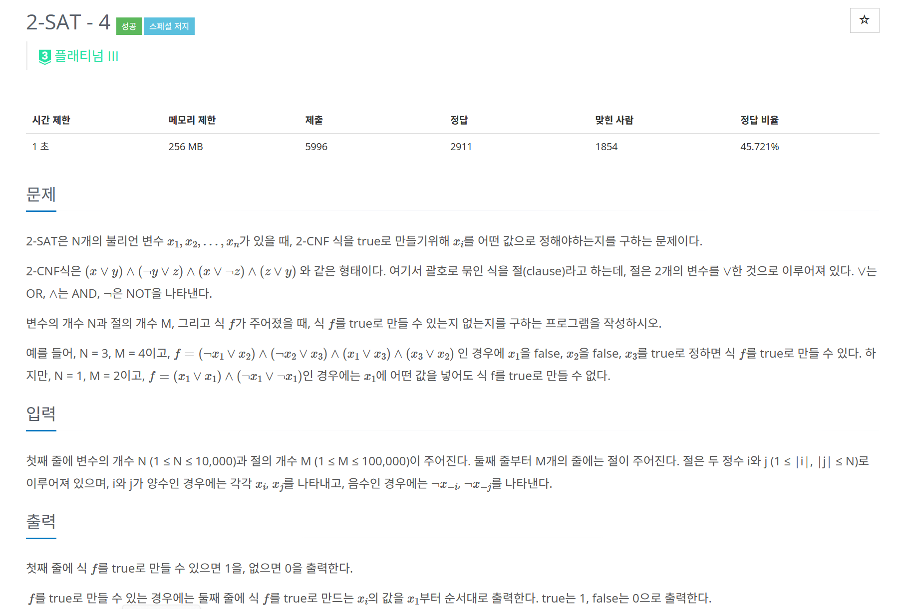

[상위 페이지 · 플래티넘](/study/algorithms/graph/platinum/)



## 문제 태그

- 그래프 이론
- SCC
- 2-SAT

## 아이디어

1. [11280. 2-SAT-3](/study/algorithms/graph/platinum/boj-11280/) 과 같은 문제지만 각 변수마다 어떤 값을 넣어야 식이 true로 만들어지는지까지 출력하는 문제이다.
2. 놀랍게도 scc된 결과를 정렬하여 뒤집으면 그게 위상정렬된 값임
3. 위상정렬된 값으로  먼저 나온걸(¬A라면 ¬A를 False A라면 A를 False) False로 두고 그 반대는 True로 둔다 이러면 각 xi에 대한 해가 나오게 된다

## 정답

```python
import sys
sys.setrecursionlimit(10**6)

def get_idx(x):
    return (abs(x) - 1) * 2 + (0 if x > 0 else 1)

def get_not_idx(idx):
    return idx ^ 1

def tarjan_scc(graph):
    n = len(graph)
    id = 0
    ids = [-1] * n
    low = [0] * n
    on_stack = [False] * n
    stack = []
    sccs = []
    scc_id = [0] * n

    def dfs(at):
        nonlocal id
        ids[at] = low[at] = id
        id += 1
        stack.append(at)
        on_stack[at] = True

        for to in graph[at]:
            if ids[to] == -1:
                dfs(to)
                low[at] = min(low[at], low[to])
            elif on_stack[to]:
                low[at] = min(low[at], ids[to])

        if ids[at] == low[at]:
            while True:
                node = stack.pop()
                on_stack[node] = False
                scc_id[node] = len(sccs)
                if node == at:
                    break
            sccs.append([])

    for i in range(n):
        if ids[i] == -1:
            dfs(i)

    return sccs, scc_id

# 입력 처리
N, M = map(int, input().split())
graph = [[] for _ in range(N * 2)]

for _ in range(M):
    A, B = map(int, input().split())
    A_idx = get_idx(A)
    B_idx = get_idx(B)
    not_A = get_not_idx(A_idx)
    not_B = get_not_idx(B_idx)
    graph[not_A].append(B_idx)
    graph[not_B].append(A_idx)

# SCC 수행
sccs, scc_id = tarjan_scc(graph)

# 모순 체크
is_possible = True
for i in range(N):
    if scc_id[i * 2] == scc_id[i * 2 + 1]:
        is_possible = False
        break

if not is_possible:
    print(0)
else:
    print(1)
    # 변수 할당
    order = [(scc_id[i], i) for i in range(2 * N)]
    order.sort(reverse=True)  # 위상 정렬 역순으로 처리

    value = [False] * (2 * N)
    assigned = [False] * N

    for _, u in order:
        var = u // 2
        is_true = (u % 2 == 0)
        if not assigned[var]:
            value[var] = not is_true  # 부정이 먼저 나오면 True
            assigned[var] = True

    result = []
    for i in range(N):
        print(1 if value[i] else 0, end=' ')

```
