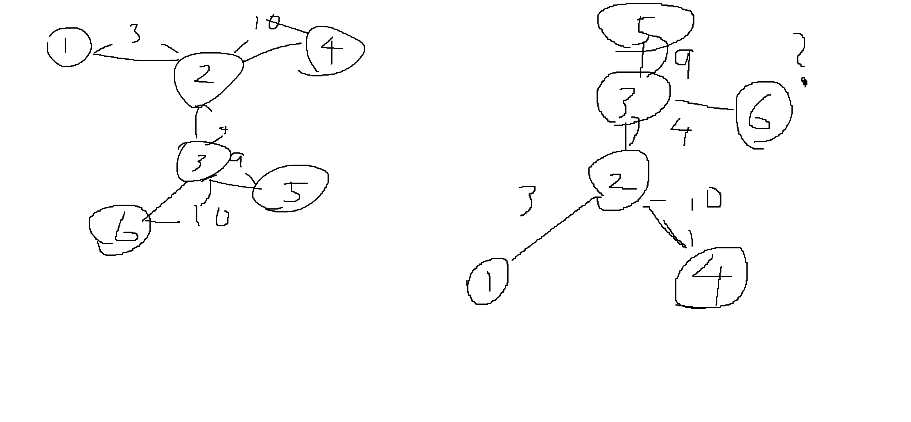
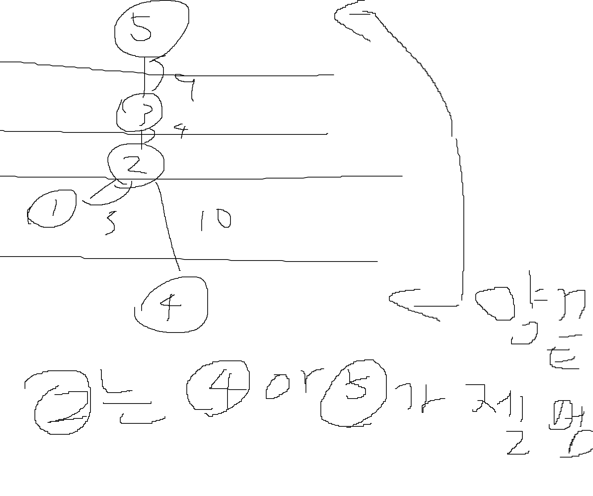

[상위 페이지 · 플래티넘](/study/algorithms/graph/platinum/)

[https://www.acmicpc.net/problem/13016](https://www.acmicpc.net/problem/13016)


## 아이디어

무방향 그래프에서 가장 먼 거리의 뜻은 그래프에서 내가 서 있는 노드를 기준으로 가장 떨어진 레벨의 노드이다.



노드 5번에서는 4번이 제일 멀리 떨어져있고 2번에서는 5번이 제일 멀리 떨어져있다.

처음에는 그냥 단순히 모든 노드를 dfs 돌려 해결을 하려 했지만 날먹은 안되는걸로,,,

모든 노드를 다 dfs 돌리는건 무리라고 판단하여 dfs 돌리는 횟수를 줄일 방법을 생각해야 했다.



5를 기준으로 한번  4를 기준으로 한번 dfs 돌려서 각각 거리를 구한다음에 5와 4중 거리가 먼걸 출력하면 될 것 같았다

좀 더 일반화를 하자면 1번노드에서 루트노드를 찾고 루트노드에서 가장 먼 테일노드를 찾는다

각각 루트,테일노드를 찾으면서 루트부터 모든 노드의 거리, 테일부터 모든 노드의 거리를 구한다음 테일부터 노드까지 루트부터 노드까지의 거리중 가장 긴걸 찾는다

다른 블로그에서는 트리의 지름?으로 푸는것 같은데 사실 읽어도 잘 모르겠다

## 정답

```python
import sys

input = sys.stdin.readline
sys.setrecursionlimit(10 ** 5)

n = int(input())
tree = [[] for _ in range(n + 1)]
for _ in range(n - 1):
    parent, child, weight = map(int, input().split())
    tree[parent].append((child, weight))
    tree[child].append((parent, weight))

tempnode = 0
tempcost = 0
visited = [False] * (n+1)
distance = [0] * (n+1)

def DFS(node, cost):
    global tempnode
    global tempcost
    visited[node] = True
    for adj_node, adj_w in tree[node]:
        cal_w = cost + adj_w
        if not visited[adj_node]:
            distance[adj_node] = cal_w
            if tempcost < cal_w:
                tempnode = adj_node
                tempcost = cal_w
            DFS(adj_node, cal_w)

DFS(1, 0)
rootnode = tempnode

tempcost = 0
visited = [False] * (n+1)
distance = [0] * (n+1)
DFS(rootnode, 0)
rootDistance = distance.copy()
#print("루트 노드:",rootnode,rootDistance)

visited = [False] * (n+1)
distance = [0] * (n+1)
tempcost = 0
tailnode = tempnode
DFS(tailnode, 0)
tailDistance = distance.copy()
#print("꼬리 노드",tailnode,tailDistance)

for i in range(1,n+1):
    print(max(tailDistance[i],rootDistance[i]))
```
