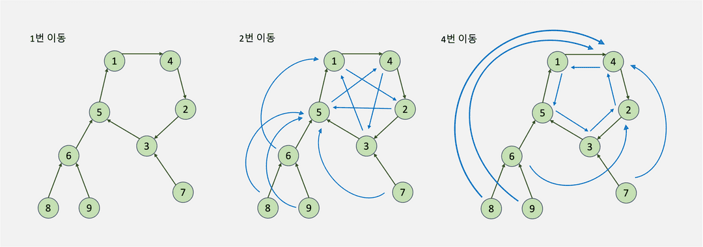

[상위 페이지 · Graph](/study/algorithms/graph/)

희소 배열은 정적 **데이터**에 대해 **압도적인 조회 속도**를 제공하는 전처리 기반 자료구조이다. 핵심은 **2의 거듭제곱($$2^k$$) 길이의 구간들을 미리 계산**해 두고, 이를 조합하여 원하는 결과를 얻는 것이다.

## 핵심 원리

우리는 1칸, 2칸, 3칸... 모든 이동 경로를 저장하지 않는다. 오직 **$$2^k$$ 길이의 정보만 저장**한다.

- **저장 구간:** $$1, 2, 4, 8, 16, \dots (2^0, 2^1, 2^2, \dots)$$
- **이유:** 모든 정수(구간의 길이, 이동 거리)는 이진수 표현법에 의해 다음이 가능하다
    - **그래프 :** 2의 거듭제곱의 합으로 표현
    - **배열 :** 2개의 겹치는 2의 거듭제곱 구간으로 커버

## 배열에서의 구간 쿼리

**목표:** 배열의 특정 구간 [L, R]에서 최솟값, 최댓값, GCD 등을 O(1)만에 찾는다.

### 테이블 정의 및 구축

- **st[i][j]**: 인덱스 i에서 시작하여 길이 $$2^j$$인 구간의 값 (범위: $$i \sim i + 2^j - 1$$)
- **점화식:** 길이 $$2^j$$는 길이 $$2^{j-1}$$ 두 개를 합친 것이다.

$$
st[i][j] = \min(st[i][j-1], \ st[i + 2^{j-1}][j-1])
$$

### 쿼리 과정

구간 [L, R]의 길이를 len이라 할 때:

1. len보다 작거나 같은 최대 2의 거듭제곱 $$2^k$$를 찾는다. ($$k = \lfloor \log_2(len) \rfloor$$)
2. **왼쪽 구간:** $$st[L][k]$$ (시작점 L에서 $$2^k$$만큼)
3. **오른쪽 구간:** $$st[R - 2^k + 1][k]$$ (끝점 R에서 거꾸로 $$2^k$$만큼)
4. **결과:** min(왼쪽, 오른쪽)

### 수학적 증명

임의의 구간 [L, R]은 최대 2개의 겹치는 2의 거듭제곱 구간으로 완전히 덮을 수 있음을 증명한다.

- **증명**
    1. **설정:** 구간 길이를 len = R - L + 1이라 한다.
    2. **k의 정의:** len 이하의 최대 2의 거듭제곱 지수를 $$k = \lfloor \log_2(len) \rfloor$$라 하면, $$2^k \le len < 2^{k+1}$$이 성립한다.
    3. **두 구간의 정의:**
        - 왼쪽 구간: $$[L, L + 2^k - 1]$$
        - 오른쪽 구간: $$[R - 2^k + 1, R]$$
    4. **커버 확인:** 두 구간이 빈틈없이 만나거나 겹치려면 (왼쪽 구간 끝 $$\ge$$ 오른쪽 구간 시작)이어야 한다.

$$
L + 2^k - 1 \ge R - 2^k + 1
$$

이 식을 정리하면 $$2 \cdot 2^k \ge R - L + 2 \iff 2^{k+1} \ge len + 1$$이다.

**결론:** $$2^k \le len < 2^{k+1}$$이므로, $$2^{k+1}$$은 항상 len보다 크다. len은 정수이므로 $$2^{k+1} \ge len + 1$$은 참이다. 따라서, 항상 빈틈없이 구간을 덮을 수 있다.

다만 이는 멱등성을 성립해야한다.

## 그래프에서의 이진 리프팅

**목표:** 트리/그래프에서 K번째 조상을 찾거나, 최소 공통 조상(LCA)을 $$O(\log N)$$에 찾는다.



### 시각적 이해

- **1번 이동 ($$2^0$$):** 기본 그래프 연결 상태 ($$8 \to 6$$)
- **2번 이동 ($$2^1$$):** 1번 이동한 곳에서 다시 1번 이동. ($$8 \to 6 \to 5$$, 즉 $$8 \to 5$$)
- **4번 이동 ($$2^2$$):** 2번 이동한 곳에서 다시 2번 이동. ($$8 \to 5 \to 1 \to 4$$, 즉 $$8 \to 4$$)

이 원리를 이용하면 "13번 이동"을 13번 반복하는 대신, **8칸($$2^3$$) + 4칸($$2^2$$) + 1칸($$2^0$$)** 점프 3번으로 해결한다.

### 테이블 구축 및 쿼리

- **st[u][k]**: 정점 u에서 $$2^k$$번 이동했을 때 도착하는 정점
- **점화식:**

$$
st[u][k] = st[st[u][k-1] \;][k-1]
$$

- **LCA 쿼리:** 두 노드의 깊이를 맞춘 후, $$2^k$$부터 $$2^0$$까지 줄여가며 공통 조상이 아닐 때만 점프하여, 최소 공통 조상 바로 밑까지 이동한다.

## 코드 구현

### 배열 - 구간 최솟값 (RMQ Min)

```python
class SparseTableMin:
	def __init__(self, arr):
		self.n = len(arr)

		# bin_log[i] = floor(log2(i))
		self.bin_log = [0] * (self.n + 1)
		for i in range(2, self.n + 1):
			self.bin_log[i] = self.bin_log[i // 2] + 1

		self.K = self.bin_log[self.n] + 1
		[self.st](http://self.st) = [[0] * self.K for _ in range(self.n)]

		# j = 0 (length 1)
		for i, v in enumerate(arr):
			[self.st](http://self.st)[i][0] = v

		# DP build
		j = 1
		while (1 << j) <= self.n:
			step = 1 << (j - 1)
			limit = self.n - (1 << j) + 1
			for i in range(limit):
				[self.st](http://self.st)[i][j] = min([self.st](http://self.st)[i][j - 1], [self.st](http://self.st)[i + step][j - 1])
			j += 1

	def query(self, L, R):
		"""Min on [L, R], 0-indexed."""
		k = self.bin_log[R - L + 1]
		return min([self.st](http://self.st)[L][k], [self.st](http://self.st)[R - (1 << k) + 1][k])
```

### 그래프 - 이진 리프팅 (+ LCA)

```python
class BinaryLifting:
	def __init__(self, n, parent, depth):
		self.n = n
		self.LOG = n.bit_length()
		self.up = [[0] * (n + 1) for _ in range(self.LOG)]
		self.depth = depth

		# 2^0-th ancestor
		for v in range(1, n + 1):
			self.up[0][v] = parent[v]

		# build up table
		for j in range(1, self.LOG):
			prev = self.up[j - 1]
			cur = self.up[j]
			for v in range(1, n + 1):
				p = prev[v]
				cur[v] = prev[p] if p else 0

	def kth_ancestor(self, v, k):
		j = 0
		while k and v:
			if k & 1:
				v = self.up[j][v]
			k >>= 1
			j += 1
		return v

	def lca(self, a, b):
		if self.depth[a] < self.depth[b]:
			a, b = b, a

		# lift a up
		a = self.kth_ancestor(a, self.depth[a] - self.depth[b])
		if a == b:
			return a

		# lift both
		for j in range(self.LOG - 1, -1, -1):
			if self.up[j][a] != self.up[j][b]:
				a = self.up[j][a]
				b = self.up[j][b]
		return self.up[0][a]
```

## 결론

데이터가 업데이트되지 않고 쿼리가 매우 많은 상황($$10^6$$ 이상)이라면 희소 배열이 세그먼트 트리보다 훨씬 빠르고 구현이 간단하다. 그래프 문제에서는 LCA 알고리즘의 표준으로 사용된다.
