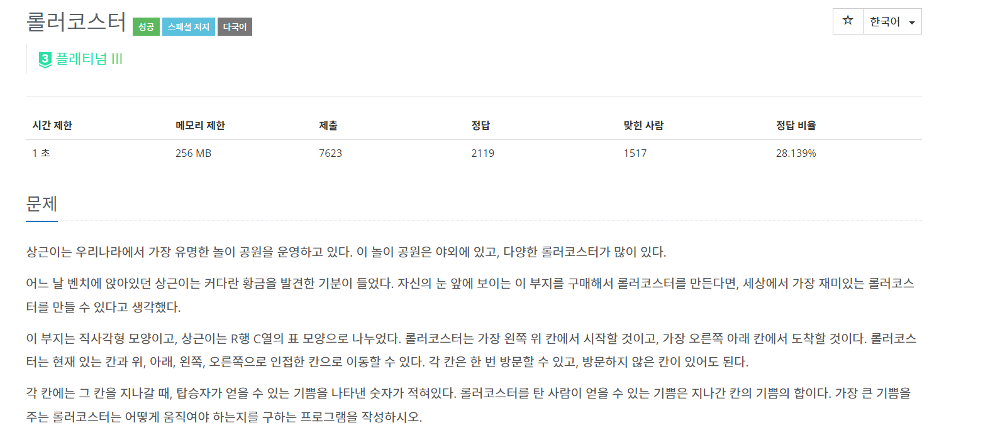
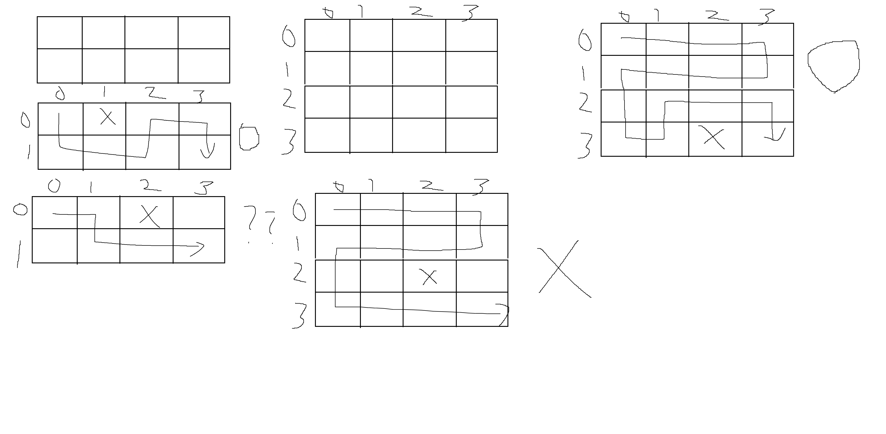
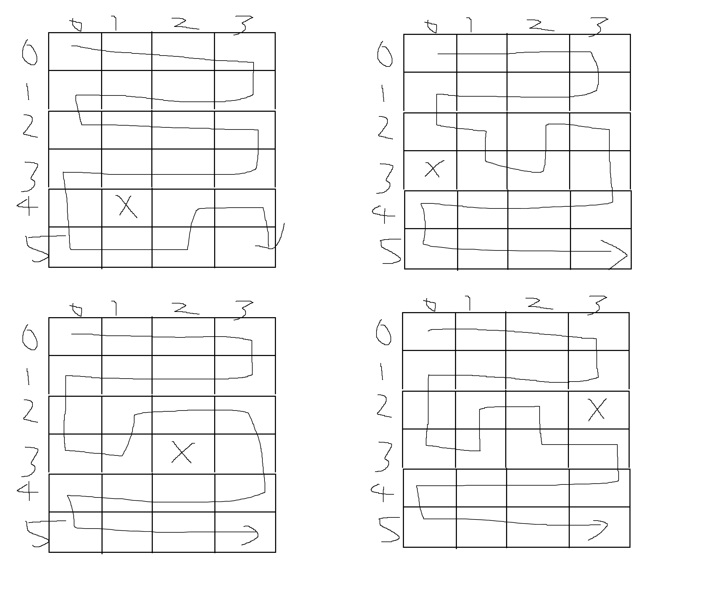

[상위 페이지 · 플레티넘](/study/algorithms/greedy/platinum/)

[https://www.acmicpc.net/problem/2873](https://www.acmicpc.net/problem/2873)



## 아이디어

1. 행이나 열이 둘 중 하나가 홀수라면 모든 구간을 다 탐색 할 수 있다.
2. 행,열 둘다 짝수라면 모든 구간을 다 탐색 할 수 없다
    1. 버려야 하는 점이 (홀,짝),(짝,홀)이라면 단 한개의 점만 버리고 모든 구간을 탐색할 수 있다





버려야 하는 점 이전까지는 평범한 지그재그 탐색. 만약 버려야하는 점까지 온다면 위 아래 탐색

움직임은 총 3가지로 아래오른쪽위,위오른쪽아래,위오른오른 정도이다.

## 정답

```python
R,C = map(int,input().split())
rollerCoasterMap = list()
lowRow,lowColumn,lowNum = -1,-1,float('inf')

for i in range(R):
    temp = list(map(int,input().split()))
    for j in range(C):
        num = temp[j]
        if (j%2 == 0 and i % 2== 1) or (j%2 == 1 and i %2 == 0):
            if lowNum > num:
                lowNum = num
                lowRow = i
                lowColumn = j
    rollerCoasterMap.append(temp)

answer = ""

if  C % 2 == 1:
    answer = ('D' * (R - 1) + 'R' + 'U' * (R - 1) + 'R') * (C//2) + "D" *(R-1)
elif R % 2 == 1:
    answer = ('R' * (C - 1) + 'D' + 'L' * (C - 1) + 'D') * (R//2) + "R" * (C-1)
else:
    #print("특수조건 탐색")
    answer = ('D' * (R - 1) + 'R' + 'U' * (R - 1) + 'R') * (lowColumn // 2)
    c = 2*(lowColumn//2)
    bound = 2*(lowColumn//2) + 1
    r = 0
    while r != R-1 or c != bound:
        if c < bound and lowRow != r:
            c+= 1
            answer += "R"
        elif c == bound and lowRow != r:
            c -= 1
            answer += "L"
        if r != R-1:
            r+= 1
            answer += "D"

    answer += ('R' + 'U' * (R - 1) + 'R' + 'D' * (R - 1)) * ((C - lowColumn - 1) // 2)

#print(rollerCoasterMap)
#print(lowRow,lowColumn,lowNum)
print(answer)
```
