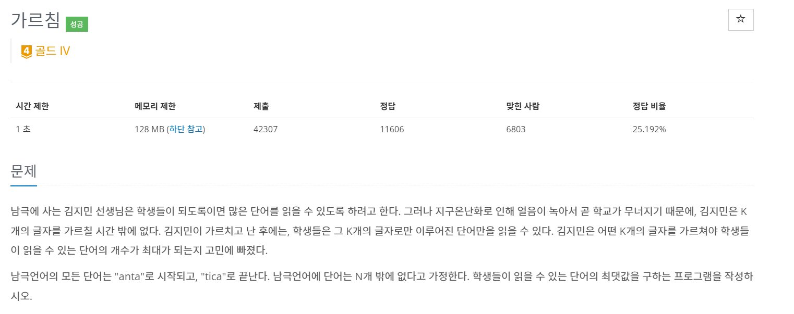

[상위 페이지 · 골드](/study/algorithms/implementation/gold/)

[https://www.acmicpc.net/problem/1062](https://www.acmicpc.net/problem/1062)



## 아이디어

들어오는 문자열을 하나 하나 분리해서 집합으로 만든다. 여기서 a, n, t, i, c는 어떤 단어든지 필요하기 때문에 K가 5 이상이어야 한다.

만약 문자열을 분리했는데 딱 5개의 알파벳으로 나타내졌다면 이건 무조건 말할 수 있다.

문자열을 분리할 때 5개 이상, K개 이하라면 a, n, t, i, c는 무조건 배워야 하기 때문에 빼고 나머지 알파벳을 배워야하는 후보군으로 집합에 넣어주고, 배울 수 있는 가능성이 있음으로 배울 수 있는 단어로 저장해준다.

만약 배워야하는 단어 후보군의  길이가 0이라면 더 배울 게 없다는 뜻으로, 지금까지 카운트 해준 것을 반환한다.

만약 배워야하는 알파벳 후보군의 길이가 K-5보다 작다면, 여기 있는 것을 다 배울 수 있는 것임으로, 배울 수 있는 단어의 길이와 지금까지 카운트 해준 개수를 반환한다.

이제 나머지는 알파벳 후보군에서 K-5개를 조합해 모든 단어와 비교해보면서 배울 수 있는지 여부를 체크한 뒤, 가장 많이 배울 수 있는 개수를 세면 된다.

## 정답

```python
import itertools
import sys

N,K = map(int,input().split())
input = sys.stdin.readline
def solution():
    global K
    if K < 5:
        return 0
    answer = 0
    can_learn = []
    all_chars = set()
    for i in range(N):
        string_l = input().rstrip()
        alphabet_set = set(string_l)
        alphabet_len = len(alphabet_set)
        if alphabet_len == 5:
            answer += 1
        elif alphabet_len <= K:
            now_set = alphabet_set - {'a','n','t','i','c'}
            can_learn.append(now_set)
            all_chars |= now_set

    if len(can_learn) == 0:
        return answer

    if len(all_chars) <= K-5:
        return len(can_learn) + answer
    maxcount = 0
    for comb in itertools.combinations(all_chars, K-5):
        temp = 0
        for i in can_learn:
            if i.issubset(set(comb)):
                temp += 1
        maxcount = max(temp,maxcount)
    return answer + maxcount
print(solution())
```
