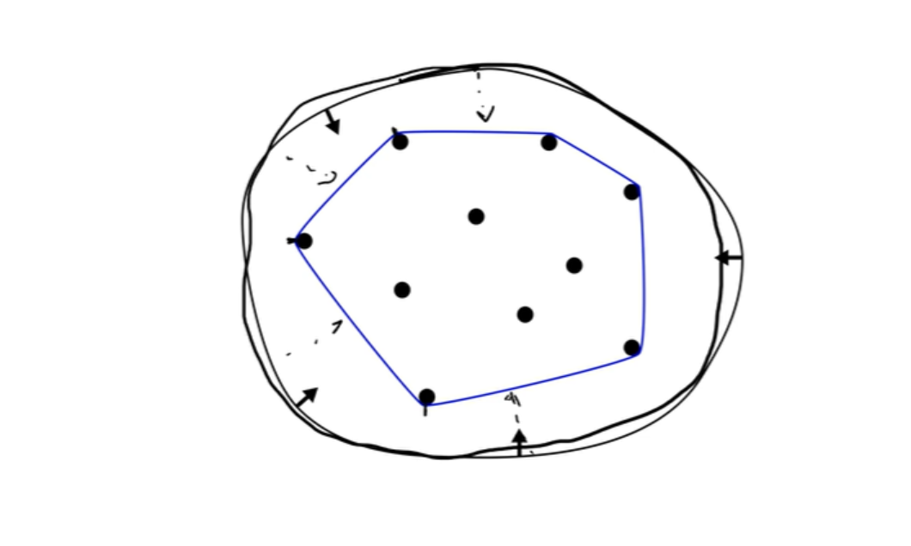
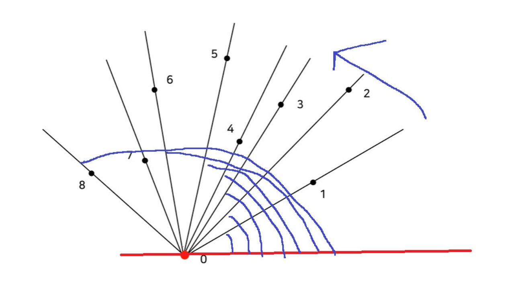

[상위 페이지 · Math](/study/algorithms/math/)

볼록 껍질이란 2차원 평면상의 점들을 모두 포함하는 가장 작은 볼록 다각형을 의미한다. 그라함 스캔(Graham's Scan)은 이러한 볼록 껍질을 찾는 대표적인 알고리즘이다.

### 볼록 다각형이란?

볼록 다각형(Convex Polygon)은 다각형의 내부에 있는 임의의 두 점을 선분으로 연결했을 때, 그 선분이 항상 다각형 내부에 완전히 포함되는 다각형을 의미한다. 다시 말해, 다각형의 내부가 파인 부분이 없이 볼록한 형태를 이루는 것이다.

볼록 다각형의 주요 특징:

- 모든 내각이 180도보다 작다.
- 어떤 변을 연장하더라도 다각형을 가로지르지 않는다.
- 임의의 두 꼭짓점을 이은 선분이 항상 다각형 내부에 있다.

직관적으로는 다음과 같은 고무줄(검은선)이 있을 때 이 고무줄을 땡긴 다음 놨을 때 점에 걸려 생기는 다각형(파란선)을 의미



## 그라함 스캔 상세 동작 과정

### 1. 초기 설정

- 가장 낮은 y좌표를 가진 점(P0)을 찾는다.
- 같은 y좌표를 가진 점이 여러 개라면, 그 중 x좌표가 가장 작은 점을 선택한다.
- 이 점이 기준점이 되어 모든 각도 계산의 기준이 된다.

### 2. 각도 기준 정렬

- 나머지 모든 점들을 P0를 기준으로 극각(polar angle) 기준 정렬한다. (좌표가 정확할 때 아크탄젠트를 이용하면 더 빠르다)
- 각도가 같은 경우, P0로부터 거리가 먼 점이 나중에 오도록 정렬한다.



### 3. 스택 처리

- 첫 세 점을 스택에 넣는다.
- 스택의 마지막 두 점과 현재 처리할 점이 반시계 방향을 이루는지 확인한다. (CCW 사용)
- 시계 방향이면 스택의 top을 제거하고 다시 검사한다.

```python
from typing import List, Tuple
import math

class Point:
    def __init__(self, x: int, y: int):
        self.x = x
        self.y = y

def distance(p1: Point, p2: Point) -> float:
    return math.sqrt((p2.x - p1.x)**2 + (p2.y - p1.y)**2)

def orientation(p: Point, q: Point, r: Point) -> int:
    val = (q.y - p.y) * (r.x - q.x) - (q.x - p.x) * (r.y - q.y)
    if val == 0:
        return 0    # 일직선
    return 1 if val > 0 else -1  # 반시계: 1, 시계: -1

def graham_scan(points: List[Point]) -> List[Point]:
    n = len(points)
    if n < 3:
        return points

    # 1. 가장 낮은 y좌표(같다면 x좌표가 작은) 점 찾기
    bottom = min(points, key=lambda p: (p.y, p.x))
    
    # 2. 각도 기준 정렬
    sorted_points = sorted(
        [p for p in points if p != bottom],
        key=lambda p: (
            math.atan2(p.y - bottom.y, p.x - bottom.x),
            distance(bottom, p)
        )
    )
    
    # 3. 스택 초기화
    stack = [bottom]
    
    # 4. 그라함 스캔 실행
    for point in sorted_points:
        while len(stack) > 1 and orientation(stack[-2], stack[-1], point) != 1:
            stack.pop()
        stack.append(point)
    
    return stack

# 사용 예시
points = [
    Point(0, 0), Point(1, 1), Point(2, 2), Point(4, 4),
    Point(0, 2), Point(1, 3), Point(3, 1), Point(3, 3)
]

hull = graham_scan(points)

```

## 실행 예시 상세 설명

다음과 같은 점들이 있다고 가정해보자:

```python
# 입력 점들
points = [
    (0, 0), (1, 1), (2, 2), (4, 4),
    (0, 2), (1, 3), (3, 1), (3, 3)
]

```

### 단계별 실행 과정

1. 기준점 선택: (0, 0)이 선택된다. (가장 낮은 y좌표)
2. 각도 정렬 결과:
    
    ```python
    # 정렬된 점들 (기준점 제외)
    [(3, 1), (1, 1), (2, 2), (0, 2), (3, 3), (1, 3), (4, 4)]
    ```
    
3. 스택 처리 과정:
    - 스택 = [(0, 0)] → 시작
    - 스택 = [(0, 0), (3, 1)] → 첫 점 추가
    - 스택 = [(0, 0), (3, 1), (4, 4)] → 볼록 껍질의 일부
    - 최종 스택 = [(0, 0), (3, 1), (4, 4), (1, 3), (0, 2)] → 완성된 볼록 껍질

## 시간 복잡도 분석

- 정렬: O(n log n)
- 스택 처리: O(n)
- 전체 시간 복잡도: O(n log n)

## 공간 복잡도

- 입력 저장: O(n)
- 스택 공간: O(n)
- 전체 공간 복잡도: O(n)
