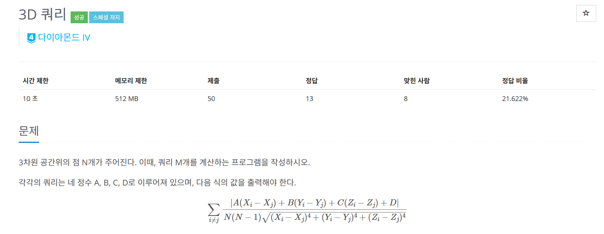

[상위 페이지 · 다이아](/study/algorithms/math/diamond/)



## 문제 태그

- 수학
- FFT

## 아이디어

- D에 대해 $$X_i-X_j, Y_i-Y_j,Z_i-Z_j$$를 3D FFT로 미리 구해준다
- 주어진 식대로 값을 구해주면 된다.

## 정답

```cpp
#include <bits/stdc++.h>

using namespace std;

using cd = complex<double>;

const int S = 77;
const int PS = 256;
const double PI = acos(-1.0);

void fft1d(vector<cd>& a, bool invert) {
    int n = a.size();
    for (int i = 1, j = 0; i < n; i++) {
        int bit = n >> 1;
        for (; j >= bit; bit >>= 1) j -= bit;
        j += bit;
        if (i < j) swap(a[i], a[j]);
    }
    for (int len = 2; len <= n; len <<= 1) {
        double ang = 2 * PI / len * (invert ? -1 : 1);
        cd wlen(cos(ang), sin(ang));
        for (int i = 0; i < n; i += len) {
            cd w(1);
            for (int j = 0; j < len / 2; j++) {
                cd u = a[i + j], v = a[i + j + len / 2] * w;
                a[i + j] = u + v;
                a[i + j + len / 2] = u - v;
                w *= wlen;
            }
        }
    }
    if (invert) {
        for (auto& x : a) x /= n;
    }
}

void fft3d(vector<cd>& data, bool invert) {
    int stride_x = PS * PS;
    int stride_y = PS;
    // along z
    for (int x = 0; x < PS; x++) {
        for (int y = 0; y < PS; y++) {
            vector<cd> row(PS);
            for (int z = 0; z < PS; z++) {
                row[z] = data[x * stride_x + y * stride_y + z];
            }
            fft1d(row, invert);
            for (int z = 0; z < PS; z++) {
                data[x * stride_x + y * stride_y + z] = row[z];
            }
        }
    }
    // along y
    for (int x = 0; x < PS; x++) {
        for (int z = 0; z < PS; z++) {
            vector<cd> row(PS);
            for (int y = 0; y < PS; y++) {
                row[y] = data[x * stride_x + y * stride_y + z];
            }
            fft1d(row, invert);
            for (int y = 0; y < PS; y++) {
                data[x * stride_x + y * stride_y + z] = row[y];
            }
        }
    }
    // along x
    for (int y = 0; y < PS; y++) {
        for (int z = 0; z < PS; z++) {
            vector<cd> row(PS);
            for (int x = 0; x < PS; x++) {
                row[x] = data[x * stride_x + y * stride_y + z];
            }
            fft1d(row, invert);
            for (int x = 0; x < PS; x++) {
                data[x * stride_x + y * stride_y + z] = row[x];
            }
        }
    }
}

int main() {
    ios::sync_with_stdio(false);
    cin.tie(NULL);

    int N;
    cin >> N;

    const int ss = S * S;
    const int s = S;
    vector<double> ff(S * S * S, 0.0);
    for (int i = 0; i < N; i++) {
        int x, y, z;
        cin >> x >> y >> z;
        ff[(x - 1) * ss + (y - 1) * s + (z - 1)] += 1.0;
    }

    int M;
    cin >> M;
    vector<tuple<int, int, int, int>> queries;
    for (int i = 0; i < M; i++) {
        int A, B, C, D;
        cin >> A >> B >> C >> D;
        queries.emplace_back(A, B, C, D);
    }

    int stride_x = PS * PS;
    int stride_y = PS;

    vector<cd> vec_f(PS * PS * PS, cd(0, 0));
    for (int x = 0; x < S; x++) {
        for (int y = 0; y < S; y++) {
            for (int z = 0; z < S; z++) {
                double val = ff[x * ss + y * s + z];
                vec_f[x * stride_x + y * stride_y + z] = cd(val, 0);
            }
        }
    }

    fft3d(vec_f, false);

    for (int i = 0; i < PS * PS * PS; i++) {
        double re = vec_f[i].real();
        double im = vec_f[i].imag();
        vec_f[i] = cd(re * re + im * im, 0);
    }

    fft3d(vec_f, true);

    double denom_N = N * (N - 1.0);
    for (auto [A, B, C, D] : queries) {
        double total = 0.0;
        for (int dx = -76; dx <= 76; dx++) {
            int ix = (dx >= 0 ? dx : PS + dx);
            for (int dy = -76; dy <= 76; dy++) {
                int iy = (dy >= 0 ? dy : PS + dy);
                for (int dz = -76; dz <= 76; dz++) {
                    int iz = (dz >= 0 ? dz : PS + dz);
                    if (dx == 0 && dy == 0 && dz == 0) continue;
                    double count = vec_f[ix * stride_x + iy * stride_y + iz].real();
                    double denom = sqrt(1.0 * (1LL * dx * dx * dx * dx + 1LL * dy * dy * dy * dy + 1LL * dz * dz * dz * dz));
                    double dot = A * dx + B * dy + C * dz + D;
                    total += count * fabs(dot) / denom;
                }
            }
        }
        double ans = total / denom_N;
        printf("%.10f\n", ans);
    }

    return 0;
}
```
