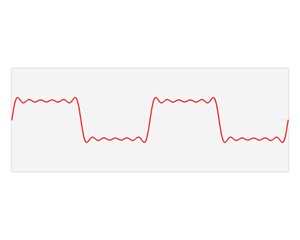
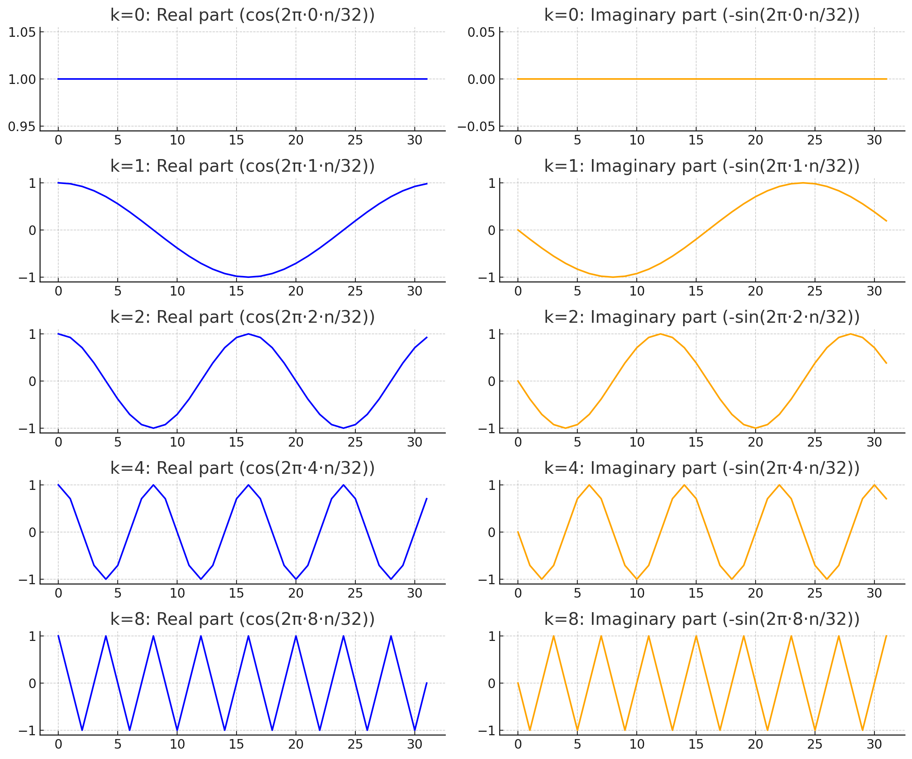
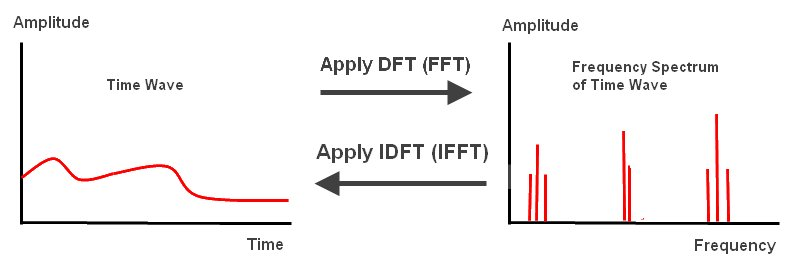
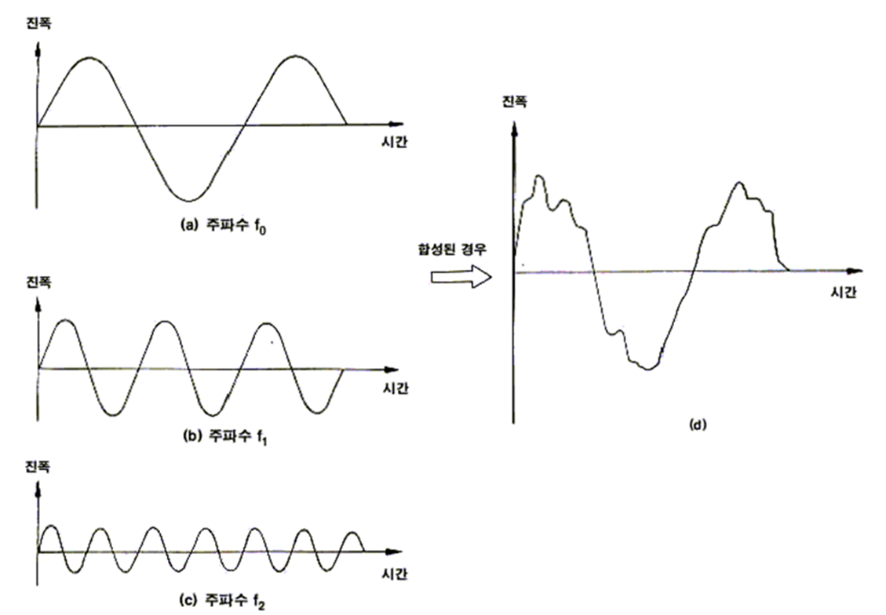
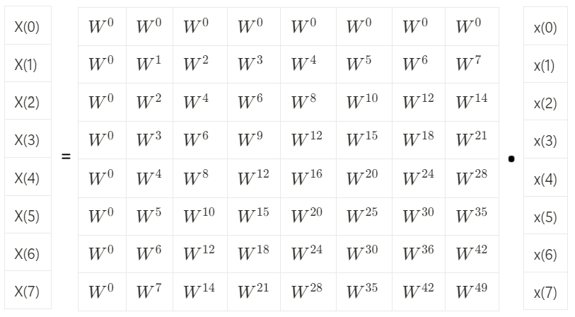
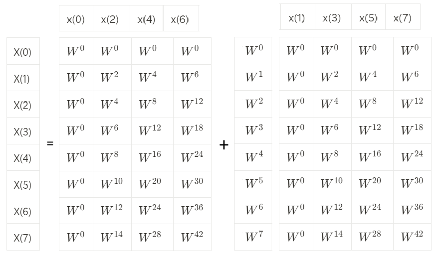
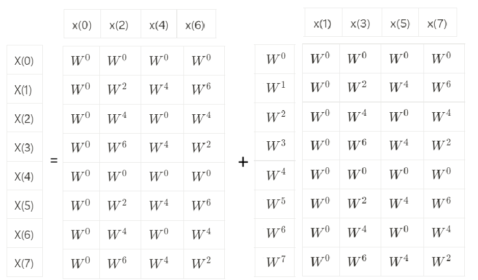
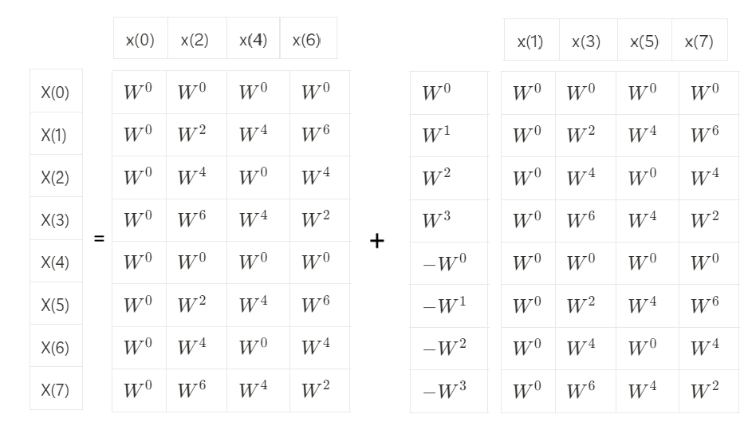
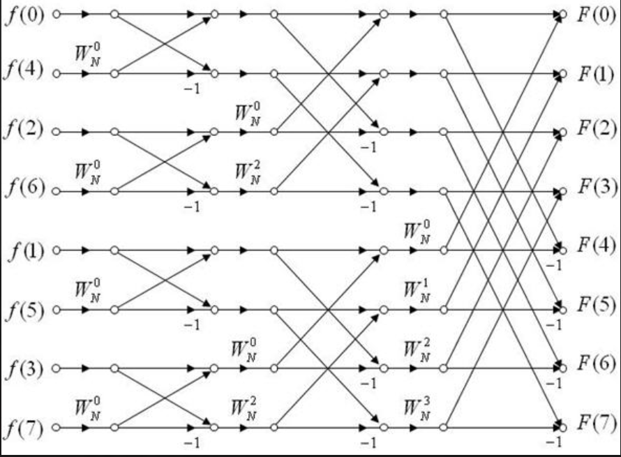
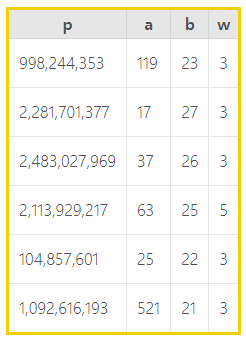

[상위 페이지 · Math](/study/algorithms/math/)

## FT란?

[https://youtu.be/eKSmEPAEr2U?feature=shared](https://youtu.be/eKSmEPAEr2U?feature=shared)

즉 푸리에 변환은 기본적으로 시간 도메인(Time Domain)을 주파수 도메인(Frequency Domain)으로 변환시키는, 즉 시간에 대한 함수(혹은 신호)를 구성하고 있는 주파수 성분으로 분해하는 과정이다.



## 그래서 어디다 씀?

[https://www.youtube.com/watch?v=KuXjwB4LzSA&pp=ygUDRkZU](https://www.youtube.com/watch?v=KuXjwB4LzSA&pp=ygUDRkZU)

이런 컨볼루션 연산 상황에서는 거의 다 적용이 가능하다.

- 다항식의 곱셈
- 큰 수 곱셈
- 문자열 비교
- 행렬곱

## DFT(Discrete Fourier Transform)

DFT는 **연속적인 시간 도메인 신호를 이산적인(discrete) 주파수 도메인**으로 변환하는 방법이다. 즉, 시간축에서 샘플링된 유한 개의 신호 값들을 유한 개의 주파수 성분으로 분해하는 변환이다.

### 수식

$$
X[k] = \sum_{n=0}^{N-1} x[n] \cdot e^{-2\pi i k n/N}
$$

| 기호 | 의미 |
| --- | --- |
| x[n] | 시간 도메인에서의 신호 값 (입력 수열) |
| N | 수열의 길이 (주기) |
| k | 주파수 인덱스 |
| $$e^{-2\pi i k n/N}$$ | 복소 회전자 — 기준 파형 |
| X[k] | 주파수 도메인에서의 k번째 성분 (복소수) |

DFT에서 하는 일은 각 k번 진동하는 **사인파/코사인파 기준 파형**에 **내가 가진 신호가 얼마나 겹치는지를 측정하는 것**이다.

### k번 진동하는 사인파/코사인파?



$$e^{-2\pi i k n/N}$$를 그래프로 그려 허수부와 실수부로 나누면 각각 코사인,사인파가 나온다.

위 그래프는 k에 대해 $$e^{-2\pi i k n/N}$$를 그린것이다.

쉽게 원래 신호와 위 그래프를 한번씩 합성해보는것이라고 생각하면 편하다

### 그래서 결과는?



DFT(FFT)를 적용하면 시간 도메인 파형이 '주파수 스펙트럼'으로 변환되어, 각 주파수 k 성분이 신호에 얼마나 포함되었는지(진폭 $$∣X[k]∣$$)와 그 성분의 시작 위치(위상 $$argX[k]$$)를 알 수 있는 것이다.

### 역변환

$$
x[n] = \frac{1}{N}\sum_{k=0}^{N-1} X[k] \cdot e^{2\pi i k n/N}
$$

반대로 각 성분을 시간파형으로 펼치는것이다. 1/N을 곱하는 이유는 신호→ 주파수로 변환하는 과정에 X[k]에 각 성분이 N번 누적되기에 원래 스케일로 돌리기 위함이다.

## 그래서 이걸로 어떻게 연산을 해?

### 1. 시간 도메인에서의 다항식 곱(컨볼루션)

다항식 A(x)와 B(x)의 계수를 시간 신호 a[n], b[n]로 보는 것이다.

전통적으로 이 둘을 곱하면

$$
C[k] = \sum_{i=0}^k a[i]b[k-i]
$$

처럼 **모든 항을 일일이 곱해서 더해야** 하는 것이다.

(이것이 선형 컨볼루션, 즉 다항식 곱셈이다)

---

### 2. 주파수 도메인으로 가면…

**DFT 변환**

$$
A[k] = \mathrm{DFT}(a[n]),\quad B[k] = \mathrm{DFT}(b[n])
$$

여기서 A[k], B[k]는 각각 "주파수 k의 사인/코사인파가 신호에 얼마나 포함됐는지"를 나타내는 복소수이다.

**점별 곱셈**

$$
C[k] = A[k] \times B[k]
$$

주파수별로 진폭과 위상을 곱해 "합성된 주파수 성분"을 만드는 것이다.

(아래 그래프의 (a), (b), (c)를 곱셈 필터링해 (d)처럼 합치는 것과 같은 원리이다)

**역변환(IDFT)**

$$
c[n] = \mathrm{IDFT}(C[k])
$$

다시 시간 도메인으로 돌아오면, c[n]은 원래의 선형 컨볼루션(다항식 곱) 결과와 **정확히 일치**하는 것이다.

---

### 왜 가능한가?

**사인/코사인파 기저의 직교성** 덕분에 "시간 도메인의 복잡한 합성(컨볼루션)"이 "주파수 도메인의 단순한 점별 곱"으로 바뀌는 것이다.



그래프 (a), (b), (c)는 DFT가 기준으로 쓰는 각 주파수 파형이며, (d)는 이 파형들끼리 합성할 때 모양이 어떻게 바뀌는지를 보여주는 것이다.

## 음… 시간복잡도에 변화가 있는게 맞나?

이걸 눈치 챘다면 매우 똑똑하다. 사실 시간복잡도에 변화가 없다.

DFT를 한 줄씩 계산하면, 출력 값 X[k]를 k=0부터 N-1까지 각각

$$
X[k]=\sum_{n=0}^{N-1}x[n]e^{-2\pi i k n/N}
$$

로 계산해야 하므로, 총 N번의 합을 각각 N개의 항에 대해 수행하게 된다.

따라서 연산 횟수는 대략 N×N=N²에 비례하고, 시간 복잡도는 **O(N²)**이다.

1. 원신호 a[n], b[n] 각각 DFT: O(N²)
2. 주파수 성분 점별 곱: O(N)
3. 역 DFT: O(N²)

이를 합치면 전체가 O(N²) + O(N) + O(N²) = O(N²)이고,

결국 **FT만 쓰는 컨볼루션은 O(N²)**이다. 그냥 아래 식과 시간복잡도가 다를게 없다.

$$
C[k] = \sum_{i=0}^k a[i]b[k-i]
$$

오히려 비효율적인것처럼 느껴진다.

## 이를 해결한 FFT

DFT를 샘플링 8개로 나누어서 식을 전개해보자

$$
W^{kn}=e^{-2\pi i k n/N}
\\
X(0) = x(0) + x(1) + x(2) + ... + x(7)
\\
X(1) = x(0)W^0 + x(1)W^1 + x(2)W^2 + ... + x(7)W^7
\\
X(2) = x(0)W^{0} + x(1)W^{2} + x(2)W^{4} + ... + x(7)W^{14}
\\
X(3) = x(0)W^{0} + x(1)W^{3} + x(2)W^{6} + ... + x(7)W^{21}
\\
...
\\
X(7) = x(0)W^{0} + x(1)W^{7} + x(2)W^{14} + ... + x(7)W^{49}
$$

이를 행렬로 바꾸어 생각해보자



여기서 DFT 식은 다음과 같다.

$$
X[k] = \sum_{n=0}^{N-1} x[n]\omega_N^{kn}, \text{ where } \omega_N = e^{-2\pi i/N}
$$

이 식을 짝수 항(n=2m)과 홀수 항(n=2m+1)으로 나누면 다음과 같이 표현할 수 있다.

$$
\begin{aligned}
X[k] &= \sum_{m=0}^{N/2-1} x[2m]\omega_N^{k(2m)} + \sum_{m=0}^{N/2-1} x[2m+1]\omega_N^{k(2m+1)} \\[6pt]
&= \underbrace{\sum_{m=0}^{N/2-1} x[2m]\omega_{N/2}^{km}}_{\displaystyle E[k]} + \omega_N^k\underbrace{\sum_{m=0}^{N/2-1} x[2m+1]\omega_{N/2}^{km}}_{\displaystyle O[k]}
\end{aligned}

$$

이렇게 분리된 식에서 E[k]는 짝수 항들의 합이고, O[k]는 홀수 항들의 합이다.

이를 적용해서 짝수항과 홀수항을 분리한다



<aside markdown="1">
💡

**회전자의 주기성**

회전자(twiddle factor)는 다음과 같이 표현되는 크기가 1인 복소수(단위 원 위의 점)이다.

$$W_N^k = e^{-2\pi i k/N}$$

이는 다음과 같은 주기성을 가진다.

$$W_N^{k+N} = e^{-2\pi i(k+N)/N} = e^{-2\pi i k/N}e^{-2\pi i} = W_N^k$$

</aside>

회전자는 단위 원 위를 도는 특성에 따라 주기성을 띤다. 샘플링의 개수가 8이라면 법 8로 주기성을 띠고, 샘플링의 개수가 4라면 법 4로 주기성을 띤다.

이러한 회전자의 주기성을 이용하여 위 행렬을 다음과 같이 변환할 수 있다.



이제 마지막으로 이 단위원을 보면 w4 = -w0임을 알 수 있다




위 행렬을 보면 반복 되는 부분이 있다. 이를 분할 정복을 이용하여 계산한다. 고로 최종적으로 FFT의 핵심 공식은 다음과 같다.

$$
\left \{\begin{matrix}
X[k] &= E[k] + W_8^k O[k] 
\\
X[k+4] &= E[k] - W_8^k O[k]\end{matrix}\right.
$$



### 이러한 과정을 거친 시간 복잡도

무려 $$O(n^2)$$에서 분할정복으로 $$O(NlogN)$$으로 감소 됐다.

## FFT의 알고리즘적 한계

FFT는 복소수 영역에서 동작하기 때문에 부동소수점 오차의 영향을 받아 일부 알고리즘(특히 정수 연산 기반)에는 부적합하다.

## NTT란?

FFT의 이러한 부동소수점 문제를 해결하기 위해서 수열에 원시근을 이용한 회전자 개념을 도입하여 방향성을 표현하고, 이를 통해 FFT와 유사한 방식으로 NTT를 수행하여 주파수 해석을 가능하게 한다.

**입력: 시간 도메인 벡터**

$$
x = [x_0, x_1, x_2, ..., x_{n-1}]
$$

**FFT:**

$$
X[k] = \sum_{n=0}^{N-1} x_n \cdot e^{-2\pi i k n/N} \quad (k = 0, 1, ..., N-1)
$$

**NTT:**

$$
X[k] = \sum_{n=0}^{N-1} x_n \cdot w^{jk}\ mod\ p \quad (k = 0, 1, ..., N-1)
$$

### 주로 사용하는 원시근



## 구현

```python
MOD = 998244353

def fft(poly, inverse):
    n = len(poly)
    bit_reversed_idx = 0
    for i in range(1, n):
        bit = n // 2
        while bit_reversed_idx >= bit:
            bit_reversed_idx -= bit
            bit //= 2
        bit_reversed_idx += bit
        if i < bit_reversed_idx:
            poly[i], poly[bit_reversed_idx] = poly[bit_reversed_idx], poly[i]

    length = 2
    while length <= n:
        half = length // 2
        root = pow(3, MOD // length, MOD)
        if inverse:
            root = pow(root, MOD - 2, MOD)
        for start in range(0, n, length):
            omega = 1
            for i in range(start, start + half):
                t = poly[i + half] * omega % MOD
                poly[i + half] = (poly[i] - t) % MOD
                poly[i] = (poly[i] + t) % MOD
                omega = omega * root % MOD
        length *= 2

    if inverse:
        inv_n = pow(n, MOD - 2, MOD)
        for i in range(n):
            poly[i] = poly[i] * inv_n % MOD

# 두 다항식
a = [5, 3, 1, 6] # 6x^3 + x^2 + 3x + 5
b = [3, 8, 3, 5] # 5x^3 + 3x^2 + 8x + 3

# 필요한 길이 계산: 결과 길이는 최대 len(a)+len(b)-1
n = 1
while n < len(a) + len(b) - 1:
    n *= 2

# fft는 2의 거듭제곱 안에서 동작함으로 zero padding
a += [0] * (n - len(a))
b += [0] * (n - len(b))

# FFT
fft(a, False)
fft(b, False)

# 주파수 공간에서 합성
c = [(a[i] * b[i]) % MOD for i in range(n)]

# 계산 결과 푸리에 역변환
fft(c, True)

# 결과 출력: 상수항부터 높은 차수까지
print("최종 계수:", c)
print("결과 다항식:", " + ".join(f"{coef}x^{i}" for i, coef in enumerate(c) if coef != 0))
```

### 비트 반전?

```python
    bit_reversed_idx = 0
    for i in range(1, n):
        bit = n // 2
        while bit_reversed_idx >= bit:
            bit_reversed_idx -= bit
            bit //= 2
        bit_reversed_idx += bit
        if i < bit_reversed_idx:
            poly[i], poly[bit_reversed_idx] = poly[bit_reversed_idx], poly[i]
```

이 부분이 좀 의아할 수 있다

이는 인덱스가 원래 0, 1, 2, 3, 4, 5, 6, 7이였던것을 단순히 비트 반전을 통해 0, 2, 4, 6, 1, 3, 5, 7로 만들 수 있기 때문이 해주는 작업이다.

## Radix-3 FFT

위 코드는 주어진 소수가 $$2^n$$ 형태일 때 사용 할 수 있다. 만약 3배수라면 radix-3 fft를 사용해야한다.
