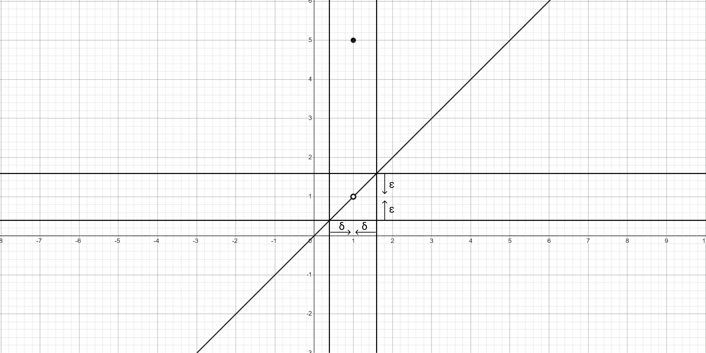
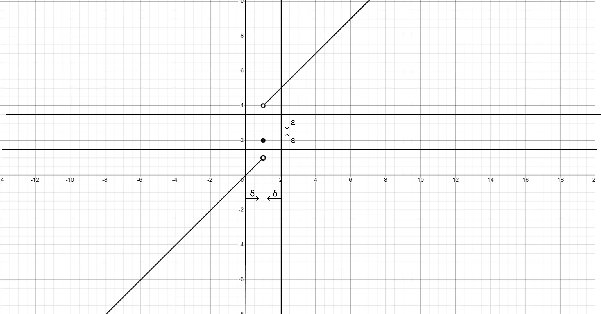
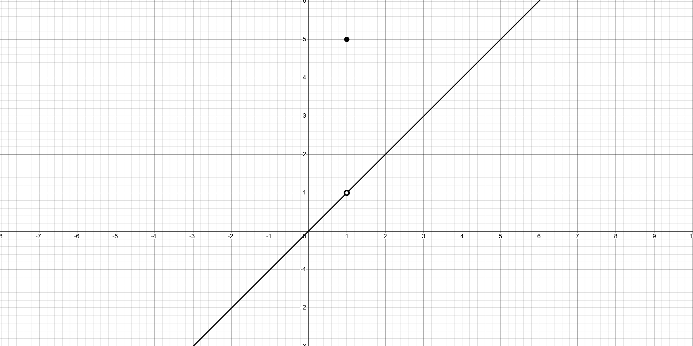
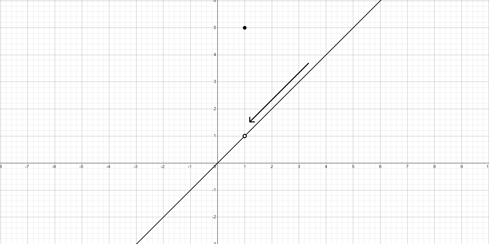
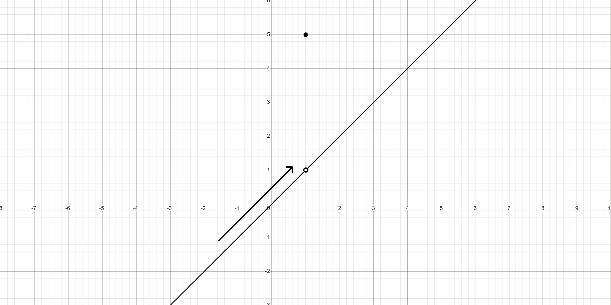
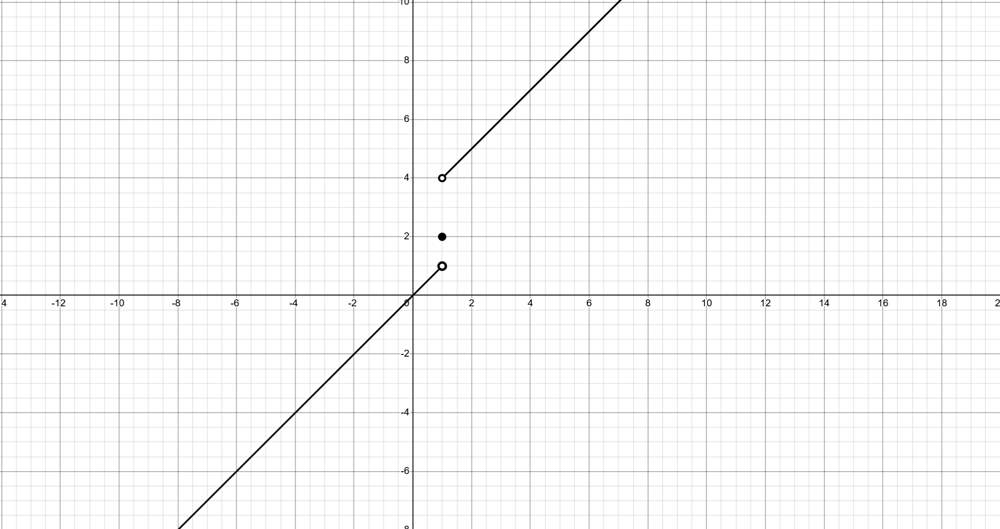

[상위 페이지 · Math](/study/algorithms/math/)

## 정의

함수 f(x)에서 x가 a가 아니면서 한없이 a에 가까워질 때 f(x)가 한없이 L에 가까워지는것을 다음과 같이 정의한다.

$$
\underset{x\rightarrow a}{\lim}f(x)= L
$$

## 엡실론-델타 논법

수학에서 함수 또는 수열의 극한을 명확하게 정의하는 방법이다. 19세기 초 수학자 베르나르트 볼차노, 오귀스탱루이 코시 등이 규명 보급했다.

엡실론-델타 논법은 직관적으로 ‘한없이 가까워진다’으로 표현하던 극한값의 개념을 엄밀히 정의한다.

### **정의**

f : $$D \rightarrow \R$$을 집합 $$D \subset \R$$위에서 정의된 함수, a를 D의 극한점, $$L\in \R$$이라 하자.

$$
\underset{x\rightarrow a}{\lim}f(x)= L \overset{\text{def}}{\Leftrightarrow} \forall \epsilon > 0, \exists \delta > 0\ s.t.\ \forall x \in D,\ (0 < |x-a| < \epsilon \Rightarrow |f(x) -L| < \epsilon)
$$

- $$\forall$$ = 모든 ~에 대해
- $$\exists$$ = 존재한다
- D = 정의역
- s.t = such that
- $$\delta$$ = 찾을 값

### **순차 해석**

1. $$\forall \epsilon > 0$$
    - **해석 :** 0보다 큰 모든(어떠한) 엡실론에 대하여
    - **의미 :** 극한값 L과 실제 함수값 f(x) 사이에 발생할 오차한계선을 설정. 여기서 핵심은 $$\forall$$기호이며 오차 한계선을 0.1로 잡던 0.0001로 잡던 아무리 작은 양수로 잡아도 뒤 따르는 조건이 만족해야한다.
2. $$\exists \delta > 0$$
    - **해석 :** 0보다 큰 어떤 델타가 존재한다
    - **의미 :** 앞서 설정된 오차한계선에 대응하여 우리가 찾아내야하는 입력값의 범위($$\delta$$)가 있다.
3. s.t.
    - **해석 :** $$\delta$$는 다음을 만족한다
4. $$0<|x-a| < \delta \Rightarrow$$
    - **해석 :** x와 a의 차는 0보다 크고 $$\epsilon$$보다 작다면 다음이 성립된다
    - **의미 :** 즉 x가 a가 아니이면서 a에 충분히 가깝다면($$\epsilon$$)이라는 조건을 거는것
5. $$\Rightarrow |f(x) - L | < \epsilon$$
    - **해석 :** 그러면 f(x)와 L의 차는 $$\epsilon$$보다 작다
    - **의미 :** 앞 조건이 만족되었을 때, 반드시 f(x)가 $$\epsilon$$안으로 들어오는것을 보장한다

이 모든 과정을 합쳐

> 극한값이 L이라는 것은, 아무리 작은 오차 한계(ε)를 제시하더라도, 그에 대응하는 적절한 입력값의 범위(δ)를 찾을 수 있으며, x가 그 범위 안에 있으면 함숫값 f(x)는 반드시 오차 한계 안에 들어온다는 의미이다.
> 

### 그래프로 이해하기

위 그래프에서 $$\underset{x→1}{\lim}f(x)$$의 경우를 살펴보자. 극한값 L = 1이라고 할 때, 아무리 작은 양수 ε(예: ε = 0.5, 0.1, 0.01 등)를 제시하더라도, 그에 대응하는 적절한 δ > 0를 항상 찾을 수 있다. 구체적으로, 0 < |x - 1| < δ를 만족하는 모든 x에 대해 |f(x) - 1| < ε가 성립하도록 하는 δ가 존재한다는 것이다. 이는 x가 1에 충분히 가까워지면(δ 범위 내에 있으면), 함숫값 f(x)는 반드시 극한값 1의 ε 근방 안에 들어온다는 의미이다. 따라서 이 경우 극한이 존재함을 엡실론-델타 논법으로 확인할 수 있다.

하지만 위와 같이 극한이 존재하지 않는 그래프에서는 상황이 다르다. 예를 들어 x = 1에서 좌극한과 우극한이 서로 다른 값으로 수렴한다고 가정하자. 이 경우 ε의 범위를 충분히 작게 설정하면(예: 좌극한과 우극한 사이 거리의 절반보다 작게), 아무리 작은 δ > 0를 선택하더라도 0 < |x - 1| < δ 범위 내에는 좌측과 우측에서 서로 다른 극한값으로 향하는 점들이 동시에 존재하게 된다. 따라서 모든 x에 대해 |f(x) - L| < ε를 만족시키는 단일한 극한값 L과 그에 대응하는 δ를 찾을 수 없다. 이것이 바로 극한이 존재하지 않는 경우를 엡실론-델타 논법으로 설명하는 방식이다.

### 증명

**문제**

엡실론-델타 논법을 이용하여 $$\underset{x\rightarrow 2}{\lim} (3x + 1) = 7$$임을 증명하시오.

**증명 과정**

1. 엡실론 델타  정의에 따라 다음이 성립함을 보이면 된다.
    - 임의의 $$\epsilon > 0$$에 대해 만약 $$0 < |x-2| < \delta$$이면 $$|(3x+1) -7| < \epsilon$$을 만족하는 적절한 $$\delta > 0$$가 항상 존재한다.
2.  $$|(3x+1) -7| < \epsilon$$에서부터 시작하여 조건인 $$|x-2|$$와의 관계를 찾아내야한다
    
    $$
    |(3x + 1) -7| < \epsilon \\
    |3x - 6| < \epsilon \\
    |3(x-2)| < \epsilon \\
    3|x-2| < \epsilon \\
    |x-2| < \frac{\epsilon}{3}
    $$
    
    $$|(3x+1) -7| < \epsilon$$이라는 목표를 달성하려면, $$|x-2|$$가 $$\frac{\epsilon}{3}$$보다 작으면 된다는 사실을 알아냈다
    
3. 따라서 임의의 양수 $$\epsilon$$에 대하여 위의 결과를 사용하면  $$0 < |x-2| < \delta$$일 때
    
    $$
    |x-2| < \frac{\epsilon}{3} \rightarrow |(3x +1) - 7|< \epsilon
    $$
    
    이므로  $$\underset{x\rightarrow 2}{\lim} (3x + 1) = 7$$가 성립함을 알 수 있다.
    

## 좌극한과 우극한

### 우극한

우극한은 변수 x가 목표 지점 a보다 큰 쪽(오른쪽)에서부터 a를 향해 다가올 때의 극한값을 의미한다.

$$
\underset{x\rightarrow a^+}{\lim}f(x)
$$

### 좌극한

우극한은 변수 x가 목표 지점 a보다 작은 쪽(왼쪽)에서부터 a를 향해 다가올 때의 극한값을 의미한다.

$$
\underset{x\rightarrow a^-}{\lim}f(x)
$$

### 예시

$$
\left\{\begin{matrix} y = x &(x \neq 1)\\y = 5 & (x=1)\end{matrix}\right.
$$

위 그래프에서 x가 1로 다가갈 때 좌극한과 우극한을 각각 구해보겠다.

**우극한**

x가 1보다 큰 쪽에서 1에 가까워질 때, x는 1이 아니지만 1에 한없이 가까워지는 값이다. 이 구간에서는 x ≠ 1이므로 함수 정의에 따라 y = x 식이 적용된다 (x = 1일 때만 y = 5가 적용됨). 따라서 x가 1에 가까워지면 y = x에 의해 y도 1에 가까워지므로 우극한은 1이다.

$$
\underset{x\rightarrow 1^+}{\lim} = 1
$$

**좌극한**

x가 1보다 작은 쪽에서 1에 가까워질 때, x는 1이 아니지만 1에 한없이 가까워지는 값이다. 이 구간에서는 x ≠ 1이므로 함수 정의에 따라 y = x 식이 적용된다 (x = 1일 때만 y = 5가 적용됨). 따라서 x가 1에 가까워지면 y = x에 의해 y도 1에 가까워지므로 좌극한은 1이다.

$$
\underset{x\rightarrow 1^-}{\lim} = 1
$$

## 극한의 기본 성질

극한의 기본 성질은 두 함수 $$f(x)$$와 $$g(x)$$가 각각 특정 지점 (x=a)에서 수렴할 때 사칙연산처럼 계산할 수 있게 해주는 규칙을 얘기한다

두 함수에 대해 $$\underset{x \rightarrow a}{\lim}f(x) =L$$이고 $$\underset{x \rightarrow a}{\lim}g(x) =M$$이라고 가정한다.

### 상수배의 성질

합수에 곱해진 상수는 극한 기호 밖으로 꺼내서 계산할 수 있다.

### 극한의 존재 조건

어떤 지점에서의 극한값( $$\lim_{x\rightarrow a}f(x)$$)이 존재하려면 반드시 좌극한과 우극한이 일치해야한다.

$$
\underset{x \rightarrow a}{\lim} f(x) = L \Leftrightarrow \underset{x \rightarrow a^+}{\lim}f(x) = \underset{x \rightarrow a^-}{\lim}f(x) = L
$$

즉, 우극한과 좌극한이 모두 존재하고 그 값이 같을 때만 비로소 그 지점의 극한값이 존재한다고 말할 수 있다.

**극한값이 존재하지 않는 경우**

$$
\left\{\begin{matrix} y = x + 3 &(x > 1)\\y = 2 & (x=1)\\y = x &(x < 1)\end{matrix}\right.
$$

좌극한과 우극한을 각각 구하면

$$
\underset{x \rightarrow a^+}{\lim}f(x) = 4 \\ \underset{x \rightarrow a^-}{\lim}f(x) = 1
$$

이기 때문에 좌극한과 우극한이 다르다. 고로 극한값이 존재하지 않는다.

## 무한대

무한대는 어떤 값이 한없이 커지거나 한없이 작아지는 상태를 나타내는 수학적 개념이다. 무한대는 특정한 수가 아니라, 값이 끝없이 증가하거나 감소하는 경향을 표현하는 기호이다.

### 양의 무한대 (+∞)

양의 무한대는 어떤 값이 한없이 커지는 것을 의미한다. 기호로는 $$+\infty$$ 또는 $$\infty$$로 표현한다.

$$
\underset{x\rightarrow a}{\lim}f(x) = +\infty
$$

이것은 $$x$$가 $$a$$에 가까워질 때 함숫값 $$f(x)$$가 아무리 큰 양수보다도 더 커진다는 의미이다.

**예시**

$$
\underset{x\rightarrow 0^+}{\lim}\frac{1}{x} = +\infty
$$

$$x$$가 양수 쪽에서 0에 가까워질수록 $$\frac{1}{x}$$는 한없이 커진다. 예를 들어 $$x = 0.1$$이면 $$\frac{1}{x} = 10$$, $$x = 0.01$$이면 $$\frac{1}{x} = 100$$, $$x = 0.001$$이면 $$\frac{1}{x} = 1000$$이 되는 식이다.

### 음의 무한대 (-∞)

음의 무한대는 어떤 값이 한없이 작아지는 것을 의미한다. 기호로는 $$-\infty$$로 표현한다.

$$
\underset{x\rightarrow a}{\lim}f(x) = -\infty
$$

이것은 $$x$$가 $$a$$에 가까워질 때 함숫값 $$f(x)$$가 아무리 작은 음수보다도 더 작아진다는 의미이다.

**예시**

$$
\underset{x\rightarrow 0^-}{\lim}\frac{1}{x} = -\infty
$$

$$x$$가 음수 쪽에서 0에 가까워질수록 $$\frac{1}{x}$$는 한없이 작아진다. 예를 들어 $$x = -0.1$$이면 $$\frac{1}{x} = -10$$, $$x = -0.01$$이면 $$\frac{1}{x} = -100$$, $$x = -0.001$$이면 $$\frac{1}{x} = -1000$$이 되는 식이다.

### 무한대의 엄밀한 정의

무한대로 발산하는 극한도 엡실론-델타 논법과 유사한 방식으로 엄밀하게 정의할 수 있다.

**양의 무한대로 발산**

$$
\underset{x\rightarrow a}{\lim}f(x) = +\infty \overset{\text{def}}{\Leftrightarrow} \forall M > 0, \exists \delta > 0 \text{ such that } 0 < |x-a| < \delta \Rightarrow f(x) > M
$$

이것은 임의로 큰 양수 $$M$$을 제시하더라도, $$x$$가 $$a$$에 충분히 가까우면 (즉, $$0 < |x-a| < \delta$$) 함숫값 $$f(x)$$가 $$M$$보다 크다는 것을 보장하는 $$\delta$$가 존재한다는 의미이다.

**음의 무한대로 발산**

$$
\underset{x\rightarrow a}{\lim}f(x) = -\infty \overset{\text{def}}{\Leftrightarrow} \forall M < 0, \exists \delta > 0 \text{ such that } 0 < |x-a| < \delta \Rightarrow f(x) < M
$$

이것은 임의로 작은 음수 $$M$$을 제시하더라도, $$x$$가 $$a$$에 충분히 가까우면 함숫값 $$f(x)$$가 $$M$$보다 작다는 것을 보장하는 $$\delta$$가 존재한다는 의미이다.

### x가 무한대로 갈 때의 극한

변수 $$x$$ 자체가 무한대로 갈 때의 극한도 정의할 수 있다.

$$
\underset{x\rightarrow +\infty}{\lim}f(x) = L
$$

이것은 $$x$$가 한없이 커질 때 함숫값 $$f(x)$$가 $$L$$에 가까워진다는 의미이다.

**예시**

$$
\underset{x\rightarrow +\infty}{\lim}\frac{1}{x} = 0
$$

$$x$$가 한없이 커질수록 $$\frac{1}{x}$$는 0에 가까워진다.

### 무한대의 성질

무한대는 일반적인 수가 아니므로 다음과 같은 성질들을 주의해야 한다.

- $$\infty + \infty = \infty$$이다.
- $$\infty \times c = \infty$$ (단, $$c > 0$$인 상수)이다.
- $$\infty - \infty$$, $$\frac{\infty}{\infty}$$, $$0 \times \infty$$와 같은 형태는 부정형이며, 추가적인 분석이 필요하다.
- 무한대는 크기를 비교할 수 없는 개념이므로 $$\infty = \infty$$라고 단순히 말할 수 없다.

## 수렴과 발산

### 수렴

함수 $$f(x)$$의 극한값이 $$x \rightarrow a$$일 때 특정한 유한한 값 $$L$$에 가까워지면, 이 함수는 **수렴한다**고 말한다.

$$
\underset{x\rightarrow a}{\lim}f(x)= L
$$

여기서 $$L$$은 유한한 실수이다. 수렴한다는 것은 $$x$$가 $$a$$에 가까워질수록 함숫값 $$f(x)$$가 일정한 값 $$L$$로 한없이 가까워진다는 의미이다.

**수렴의 예시**

$$
\underset{x\rightarrow 2}{\lim}(3x + 1) = 7
$$

이 경우 $$x$$가 2에 가까워질 때 함숫값은 7에 가까워지므로 이 극한은 수렴한다.

### 발산

함수 $$f(x)$$의 극한값이 $$x \rightarrow a$$일 때 특정한 유한한 값으로 수렴하지 않으면, 이 함수는 **발산한다**고 말한다.

발산하는 경우는 크게 두 가지로 나눌 수 있다.

### 1. 무한대로 발산

함숫값이 한없이 커지거나 한없이 작아지는 경우를 무한대로 발산한다고 한다.

**양의 무한대로 발산**

$$
\underset{x\rightarrow a}{\lim}f(x)= +\infty
$$

$$x$$가 $$a$$에 가까워질 때 $$f(x)$$가 한없이 커지는 경우이다.

**예시**

$$
\underset{x\rightarrow 0^+}{\lim}\frac{1}{x}= +\infty
$$

$$x$$가 0보다 큰 쪽에서 0에 가까워질 때 $$\frac{1}{x}$$는 한없이 커진다.

**음의 무한대로 발산**

$$
\underset{x\rightarrow a}{\lim}f(x)= -\infty
$$

$$x$$가 $$a$$에 가까워질 때 $$f(x)$$가 한없이 작아지는 경우이다.

**예시**

$$
\underset{x\rightarrow 0^-}{\lim}\frac{1}{x}= -\infty
$$

$$x$$가 0보다 작은 쪽에서 0에 가까워질 때 $$\frac{1}{x}$$는 한없이 작아진다.

### 2. 진동하며 발산

함숫값이 일정한 값으로 수렴하지도 않고, 무한대로 발산하지도 않으며, 여러 값 사이를 진동하는 경우를 진동하며 발산한다고 한다.

**예시**

$$
\underset{x\rightarrow 0}{\lim}\sin\left(\frac{1}{x}\right)
$$

$$x$$가 0에 가까워질 때 $$\sin\left(\frac{1}{x}\right)$$는 -1과 1 사이를 끊임없이 진동하므로 극한값이 존재하지 않는다. 따라서 이 극한은 진동하며 발산한다.

### 수렴과 발산의 판정

극한이 수렴하는지 발산하는지 판정하기 위해서는 다음을 확인해야 한다.

1. 좌극한과 우극한이 모두 존재하고 같은 유한한 값이면 수렴한다.
2. 좌극한과 우극한 중 하나라도 무한대이거나 존재하지 않으면 발산한다.
3. 좌극한과 우극한이 모두 존재하지만 서로 다른 값이면 극한값이 존재하지 않으므로 발산한다.

## 부정형의 극한

부정형의 극한이란 극한을 계산할 때 직접 대입하면 그 값이 불확정적인 형태로 나타나는 경우를 말한다. 이러한 형태는 추가적인 분석이나 계산 기법을 통해 극한값을 구해야 한다.

### 주요 부정형의 종류

부정형에는 다음과 같은 대표적인 형태들이 있다.

### 1. $$\frac{0}{0}$$ 꼴

분자와 분모가 모두 0으로 수렴하는 경우이다.

**예시**

$$
\underset{x\rightarrow 1}{\lim}\frac{x^2-1}{x-1}
$$

$$x=1$$을 직접 대입하면 $$\frac{0}{0}$$이 되어 부정형이다. 이 경우 분자를 인수분해하면 다음과 같이 계산할 수 있다.

$$
\underset{x\rightarrow 1}{\lim}\frac{x^2-1}{x-1} = \underset{x\rightarrow 1}{\lim}\frac{(x+1)(x-1)}{x-1} = \underset{x\rightarrow 1}{\lim}(x+1) = 2
$$

### 2. $$\frac{\infty}{\infty}$$ 꼴

분자와 분모가 모두 무한대로 발산하는 경우이다.

**예시**

$$
\underset{x\rightarrow \infty}{\lim}\frac{3x^2+2x}{x^2-5}
$$

$$x$$가 무한대로 갈 때 분자와 분모 모두 무한대이므로 부정형이다. 이 경우 분자와 분모를 최고차항으로 나누면 다음과 같다.

$$
\underset{x\rightarrow \infty}{\lim}\frac{3x^2+2x}{x^2-5} = \underset{x\rightarrow \infty}{\lim}\frac{3+\frac{2}{x}}{1-\frac{5}{x^2}} = \frac{3}{1} = 3
$$

### 3. $$0 \times \infty$$ 꼴

한 함수는 0으로 수렴하고 다른 함수는 무한대로 발산하는 경우의 곱이다.

**예시**

$$
\underset{x\rightarrow 0^+}{\lim}x \ln x
$$

$$x \rightarrow 0^+$$일 때 $$x \rightarrow 0$$이고 $$\ln x \rightarrow -\infty$$이므로 $$0 \times \infty$$ 꼴이다. 이를 분수 형태로 바꾸면 다음과 같다.

$$
\underset{x\rightarrow 0^+}{\lim}x \ln x = \underset{x\rightarrow 0^+}{\lim}\frac{\ln x}{\frac{1}{x}}
$$

이제 $$\frac{\infty}{\infty}$$ 꼴이 되어 로피탈의 정리를 적용할 수 있다.

### 4. $$\infty - \infty$$ 꼴

두 함수가 모두 무한대로 발산하는 경우의 차이다.

**예시**

$$
\underset{x\rightarrow \infty}{\lim}\left(\sqrt{x^2+x} - x\right)
$$

이 경우 분자를 유리화하여 계산한다.

$$
\underset{x\rightarrow \infty}{\lim}\left(\sqrt{x^2+x} - x\right) = \underset{x\rightarrow \infty}{\lim}\frac{(\sqrt{x^2+x} - x)(\sqrt{x^2+x} + x)}{\sqrt{x^2+x} + x} = \underset{x\rightarrow \infty}{\lim}\frac{x^2+x-x^2}{\sqrt{x^2+x} + x} = \underset{x\rightarrow \infty}{\lim}\frac{x}{\sqrt{x^2+x} + x}
$$

분자와 분모를 $$x$$로 나누면 다음과 같다.

$$
\underset{x\rightarrow \infty}{\lim}\frac{1}{\sqrt{1+\frac{1}{x}} + 1} = \frac{1}{2}
$$

### 5. $$1^\infty$$, $$0^0$$, $$\infty^0$$ 꼴

지수 형태의 부정형들이다. 이러한 경우 로그를 취하여 계산하는 것이 일반적이다.

**예시: $$1^\infty$$ 꼴**

$$
\underset{x\rightarrow \infty}{\lim}\left(1+\frac{1}{x}\right)^x
$$

이것은 자연상수 $$e$$의 정의로, 그 값은 $$e \approx 2.71828$$이다.

### 부정형 해결 방법

부정형의 극한을 구하기 위한 주요 방법들은 다음과 같다.

- **인수분해 또는 약분:** $$\frac{0}{0}$$ 꼴에서 공통인수를 소거한다.
- **최고차항으로 나누기:** $$\frac{\infty}{\infty}$$ 꼴에서 분자와 분모를 최고차항으로 나눈다.
- **유리화:** $$\infty - \infty$$ 꼴에서 분자를 유리화한다.
- **로피탈의 정리:** $$\frac{0}{0}$$ 또는 $$\frac{\infty}{\infty}$$ 꼴에서 분자와 분모를 각각 미분하여 극한을 구한다.
- **로그 취하기:** 지수 형태의 부정형에서 로그를 취한 후 극한을 구한다.

### 로피탈의 정리

로피탈의 정리는 부정형 $$\frac{0}{0}$$ 또는 $$\frac{\infty}{\infty}$$을 해결하는 쉽게 해결할 수 있는 정리이다.

함수 $$f(x)$$와 $$g(x)$$가 $$x \rightarrow a$$일 때 모두 0으로 수렴하거나 모두 무한대로 발산하고, 이들이 미분 가능하며 $$g'(x) \neq 0$$이면 다음이 성립한다.

$$
\underset{x\rightarrow a}{\lim}\frac{f(x)}{g(x)} = \underset{x\rightarrow a}{\lim}\frac{f'(x)}{g'(x)}
$$

단, 우변의 극한이 존재하거나 무한대일 때만 적용된다.

**예시**

$$
\underset{x\rightarrow 0}{\lim}\frac{\sin x}{x}
$$

이것은 $$\frac{0}{0}$$ 꼴이므로 로피탈의 정리를 적용하면 다음과 같다.

$$
\underset{x\rightarrow 0}{\lim}\frac{\sin x}{x} = \underset{x\rightarrow 0}{\lim}\frac{\cos x}{1} = \frac{1}{1} = 1
$$

## 샌드위치 정리

샌드위치 정리(Squeeze Theorem 또는 Sandwich Theorem)는 함수의 극한을 구할 때 사용되는 중요한 정리이다. 이 정리는 직접 계산하기 어려운 함수의 극한값을 구할 때 특히 유용하다.

### 정의

세 함수 $$f(x)$$, $$g(x)$$, $$h(x)$$에 대하여, $$a$$를 포함하는 어떤 열린구간에서 다음 부등식이 성립한다고 하자.

$$
f(x) \leq g(x) \leq h(x)
$$

만약 다음이 성립하면

$$
\underset{x\rightarrow a}{\lim}f(x) = \underset{x\rightarrow a}{\lim}h(x) = L
$$

다음도 성립한다.

$$
\underset{x\rightarrow a}{\lim}g(x) = L
$$

즉, 함수 $$g(x)$$가 두 함수 $$f(x)$$와 $$h(x)$$ 사이에 끼어있고, 양쪽 함수의 극한값이 같으면 중간에 있는 함수의 극한값도 같은 값으로 수렴한다는 것이다.

### 직관적 이해

샌드위치 정리의 이름은 샌드위치의 구조에서 유래했다. 빵(위, 아래)이 같은 위치로 이동하면 그 사이에 있는 재료(중간 함수)도 같은 위치로 가야 한다는 직관에서 나온 것이다.

### 대표적인 예시

**예시 1: $$\underset{x\rightarrow 0}{\lim}x^2 \sin\left(\frac{1}{x}\right)$$**

$$x \rightarrow 0$$일 때 $$\sin\left(\frac{1}{x}\right)$$는 진동하므로 극한이 존재하지 않는다. 하지만 $$\sin$$ 함수의 범위를 이용하면 다음 부등식이 성립한다.

$$
-1 \leq \sin\left(\frac{1}{x}\right) \leq 1
$$

양변에 $$x^2$$를 곱하면 ($$x^2 \geq 0$$이므로 부등호 방향은 유지된다)

$$
-x^2 \leq x^2\sin\left(\frac{1}{x}\right) \leq x^2
$$

이제 양쪽 극한을 계산하면

$$
\underset{x\rightarrow 0}{\lim}(-x^2) = 0, \quad \underset{x\rightarrow 0}{\lim}x^2 = 0
$$

따라서 샌드위치 정리에 의해

$$
\underset{x\rightarrow 0}{\lim}x^2\sin\left(\frac{1}{x}\right) = 0
$$

**예시 2: $$\underset{x\rightarrow 0}{\lim}\frac{\sin x}{x}$$의 또 다른 증명**

단위원을 이용한 기하학적 논증에서 $$0 < x < \frac{\pi}{2}$$일 때 다음 부등식이 성립함을 보일 수 있다.

$$
\cos x < \frac{\sin x}{x} < 1
$$

양쪽 극한을 계산하면

$$
\underset{x\rightarrow 0^+}{\lim}\cos x = 1, \quad \underset{x\rightarrow 0^+}{\lim}1 = 1
$$

따라서 샌드위치 정리에 의해

$$
\underset{x\rightarrow 0^+}{\lim}\frac{\sin x}{x} = 1
$$

좌극한도 같은 방법으로 증명할 수 있으므로

$$
\underset{x\rightarrow 0}{\lim}\frac{\sin x}{x} = 1
$$

### 적용 조건

샌드위치 정리를 적용하기 위해서는 다음 조건들이 만족되어야 한다.

- $$g(x)$$가 $$f(x)$$와 $$h(x)$$ 사이에 끼어있어야 한다.
- 양쪽 함수 $$f(x)$$와 $$h(x)$$의 극한값이 같아야 한다.
- 부등식은 $$x = a$$인 점을 제외한 $$a$$ 근방에서 성립하면 된다.
