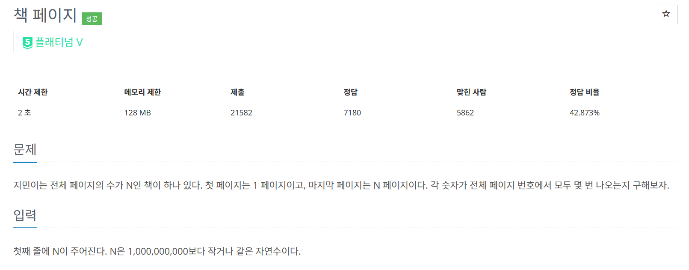
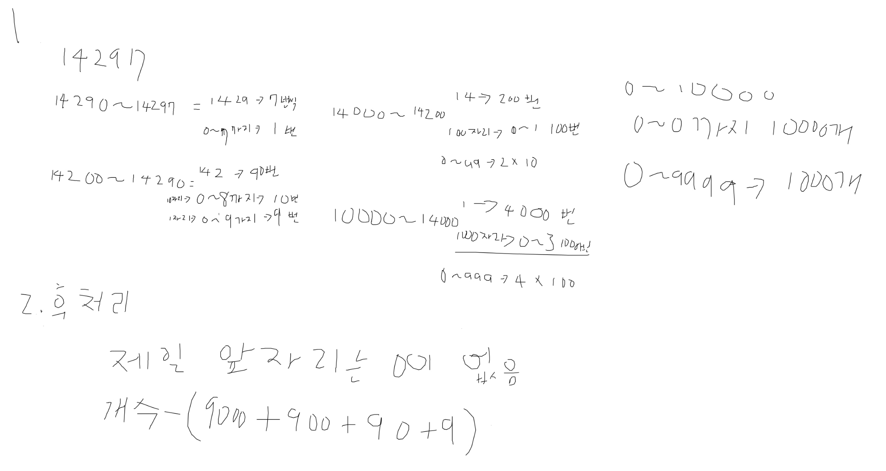

[상위 페이지 · 플레티넘](/study/algorithms/math/platinum/)



이건 N 범위까지가 문제다

## 문제 태그

- 구현
- 정수론

## 아이디어



1. N의 범위가 10억임으로 간단하게 모든 자리수를 만들어보는건 시간 초과. 최소 logn의 시간복잡도를 만들어야 함 
2. 기본 원리는 각 자리수를 나눠서 생각
    1. 예) 14297
    2. 14290 ~ 14297 자리수 i = 1, d = 7
        1. 자리수보다 높은 자리수의 숫자 빈도는 7 * 1번 나옴 → 1,4,2,9 총 7번 등장
        2. 자기 자리수에서는 0~6이 1 번 나온다
        3. 자기 아래 자리수는 없음으로 패스
    3. 14200 ~ 14290 자리수 i = 10, d =  9
        1. 자리수보다 높은 자리수의 숫자 빈도는 9 *10번 나옴 → 1,4,2 총 90번 등장
        2. 자기 자리수에서는 0~8까지 10번 나온다
        3. 자기 아래 자리수는 0~9까지 각 자리수는  1번 나온다
    4. 14000 ~ 14200 자리수 i = 100, d = 2
        1. 자리수보다 높은 자리수의 숫자 빈도는 2 * 100번 나옴 → 1,4 총 200번 등장
        2. 자기 자리수에서는 0~1까지 100번 나온다
        3. 자기 아래 자리수는 0~99까지 각 자리수는  10번 나온다
    5. 10000 ~ 140000 자리수 i=1000, d = 4
        1. 자리수보다 높은 자리수의 숫자 빈도는 4 * 1000번 나옴 → 1 총 4000번 등장
        2. 자기 자리수에서는 0~3까지 1000번 나온다
        3. 자기 아래 자리수는 0~999까지 각 자리수는 100번 나온다
    6. 00000  ~ 10000
        1. 자리수보다 높은 자리수는 없음으로 패스
        2. 자기 자리수에서 0은 10000번 나온다
        3. 자기 아래 자리수 0~9999까지 각 자리수는 1000번 나온다
3. 후처리
    1. 00000~9999까지 계산할때 맨 앞 0까지 계산된다 고로 마지막에 0의 개수를 빼줘야한다
    2. 9000 + 900 + 90+ 9가 불필요한 0의 개수이다
4. 일반화
    1. 자리수보다 높은 자리수의 숫자 빈도는
    
    $$
    빈도 = i(자리 \ 수)*d(숫자)
    $$
    
    1. 자기 자리수에서는
        
        $$
        빈도 = i(자리\ 수)
        $$
        
    2. 자기 아래 자리수에서는 이때 i는 10 100 1000이 아닌 1 2 3 4
    
    $$
    빈도 = i * 10^{i-1}
    $$
    
    1. 0 제거는
    
    $$
    불필요한\ 0의\ 빈도 = 1+\sum_{i=1}^{N - 1}{i∗9∗10^{N−i−1}}
    $$
    
5. 위 과정을 거치면 약 N의 시간복잡도에서 N의 길이의 시간 복잡도로 매우 크게 시간 복잡도가 줄어든다 

## 정답

```python
def count_digit_occurrences(N):
    result = [0] * 10
    multiplier = 0
    original_N = N

    while N > 0:
        digit = N % 10
        power = 10 ** multiplier
        left = N // 10
        right = original_N % power

        # 현재 자릿수보다 높은 자리수로 인해 반복된 횟수
        for i in range(10):
            result[i] += left * power

        # 현재 자릿수의 digit보다 작은 숫자들은 1세트 더 등장
        for i in range(digit):
            result[i] += power

        # 현재 자릿수의 숫자 그 자체는 하위 숫자(right)만큼 추가 등장
        result[digit] += right + 1

        # 앞자리 0 보정 (0은 숫자의 맨 앞에 올 수 없으므로 빼줌)
        if multiplier > 0:
            result[0] -= power

        multiplier += 1
        N //= 10

    return result

N = int(input())
result = count_digit_occurrences(N)
result[0] -= 1
print(*result)

```
