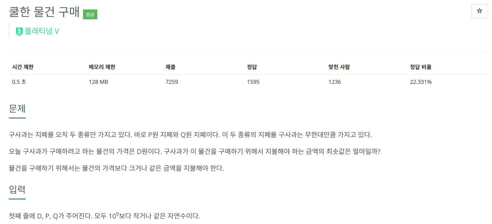

[상위 페이지 · 플레티넘](/study/algorithms/math/platinum/)



## 문제 태그

- 브루트포스
- 정수론

## 아이디어

1. 우리가 구해야 하는 것은 다음 부등식을 만족하는 **최소의 정수값**이다:

$$
a \cdot P + b \cdot Q \ge D \quad (P \le Q)
$$

1. 한 쪽 지폐의 개수(예: a)를 고정하면, 다른 쪽(b)은 자동으로 결정되므로 **한 변수만 탐색해도 충분**하다.
2. 특히 a·P mod Q는 **Q번만 반복하면 주기를 가짐** → 즉, a는 **0부터 Q-1까지만** 보면 모든 나머지 케이스를 커버할 수 있다.
3. 따라서 a=0부터 Q-1까지만 시도해보면서, 그에 따라 필요한 b를 계산하고 **총합이 D 이상인 경우 중 최솟값**을 찾으면 된다.

## 정답

```python
D, P, Q = map(int, input().split())

if P < Q:
    P, Q = Q, P

ans = float('inf')
for k in range(Q):
    total = k * P
    if total >= D:
        ans = min(ans, total)
    else:
        remain = D - total
        q_need = (remain + Q - 1) // Q
        total2 = total + q_need * Q
        ans = min(ans, total2)

print(ans)
```
